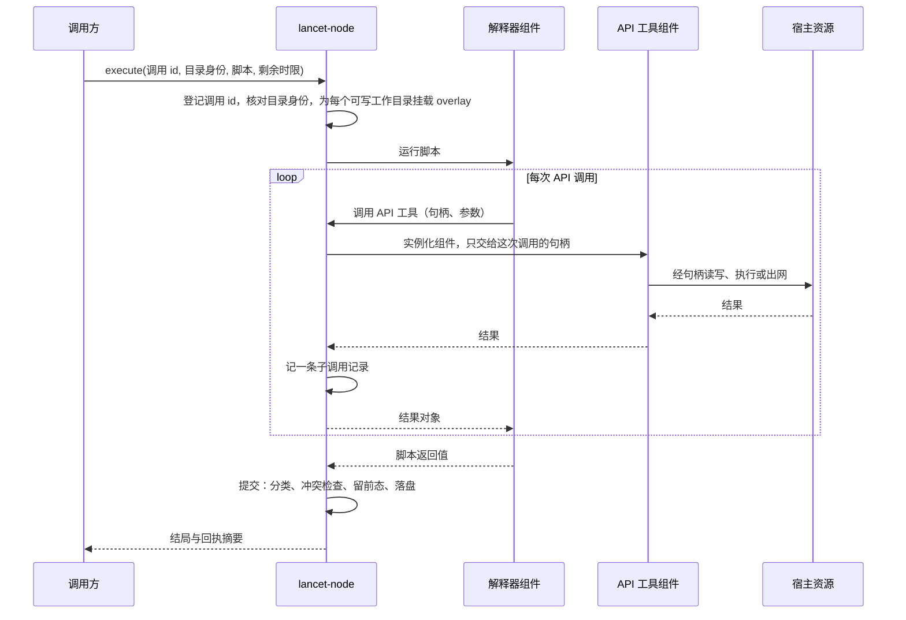

# ADR 0001：`lancet-node` 以 API 工具、宿主资源与写时复制提供 `act`

## 背景

### 来源

- LATTICE 的 [ADR 0009](https://github.com/Skyline10124/lattice/blob/0b261013ceb5f07a3948d2ecc8c8826729e93efa/docs/adr/0009-remove-legacy-lancet-tool-executor.md) 把旧 LANCET 移出 LATTICE 仓库，规定新 LANCET 在独立仓库中重写为独立进程 `lancet-node`，对外提供 `act`，设计记为本 ADR。
- 方向来自 LATTICE 的 [`#309`](https://github.com/Skyline10124/lattice/issues/309)：模型只有一个工具 `act`，脚本在受约束的 API 上组合调用，每个调用声明 effect 与 scope，结果以回执保存。
- 本 ADR 记录 2026-11-11 维护者与 Agent 的设计讨论结论。讨论中未确认的事项集中在[待裁决](#待裁决)。

### 约束

| 约束 | 出处 |
| --- | --- |
| 调用方按轮冻结工具目录；每次调用带调用 id、取消信号与截止时间；结局只有成功、失败、已取消、超时、不确定五种 | LATTICE ADR 0009 第 2 节的 `ToolExecutor` |
| 执行方不重试，不向调用方的会话库写入 | 同上 |
| 一次工具调用的结果整体交回模型，中途输出模型看不到 | 模型接口的工具调用形式 |
| 单次结果的载荷上限由调用方规定，LATTICE 现为 64 KiB | LATTICE 的 `MAX_TOOL_CONTENT_BYTES` |
| LATTICE 的 `rewind` 只移动会话位置，不恢复工作区文件 | LATTICE ADR 0006 第 4 节 |
| 只支持 Linux 主机 | [项目介绍](../../README.md#环境要求与验证) |

### 已核实的事实

2026-11-11 在开发主机上核实：Rocky Linux 10.2，内核 6.12，SELinux 为 Enforcing，工作区位于 XFS。

| 事实 | 核实方式与结果 |
| --- | --- |
| 非特权进程能建立用户、挂载、PID、网络命名空间 | `unshare --user --map-root-user --mount --pid --net --fork` 成功；新网络命名空间内只有 `lo` |
| 非特权进程能设置资源上限 | `systemd-run --user --scope -p MemoryMax=64M` 建出的 cgroup 中 `memory.max` 为 67108864 |
| 非特权进程能在用户命名空间内挂载 overlayfs | 以 `userxattr` 选项挂载成功；修改、删除、新建各一个文件后，下层保持原样，上层正好是改动的文件、删除标记与新文件 |
| 上层与下层同在这块 XFS 时，copy-up 不复制数据 | 向 512 MiB 文件追加 1 字节耗时 1 ms，磁盘占用不随文件大小增长 |
| 上层文件能以改名提交到同一文件系统 | 2 万个新文件改名到目标目录耗时 443 ms |
| 工作区所在文件系统支持 reflink | `cp --reflink=always` 成功 |
| bubblewrap 可从系统软件源取得，当前未安装 | Rocky 10.2 的 baseos 源提供 0.10.0 |
| starlark-rust 能编译为 `wasm32-wasip2` 组件 | `starlark` 0.14.2 以 rustc 1.96.0 编译通过，产物 6.5 MB；组件只导入 WASI 的时钟、标准流、环境与随机数接口，不导入文件系统与套接字 |
| Starlark 组件能在 wasmtime 中运行，预编译后启动开销小 | wasmtime 49.0.5 命令行运行一段含函数与列表推导的脚本，结果与原生一致；每次现编译时整个进程耗时 1152 ms，预编译后约 12 ms，原生进程约 6 ms（均含进程启动） |

### 尚未核实

| 事项 | 影响的决策 |
| --- | --- |
| 节点进程内实例化解释器组件与 API 工具组件的耗时；上面的数字来自命令行，含进程启动 | 第 3 节 |
| overlay 挂载期间下层被其他写者修改时，合并视图是否稳定；内核文档对此不作保证 | 第 5 节 |
| 由节点自行挂载 overlay 后交给 bubblewrap 使用；软件源中的 0.10.0 没有 overlay 参数 | 第 3、5 节 |
| 原生进程经节点代理出网的完整链路 | 第 3 节 |
| 上层与工作目录不在同一文件系统、或文件系统不支持 reflink 时的开销 | 第 5 节 |

## 决策

### 1. 能力完整

`lancet-node` 让模型在工作区里完成开发者在终端里能完成的事。第一个可用版本就具备下列四类能力：

| 能力 | 内容 |
| --- | --- |
| 读与搜 | 读取文件、列目录、按内容与名称搜索 |
| 改 | 新建与修改文件 |
| 执行 | 运行原生进程：构建、测试、版本管理与包管理工具 |
| 联网 | 发起 HTTP 请求；原生进程访问网络 |

分期交付时推后的是深度：撤销命令、审批、并行调度、远程节点与第三方扩展。能力不因边界机制的实现难度而削减。

### 2. 唯一的定义单元是 API 工具

| 概念 | 规则 |
| --- | --- |
| API 工具 | 唯一的工具定义单元。每个 API 工具有一份声明：签名、effect 类别与 scope 类型。目录、模型可见的说明、沙箱与回执都由这份声明推出 |
| 脚本 | 模型写的一段 Starlark，只做编排：持有授权句柄，调用 API 工具，组合结果。脚本自身没有 effect，也不是工具 |
| `act` | 模型可见的唯一工具，输入是一段脚本。它本身不带任何能力 |

四个核心术语：

| 术语 | 含义 |
| --- | --- |
| scope | 一次调用的副作用被限定的范围。scope 类型是一种宿主资源，scope 实例是该资源的一个句柄，持有句柄即获得授权 |
| effect | 一次调用对其 scope 做的事的类别：读、写、执行、外发 |
| residue | 一次调用撤销之后仍然留下的东西 |
| seam | 两个 scope 的接缝：一次调用的副作用，不经任何调用就成为另一个 scope 里的权限 |

首批 API 工具：

| API 工具 | effect | scope 类型 |
| --- | --- | --- |
| `fs.read`、`fs.list`、`fs.search` | 读 | 目录 |
| `fs.write`、`fs.edit` | 写 | 目录 |
| `proc.run` | 执行 | 执行环境 |
| `http.fetch` | 外发 | 网络出口 |

脚本的形态如下，句柄由节点按配置发放：

```python
ws  = dirs.lancet
src = fs.read(ws, "src/lib.rs")
fs.write(ws, "src/lib.rs", patched(src))
out = proc.run(env, ["cargo", "test", "--offline"], cwd = ws)
```

`proc.run` 接受参数数组，不接受 shell 命令字符串。

### 3. 边界由宿主资源承担

规则：**原生能力一律以宿主资源的形式进入，API 工具只通过句柄使用。** 宿主资源是一个小的封闭集合，由节点实现。

| 宿主资源（scope 类型） | 句柄代表什么 | 实现 |
| --- | --- | --- |
| 目录 | 一个工作目录及其读写级别 | 节点实现的目录资源，在这一层过滤配置中的排除路径 |
| 执行环境 | 一组挂载、资源上限与网络出口 | bubblewrap：只挂载句柄列出的目录，网络命名空间为空，到期终止整个 PID 命名空间 |
| 网络出口 | 允许访问的主机清单 | 节点内的放行代理 |

- **API 工具与解释器是 WASM 组件**，在 wasmtime 中运行。组件实例化时只得到这次调用授权的句柄，没有交给它的资源无从引用。
- **解释器组件不持有任何宿主资源**，只导入调用 API 工具的接口。
- **组件预编译后加载。** 每次调用现编译的开销在秒级，节点只加载预编译产物。
- **原生进程经执行环境资源运行。** `proc.run` 的声明方式与其他 API 工具相同，操作系统级沙箱是执行环境这个资源的实现。
- **原生进程经节点代理出网。** 执行环境里的进程没有直接网络，节点把代理地址通过 `HTTPS_PROXY` 等环境变量交给进程；代理按网络出口句柄放行，并记录每次连接。不走代理的连接失败。
- **依赖缺失时启动失败。** 配置授予了执行环境而主机没有可用的 bubblewrap 时，节点启动报错，不退回无沙箱执行。

### 4. 节点、工作区与配置

| 概念 | 规则 |
| --- | --- |
| 节点 | 一个 `lancet-node` 进程。节点独立启动，调用方只连接它 |
| 工作区 | 一个节点对应一个工作区。工作区是一组工作目录 |
| 工作目录 | 模型工作的对象。每个工作目录是一个目录句柄，有自己的名字、读写级别与路径规则。工作目录互不重叠，节点启动时检查 |
| 环境目录 | 执行环境句柄的内容：只读的工具链与系统库，以及直接写的缓存。只有 `proc.run` 能看到，`fs.*` 拿不到它们的句柄 |
| 节点 id | 工作区的身份。调用方以节点 id 绑定工作区，握手时核对 |

- **策略归节点配置。** 授权、路径规则与出口清单只写在节点配置里，由机器所有者维护；协议里没有修改它们的操作。
- **路径规则借用 `.gitignore` 的模式语法**：目录后缀 `/`、`**`、`!` 否定、后写的规则优先，路径相对各工作目录的根。节点不读取工作区里的 `.gitignore`。
- **规则默认为空。** 节点不内置任何路径规则，配置模板给出示例。

配置形态示意：

```toml
[[dir]]
name = "lancet"
path = "/home/dev/lancet"
access = "write"
regenerable = ["target/"]        # 可再生：提交时不留前态
hidden = [".env"]                # 排除：脚本不可见也不可写

[[dir]]
name = "lattice"
path = "/home/dev/lattice"
access = "read"
```

### 5. 文件副作用经写时复制提交

一次 `act` 的全部文件写入先落在 overlay 的上层，脚本结束时统一提交。文件副作用只有这一条路径，`fs.write` 与 `proc.run` 共用。



- **每个可写工作目录一个 overlay。** 下层是工作目录，上层建在该目录所在的文件系统上；无法满足时节点报错。只读工作目录直接只读挂载。
- **执行环境里工作目录保持真实路径**，跨目录的相对引用照常可用。
- **提交时按规则分类。** 节点取得上层的变更清单，逐条按 `regenerable` 规则处理：

| 变更路径 | 留前态 | 进回执明细 | 冲突检查 |
| --- | --- | --- | --- |
| 不匹配 `regenerable` | 留 | 逐个文件列出 | 做 |
| 匹配 `regenerable` | 不留 | 只记数量与总大小 | 不做 |

- **前态是变更前的文件内容**，提交时以 reflink 保存到节点的状态目录。
- **冲突检查**：文件在脚本开始之后被其他写者改过时，该次提交整体拒绝，不覆盖。
- **提交有日志。** 多个文件逐个落盘；节点在提交前写入提交日志，重启后凭日志与前态完成或回退。

结局按下面的规则判定：

```text
act 结束时:
    if 脚本正常返回:
        提交 overlay
        if 提交完成:           成功(返回值)
        elif 存在冲突:         丢弃上层 -> 失败(冲突)
    elif 脚本报错:             丢弃上层 -> 失败(脚本错误)
    elif 调用方取消或连接断开:  丢弃上层 -> 已取消
    elif 剩余时限用尽:         丢弃上层 -> 超时
```

- 丢弃上层后，工作目录中的文件副作用视为未发生。
- 已发生的联网与环境目录中的缓存写入不撤回，照实记入回执。
- 节点在提交过程中崩溃时，调用方因连接中断自行记为不确定；节点重启并处理完提交日志后，`receipt` 给出确定的事实。

### 6. effect、residue 与 seam 各有读取方

声明只有在有一方读取它并据此作决定时才保留。

| 概念 | 读取方 | 据此作的决定 |
| --- | --- | --- |
| scope | 节点 | 实例化组件时交出哪些句柄；回执记录副作用落在哪里 |
| effect | 节点 | 句柄的读写级别是否满足调用；被中断的调用留下了什么 |
| residue | 撤销操作与调用方 | 能还原多少；向用户说明还原不了什么 |
| seam | 节点 | 授权的组合是否升级了权限 |

residue 的取值：

| 副作用 | residue |
| --- | --- |
| 读 | 无 |
| 提交到工作目录、留有前态的文件变更 | 无，可撤销 |
| 提交到工作目录、匹配 `regenerable` 的文件变更 | 留在工作区内，不可还原，可再生 |
| 环境目录中的缓存写入 | 留在节点内，不可还原 |
| 联网 | 已发出，不可收回；回执记录访问的主机 |

已识别的两类 seam：

| seam | 例子 |
| --- | --- |
| 可写的工作目录同时是执行环境的输入 | 一次可撤销的写改了构建脚本，下一次 `proc.run` 时它成为带着执行环境全部授权运行的代码 |
| 读权限与网络出口同时授予 | 读到的内容可以经出口发出 |

### 7. 对外操作接口

节点对调用方暴露六个操作。`execute` 是一次请求、一次应答，不流式输出进度。

| 操作 | 输入 | 输出 | 语义 |
| --- | --- | --- | --- |
| `hello` | 无 | 节点 id、协议版本 | 握手；调用方核对节点 id |
| `describe` | 无 | `act` 的定义与目录身份 | 目录身份是当前授权与 API 声明的摘要 |
| `execute` | 调用 id、目录身份、脚本、剩余时限、输出上限、会话与轮次标签 | 结局与回执摘要 | 见下 |
| `cancel` | 调用 id | 无 | 中止进行中的调用；连接断开等同取消 |
| `receipt` | 调用 id | 完整回执 | 只读 |
| `revert` | 撤销 id、一组调用 id | 每个调用、每个文件的结果 | 见第 8 节 |

`execute` 的规则：

- **零重放。** 同一个调用 id 第二次到达时拒绝，不重新执行。
- **目录冻结。** 传入的目录身份与节点当前的不一致时，执行前拒绝。节点不保存轮次状态。
- **结局五种**，与调用方的结局一一对应：成功、失败（机器码与消息）、已取消、超时、不确定。
- **时限传剩余时长。**
- **标签只用于记账。** 会话 id 与轮次 id 对节点是不透明字符串。

模型可见的只有 `act`。脚本可用的句柄与 API 工具全部来自 `describe` 返回的说明。

协议不暴露：单个 API 工具的直接调用、配置与授权的修改、节点的启停。

### 8. 回执与撤销

- **回执归节点。** 一次 `act` 的回执包含子调用明细、文件变更清单、前态引用、联网记录与各项 residue。调用方只保存模型看到的结果与调用 id。
- **撤销按调用进行。** `revert` 接受一组调用 id，按逆序逐个撤销。
- **逐个文件核对后态。** 文件当前内容等于回执记录的写后内容时恢复前态；不等时该文件保持不动，报冲突。
- **撤销是一次新的变更**，有自己的回执。账本只追加。
- **撤销的范围是留有前态的文件变更。** 其余按 residue 如实报告。

与 LATTICE `rewind` 的配合：

```text
用户要求撤销一段对话中的文件变更:
    前端向 LATTICE 后台发出命令
    后台独占会话执行锁，从会话树算出这一段的调用 id
    后台调用节点的 revert，把逐个文件的结果返回前端
```

- `rewind` 与 `revert` 相互独立，只靠调用 id 关联。节点不知道会话树。
- `revert` 的调用方与 `execute` 相同，都是 LATTICE 后台。
- 文件不跟随会话位置：再次 `rewind` 到被离开的分支时，文件不自动重做。

### 9. 与 LATTICE 的接回边界

本 ADR 规定 LANCET 一侧；LATTICE 一侧的修改由 LATTICE 的接回 ADR 决定。

| LANCET 提供 | LATTICE 需要决定 |
| --- | --- |
| 节点 id 作为工作区身份 | 会话的项目绑定改为节点 id，或与规范项目路径并存 |
| `hello` 与 `describe` | 节点表（节点 id 对应连接地址）；`open_turn` 以节点 id 为参数并映射为一次 `describe` |
| `execute`、`cancel` | `ToolExecutor` 适配器 |
| `receipt`、`revert` | 取一段路径上调用 id 的查询；撤销文件的后台命令 |

## 待裁决

| 事项 | 建议 |
| --- | --- |
| 第 1 节的能力清单是否完整，例如长时间运行的后台进程与交互式输入 | 先按四类实施 |
| 整次 `act` 一个 overlay、结束时统一提交 | 采用；代价是脚本运行中的写入在提交前对外不可见 |
| API 工具是随节点发布的封闭集合，还是各自独立构建的单元 | 封闭集合，随节点发布 |
| 节点 id 的产生方式 | 节点首次启动时生成并存入状态目录，配置里另设显示名 |
| seam 在第一个版本里的处置 | 节点加载配置时列出授权组合产生的 seam，写入日志与 `describe` 的说明；审批上线后由准入读取 |
| `hidden` 规则在执行环境内怎样生效；整目录挂载后，原生进程能读到 `fs.*` 过滤掉的路径 | 待设计 |
| `revert` 是否进入第一批实现 | 接口按本 ADR 定稿，实现排在 `execute` 之后；前态从第一个版本开始留存 |
| 协议类型是否作为独立 crate 供 LATTICE 依赖 | 本仓库提供协议 crate，LATTICE 按固定提交依赖 |

## 归属

| 概念 | 状态持有者 | 规则执行者 | 只使用结果的组件 |
| --- | --- | --- | --- |
| 工作区的组成、授权与路径规则 | 节点配置文件 | 节点（加载时校验，实例化组件与挂载时执行） | 调用方、脚本 |
| 节点 id | 节点状态目录 | 节点（生成与握手） | 调用方 |
| API 工具的声明 | 随节点发布的声明 | 节点（生成目录、说明与目录身份） | 模型、调用方 |
| 一次 `act` 的未提交写入 | 该次调用的 overlay 上层 | 节点（提交或丢弃） | 脚本 |
| 回执、前态与提交日志 | 节点状态目录 | 节点（提交、撤销与重启恢复） | 调用方 |
| 已见过的调用 id | 节点状态目录 | 节点（零重放） | 调用方 |
| 会话树与调用槽位 | LATTICE 会话库 | LATTICE | 节点只把调用 id 与标签当作不透明字符串 |

## 否决的方案

| 方案 | 否决理由 |
| --- | --- |
| 脚本进程单独设沙箱，API 降为节点内置的宿主函数 | 出现两套定义；API 声明的 effect 与 scope 只剩文档意义 |
| 以 Landlock 与 seccomp 的进程沙箱作为统一边界 | 授权是套在进程上的路径规则，不是句柄；不能在已授权的目录下排除子路径 |
| 第一个版本只做只读 API，或不含进程执行，或断网 | 缺少完成实际任务所需的能力 |
| 进程执行时整体放开宿主网络 | 出口不受约束，也无法记录 |
| 原生进程直接写工作目录，只对结构化写入留前态 | `proc.run` 改了哪些文件事先不可知，无法留前态，中断后只能记为不确定 |
| 目录按挂载分成写时复制与直接写两种 | 规则按文件模式匹配，挂载只能按整个目录划分；实测同文件系统上的提交开销可以接受 |
| 读取工作区的 `.gitignore` 作为规则 | 被忽略不等于可再生；规则文件在工作区内，脚本可以修改 |
| 路径规则放在工作区内随项目进版本库 | 策略归机器所有者；放在工作区内需要额外防止脚本修改 |
| 一个节点服务多个工作区 | 节点就是工作区；多个目录由工作目录表达 |
| 调用方以项目路径打开一轮 | 路径是节点内部的事实；节点在另一台机器上时调用方无法核对 |
| `execute` 流式输出进度 | 模型一侧整体接收工具结果；调用方现在没有读取进度的一方 |
| `rewind` 同时恢复文件 | LATTICE ADR 0006 已否决：从旧节点继续对话不等于退回工作区，全局回退影响其他会话 |
| 由前端组合 `rewind` 与 `revert` | 前端连不到节点，拿不到会话执行锁，中途中断无人收尾 |
| 以微虚拟机承载执行环境 | LATTICE ADR 0002 的经验：工作区投影、保存点与合并的机制多于所需 |

## 影响

### 平台与依赖

| 项 | 影响 |
| --- | --- |
| 内核能力 | 需要非特权用户命名空间、用户命名空间内的 overlayfs 与 cgroup 委派；缺失时节点启动失败 |
| 文件系统 | overlay 上层与工作目录同处一个文件系统；支持 reflink 时 copy-up 与前态保存不复制数据 |
| bubblewrap | 授予执行环境时为主机必需依赖，由机器所有者安装 |
| wasmtime | 成为节点的依赖。wasmtime 50 要求 rustc 1.97，本仓库固定 1.96.0；引入时选用 49 系列，或先升级工具链 |
| Rust 目标 | 构建组件需要 `wasm32-wasip2` |

### 文档

| 文档 | 处理 |
| --- | --- |
| [领域术语表](../reference/glossary.md) | 本 ADR 接受后写入：工作区、工作目录、环境目录、节点 id、API 工具、宿主资源、scope、effect、residue、seam、回执、前态 |
| `docs/architecture/` | 随实施建立合同：协议、工作区与提交、回执与撤销、配置 |
| [项目介绍](../../README.md) | 随第一个业务 crate 更新当前状态 |

### 实施

实施顺序与切片另开实施跟踪票，按票分别授权。本 ADR 接受之前，仓库不建业务 crate。

### 与 LATTICE 的 ADR 的关系

| ADR | 关系 |
| --- | --- |
| LATTICE ADR 0009 | 承接其第 7 节：本 ADR 是其中所说的新仓库 ADR 0001 |
| LATTICE ADR 0006 | 沿用 `rewind` 只移动会话位置；文件恢复由第 8 节的 `revert` 提供 |
| LATTICE ADR 0012 | 会话的项目绑定在接回时需要改为节点 id 或与之并存，由 LATTICE 的接回 ADR 决定 |
