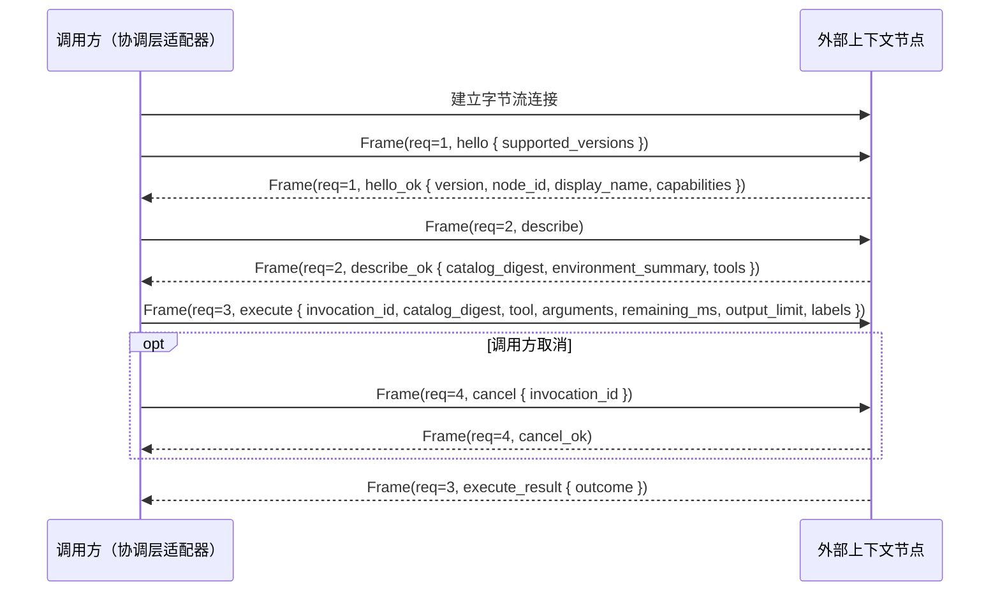

# ADR 0001：以 `lancet-protocol` 定义外部上下文节点协议

## 背景

### 来源

- LATTICE 的 [ADR 0009](https://github.com/Skyline10124/lattice/blob/0b261013ceb5f07a3948d2ecc8c8826729e93efa/docs/adr/0009-remove-legacy-lancet-tool-executor.md) 将旧 LANCET 移出 LATTICE 仓库，协调层收窄为单一窄接口 `ToolExecutor`，不再在会话进程内直接运行工具或触碰工作区业务文件。
- 2026-11-11 维护者与 Agent 的架构讨论进一步明确：Agent 定义与会话协调位于被操作对象之外；软件工作区（如 `lancet-node`，见 [ADR 0002](0002-lancet-node-api-tools-and-act.md)）、只读检索源乃至未来的硬件/设备节点，均作为外部上下文节点按统一协议挂载到协调层。
- 现有通用工具协议（如 MCP）缺少持久实例身份核对、目录快照冻结、持久零重放、不确定态以及副作用回执与求逆语义，在非幂等工作区变更或硬件物理动作下无法防止断连重试导致的重复执行，也无法在故障后对账真实副作用。

### 约束

| 约束 | 出处 |
| --- | --- |
| 调用方按轮冻结能力目录；每次调用携带持久调用 id、取消信号与截止时间；单次调用结局为成功、失败、已取消、超时、不确定五种 | LATTICE ADR 0009 第 2 节的 `ToolExecutor` |
| 节点不自行重试，不读写调用方的会话库；已写入会话树的结果以会话树为唯一权威 | LATTICE ADR 0007、ADR 0009 |
| 单次调用结果整体返回，不流式输出中间进度；进入模型上下文的载荷受调用方传入的 `output_limit` 约束（LATTICE 现为 64 KiB） | 模型接口的工具调用形式；LATTICE `MAX_TOOL_CONTENT_BYTES` |
| LATTICE 的 `rewind` 只移动会话树位置，不自动回退外部节点状态 | LATTICE ADR 0006 第 4 节 |
| 调用方与节点可能分处不同进程或不同机器，系统绝对时钟不可直接比较 | 跨进程与远程节点部署场景 |

## 决策

### 1. 定位与 `lancet-protocol` 边界

| 概念 | 规则 |
| --- | --- |
| 节点 | 一个独立运行的外部上下文与动作服务进程，对外暴露单一被挂载目标的读取、变更、回执查询与可选求逆能力 |
| `node_id` | 节点实例跨重启稳定的持久身份。调用方以 `node_id` 绑定挂载目标，连接握手时强制核对 |
| `lancet-protocol` | 本仓库提供的独立协议 crate，只包含帧编解码、协议消息类型、结局与错误码、回执与 `residue` 数据结构及规范摘要计算，不依赖 `wasmtime`、操作系统沙箱或特定存储引擎 |

- **协议与节点内部机制解耦。** 协议不预设节点内部使用脚本解释器、WASM、`overlayfs` 或本地文件系统。`lancet-node` 通过该协议暴露单一编排入口 `act`（见 [ADR 0002](0002-lancet-node-api-tools-and-act.md)）；算力受限的硬件节点或只读数据源可直接通过同一协议暴露一组类型化原子操作。
- **Agent 与节点分离。** 节点不感知 Agent 配置、模型、系统提示词或会话树结构；会话与轮次标识对节点仅作不透明记账标签。
- **向下兼容外部生态。** 协议语义严于 MCP；第三方 MCP Server 后续可经独立桥接进程降级接入（诚实声明不支持 `revert`，断连或未知副作用记为 `Indeterminate`），主协议不为迁就弱保证而削减约束。

### 2. 连接与帧模型



- **帧格式**：双向有序字节流（本地为 Unix 域套接字，远程可承载于 SSH 隧道或 TLS 连接）上采用 4 字节大端长度前缀加 UTF-8 JSON 负载（设置单帧最大字节上限防止内存耗尽）。
- **单连接多路复用**：每帧携带连接内唯一的 `request_id`。`execute` 等待完成期间，调用方可在同一条连接上并发发送 `cancel` 或只读查询 `receipt`。
- **先握手后操作**：建连后的首个请求必须是 `hello`；未完成版本协商或调用方发现 `node_id` 不匹配时立即关闭连接。
- **断连即取消**：连接意外断开时，节点将该连接上所有尚未进入最终提交临界区的在途 `execute` 视为收到取消。

### 3. 六个协议操作

节点对外只暴露六个操作。协议不提供修改节点配置、调整授权或启停节点的操作。

| 操作 | 输入 | 输出 | 语义 |
| --- | --- | --- | --- |
| `hello` | 支持的协议版本列表 | 选定版本、`node_id`、显示名、`capabilities`（如 `supports_revert`） | 握手与身份核验 |
| `describe` | 无 | `catalog_digest`、`environment_summary`、`tools: Vec<ToolSpec>` | 返回当前可用操作定义与环境简述；`catalog_digest` 为二者及当前授权的规范摘要 |
| `execute` | `invocation_id`、`catalog_digest`、`tool`、`arguments`、`remaining_ms`、`output_limit`、`labels` | `ExecuteOutcome`（见下） | 执行一次操作 |
| `cancel` | `invocation_id` | 空确认 | 幂等请求中止进行中的调用；目标不存在或已结束时直接返回成功 |
| `receipt` | `invocation_id` | `Receipt` | 只读查询节点记录的完整回执 |
| `revert` | `revert_id`、`Vec<invocation_id>` | 每个调用、每个变更项的还原结果 | 按逆序求逆可还原的变更，见第 5 节 |

`execute` 的执行与返回规则：

```text
ExecuteOutcome = Succeeded { content: Value, receipt_summary: ReceiptSummary }
               | Failed    { error: ToolError, receipt_summary: Option<ReceiptSummary> }
               | Cancelled { receipt_summary: Option<ReceiptSummary> }
               | Deadline  { receipt_summary: Option<ReceiptSummary> }
               | Indeterminate { reason: String, receipt_summary: Option<ReceiptSummary> }
```

- **严格零重放**：节点在执行前持久化登记 `invocation_id`。同一个 `invocation_id` 第二次到达 `execute` 时，节点以协议错误 `DuplicateInvocation` 拒绝，绝不二次执行；调用方需要找回结局时调用 `receipt`。
- **目录快照冻结**：传入的 `catalog_digest` 与节点当前计算的摘要不一致时，节点在产生任何副作用前以 `CatalogMismatch` 拒绝。节点不维护跨请求的“轮次”状态。
- **相对时限**：`remaining_ms` 传递剩余毫秒预算，不传绝对时间戳。预算耗尽时由节点负责中止内部活动、进入安全状态并返回 `Deadline`。
- **上下文载荷与回执分离**：`content` 是交回模型上下文的数据，序列化后字节数不超过 `output_limit`；完整执行轨迹、大体积前态与外部连接明细保存在节点，回包仅附紧凑的 `receipt_summary`。
- **`Indeterminate` 的两类来源**：连接中断或进程崩溃未收到回包时，由调用方本地判定为不确定；节点自身驱动下游硬件或外部桥接器丢失确认、无法断定副作用是否发生时，由节点显式返回 `Indeterminate`。

### 4. 副作用、回执与 `residue`

每次被节点受理的 `execute`（以及 `revert`）都在节点侧生成持久化的 `Receipt`，包含调用身份、标签、最终结局、子步骤摘要、变更项列表与 `residue` 清单。

| 字段 | 取值与含义 | 读取方 |
| --- | --- | --- |
| `effect` | `Read`（只读）、`Write`（可寻址状态变更）、`Exec`（子进程或设备动作执行）、`Emit`（网络外发或物理信号输出） | 节点准入与中断处置、调用方审批与展示 |
| `residue` | 撤销之后仍留下的影响：<br>• `None`：无残留（纯读，或留有完整前态且可核对后态还原的变更）<br>• `Regenerable`：可再生构建产物或缓存，不留前态<br>• `InternalState`：节点私有运行缓存变更<br>• `External`：已发出的网络请求、硬件物理动作等不可收回的外部影响（附目标与动作描述） | `revert` 操作、调用方与用户 |

### 5. 求逆（`revert`）与会话 `rewind` 的配合

- **能力声明**：不支持求逆的节点（纯只读节点、无前态的硬件节点或降级桥接器）在 `hello` 中声明 `supports_revert = false`，调用 `revert` 时直接返回不支持。
- **零重放与只追加账本**：`revert` 携带调用方生成的 `revert_id`，节点同样持久去重；每次 `revert` 作为一次新的状态变更生成自己的回执，原回执保持只读不改写。
- **逆序与后态核对**：节点按传入的 `invocation_id` 列表逆序逐个处理。对留有前态的每个变更项，核对当前目标状态是否等于该次调用回执记录的写后状态：
  - 相等：恢复为前态，记为 `Restored`；
  - 不等（期间已被用户或其他调用改过）：保持现状不动，记为 `Conflict`；
  - `residue` 不为 `None` 的项：如实报告 `Irreversible(residue)`。
- **由协调层后台调度**：`revert` 与会话 `rewind` 相互独立，仅通过 `invocation_id` 关联。用户请求撤销某段对话产生的外部变更时，由协调层后台独占会话执行锁、从会话树提取该路径段的 `invocation_id` 列表并调用对应节点的 `revert`，前端不直连节点。

### 6. 与 LATTICE 的接回边界

本 ADR 规定 `lancet-protocol` 与节点一侧；LATTICE 一侧的会话模型与挂载路由由 LATTICE 的后续 ADR 决定。

| 本协议提供 | LATTICE 侧决定 |
| --- | --- |
| `node_id` 与 `hello` 握手 | 会话设置持有外部上下文挂载列表（0 个、1 个或多个），Agent 配置置于被挂载工作目录之外 |
| `describe`（`catalog_digest`、`environment_summary`、`tools`） | `open_turn` 对各挂载节点核对身份并冻结本轮目录与环境说明；多节点挂载时的工具命名或目标路由 |
| `execute`、`cancel` | 协调层上下文操作接口的适配器实现 |
| `receipt`、`revert` | 从会话树路径段提取挂载调用 id 的查询，以及后台持锁执行的撤销命令 |

## 待裁决

| 事项 | 建议 |
| --- | --- |
| `node_id` 的格式与生成时机 | 节点首次初始化状态目录时生成 UUID v4 并持久化，配置文件另设人类可读的显示名 |
| 远程字节流传输的认证与加密封装 | 第一个版本只落地本地 Unix 域套接字；帧协议保持传输无关，远程连接后续经 SSH 转发或 mTLS 承载 |

## 归属

| 概念 | 状态持有者 | 规则执行者 | 只使用结果的组件 |
| --- | --- | --- | --- |
| 协议帧、消息类型与摘要规则 | `lancet-protocol` crate | 节点与调用方适配器（编解码与校验） | 上层协调器、节点业务实现 |
| `node_id`、已受理的 `invocation_id` / `revert_id` | 节点状态存储 | 节点（握手核验与零重放） | 调用方 |
| 完整 `Receipt`、前态材料与 `residue` 记录 | 节点状态存储 | 节点（记录、查询与求逆） | 调用方、用户 |
| 会话树、调用槽位与多节点挂载关系 | 调用方会话库（如 LATTICE） | 调用方协调层 | 节点仅将标签视为不透明字符串 |

## 否决的方案

| 方案 | 否决理由 |
| --- | --- |
| 直接采用标准 MCP 作为主节点协议 | 缺少稳定 `node_id`、目录摘要冻结、持久 `invocation_id` 零重放、`Indeterminate` 结局以及结构化回执与 `revert`，非幂等软件变更与硬件控制下无法保证重试与对账安全 |
| 在协议操作中硬编码 `act` 与脚本字符串参数 | 把 Linux 软件工作区的内部编排方式耦合进协议层，简单硬件节点或只读检索节点无法自然复用同一协议 |
| 调用方以本地目录路径标识节点 | 路径是特定软件节点内部的私有事实；远程节点、非文件系统节点与硬件节点不存在调用方可核对的本地路径 |
| `execute` 流式推送中间输出 | 模型接口整体接收单次工具结果，流式中间帧在模型侧无消费方且增加断连状态复杂度 |
| 由前端进程直接连接节点执行 `receipt` 或 `revert` | 前端拿不到会话执行锁，远程或后台托管场景下前端不持有节点连接，中途退出无人收尾 |
| 在协议仓库外重复定义两套消息结构 | 由 `lancet-protocol` 保持零重依赖供双方共同依赖，避免跨仓手写同步产生协议漂移 |

## 影响

### 代码与包结构

- 本 ADR 接受后，首个业务切片建立 `crates/lancet-protocol`，仅引入序列化与摘要计算所需的最小依赖，不引入运行时重依赖。本 ADR 接受之前，仓库不建业务 crate。
- LATTICE 接回时按固定 Git 提交依赖 `lancet-protocol` 实现挂载适配器。

### 文档

| 文档 | 处理 |
| --- | --- |
| [ADR 0002](0002-lancet-node-api-tools-and-act.md) | 规定 `lancet-node` 如何作为本协议的软件工作区节点实现，通过 `act`、API 工具、宿主资源与写时复制落地各项协议保证 |
| [领域术语表](../reference/glossary.md) | 本 ADR 与 ADR 0002 接受后写入：外部上下文节点、`node_id`、`catalog_digest`、回执（`Receipt`）、`effect`、`residue` |
| `docs/architecture/` | 随 `lancet-protocol` 实施建立节点协议架构合同 |

### 与 LATTICE 的 ADR 的关系

| ADR | 关系 |
| --- | --- |
| LATTICE ADR 0009 | 与 [ADR 0002](0002-lancet-node-api-tools-and-act.md) 共同承接其第 7 节，把协调层与外部节点的通信契约抽离为通用协议 |
| LATTICE ADR 0006 | 沿用 `rewind` 只移动会话树位置；外部节点状态恢复由第 5 节的 `revert` 独立提供 |
| LATTICE ADR 0012 | 会话的外部上下文挂载列表与项目绑定方式在 LATTICE 接回 ADR 中决定 |
