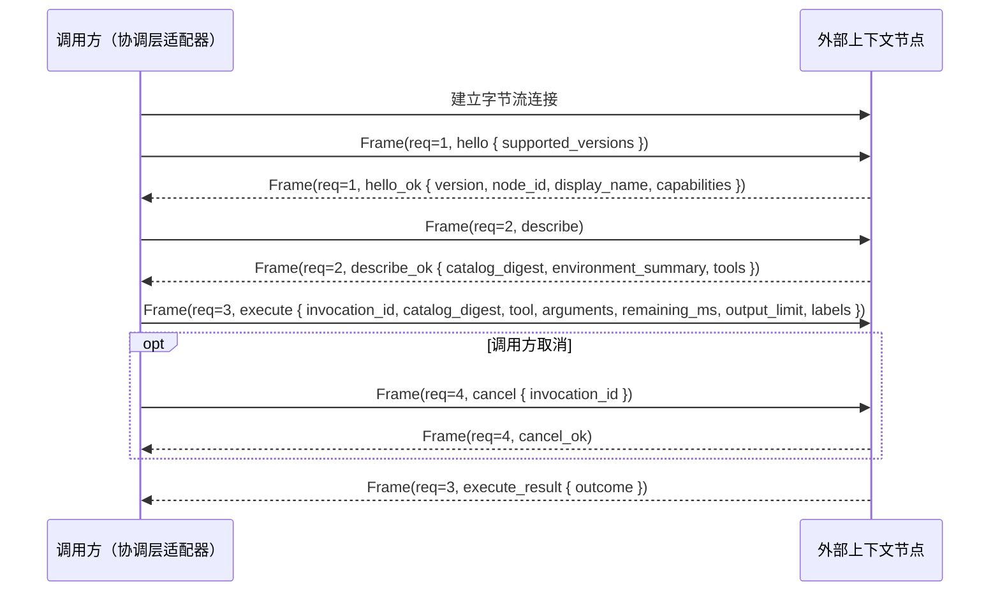
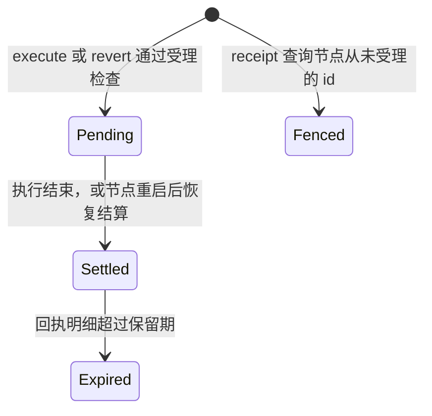

# ADR 0001：以 `lancet-protocol` 定义外部上下文节点协议

## 背景

### 来源

- LATTICE 的 [ADR 0009](https://github.com/Skyline10124/lattice/blob/0b261013ceb5f07a3948d2ecc8c8826729e93efa/docs/adr/0009-remove-legacy-lancet-tool-executor.md) 将旧 LANCET 移出 LATTICE 仓库，协调层收窄为单一窄接口 `ToolExecutor`，不再在会话进程内直接运行工具或触碰工作区业务文件。
- 2026-11-11 维护者与 Agent 的架构讨论进一步明确：Agent 定义与会话协调位于被操作对象之外；软件工作区（如 `lancet-node`，见 [ADR 0002](0002-lancet-node-api-tools-and-act.md)）、只读检索源乃至未来的硬件/设备节点，均作为外部上下文节点按统一协议挂载到协调层。
- 现有通用工具协议（如 MCP）缺少持久实例身份核对、目录快照冻结、持久零重放、不确定态以及 effect 回执与求逆语义，在非幂等工作区变更或硬件物理动作下无法防止断连重试导致的重复执行，也无法在故障后对账真实发生的 effect。

### 约束

| 约束 | 出处 |
| --- | --- |
| 调用方按轮冻结能力目录；每次调用携带持久调用 id、取消信号与截止时间；单次调用结局为成功、失败、已取消、超时、不确定五种 | LATTICE ADR 0009 第 2 节的 `ToolExecutor` |
| 节点不自行重试，不读写调用方的会话库；已写入会话树的结果以会话树为唯一权威 | LATTICE ADR 0007、ADR 0009 |
| 单次调用结果整体返回，不流式输出中间进度；进入模型上下文的载荷受调用方传入的 `output_limit` 约束（LATTICE 现为 64 KiB） | 模型接口的工具调用形式；LATTICE `MAX_TOOL_CONTENT_BYTES` |
| LATTICE 的 `rewind` 只移动会话树位置，不自动回退外部节点状态 | LATTICE ADR 0006 第 4 节 |
| 调用方与节点可能分处不同进程或不同机器，系统绝对时钟不可直接比较 | 跨进程与远程节点部署场景 |

## 决策

### 1. 定位与 `lancet-protocol` 边界

| 概念 | 规则 |
| --- | --- |
| 节点 | 一个独立运行的外部上下文与动作服务进程，对外暴露单一被挂载目标的读取、变更、回执查询与可选求逆能力 |
| `node_id` | 节点实例跨重启稳定的持久身份。调用方以 `node_id` 绑定挂载目标，连接握手时强制核对 |
| `lancet-protocol` | 本仓库提供的独立协议 crate，只包含帧编解码、协议消息类型、结局与错误码、effect 与 co-effect、环境简述、回执与 `residue` 数据结构及规范摘要计算，不依赖 `wasmtime`、操作系统沙箱或特定存储引擎 |

- **协议与节点内部机制解耦。** 协议不预设节点内部使用脚本解释器、WASM、`overlayfs` 或本地文件系统。`lancet-node` 通过该协议暴露单一编排入口 `act`（见 [ADR 0002](0002-lancet-node-api-tools-and-act.md)）；算力受限的硬件节点或只读数据源可直接通过同一协议暴露一组类型化原子操作。
- **Agent 与节点分离。** 节点不感知 Agent 配置、模型、系统提示词或会话树结构；会话与轮次标识对节点仅作不透明记账标签。
- **向下兼容外部生态。** 协议语义严于 MCP；第三方 MCP Server 后续可经独立桥接进程降级接入（诚实声明不支持 `revert`，断连或 effect 是否发生未知时记为 `Indeterminate`），主协议不为迁就弱保证而削减约束。

### 2. 连接与帧模型



- **帧格式**：双向有序字节流（本地为 Unix 域套接字，远程可承载于 SSH 隧道或 TLS 连接）上采用 4 字节大端长度前缀加 UTF-8 JSON 负载（设置单帧最大字节上限防止内存耗尽）。
- **单连接多路复用**：每帧携带连接内唯一的 `request_id`。`execute` 等待完成期间，调用方可在同一条连接上并发发送 `cancel` 或只读查询 `receipt`。
- **先握手后操作**：建连后的首个请求必须是 `hello`；未完成版本协商或调用方发现 `node_id` 不匹配时立即关闭连接。
- **断连即取消**：连接意外断开时，节点将该连接上所有尚未进入最终提交临界区的在途 `execute` 视为收到取消。

### 3. 六个协议操作

节点对外只暴露六个操作。协议不提供修改节点配置、调整授权或启停节点的操作。

| 操作 | 输入 | 输出 | 语义 |
| --- | --- | --- | --- |
| `hello` | 支持的协议版本列表 | 选定版本、`node_id`、显示名、`capabilities`（`supports_revert`、`settle_grace_ms`、回执与前态保留期） | 握手与身份核验 |
| `describe` | 无 | `catalog_digest`、`environment_summary: EnvironmentSummary`、`tools: Vec<ToolSpec>` | 返回当前可用操作定义与环境简述（见第 4 节）；`catalog_digest` 为二者及当前授权的规范摘要 |
| `execute` | `invocation_id`、`catalog_digest`、`tool`、`arguments`、`remaining_ms`、`output_limit`、`labels` | `execute_result { ExecuteOutcome }` 或 `rejected`（见下） | 执行一次操作 |
| `cancel` | `invocation_id` | 空确认 | 幂等请求中止进行中的调用；目标不存在或已结束时直接返回成功 |
| `receipt` | `ReceiptTarget`（`invocation_id` 或 `revert_id`） | `ReceiptLookup` | 查询调用记录；对节点从未受理的 id 持久登记围栏，见第 6 节 |
| `revert` | `revert_id`、`Vec<invocation_id>` | 每个调用、每个变更项的还原结果，或 `rejected` | 按逆序求逆可还原的变更，见第 5 节 |

`execute` 的执行与返回规则：

```text
ExecuteOutcome = Succeeded { content: Value, receipt_summary: ReceiptSummary }
               | Failed    { error: ToolError, receipt_summary: Option<ReceiptSummary> }
               | Cancelled { receipt_summary: Option<ReceiptSummary> }
               | Deadline  { receipt_summary: Option<ReceiptSummary> }
               | Indeterminate { reason: String, receipt_summary: Option<ReceiptSummary> }

execute 的回复 = execute_result { outcome: ExecuteOutcome }  # 已受理：id 已持久登记，节点必定生成回执
              | rejected { code: RejectCode, message }       # 未受理：未登记 id，未发生任何 effect，没有回执
RejectCode    = DuplicateInvocation | DuplicateRevert | CatalogMismatch | InvalidRequest | Unsupported
```

- **受理检查**：节点依次核对 id 未出现在调用记录中、`catalog_digest` 一致、`tool` 与 `arguments` 合法，全部通过后持久登记 id 再开始执行；任一项不通过时以 `rejected` 回复。`revert` 的受理检查与回复通道相同。
- **严格零重放**：同一个 `invocation_id` 第二次到达 `execute` 时，节点以 `DuplicateInvocation` 拒绝，绝不二次执行；调用方需要找回结局时调用 `receipt`。
- **目录快照冻结**：传入的 `catalog_digest` 与节点当前计算的摘要不一致时，节点以 `CatalogMismatch` 拒绝。节点不维护跨请求的“轮次”状态。
- **拒绝到五种结局的映射**由调用方执行：

  ```text
  match execute 的回复:
      execute_result { outcome }        → outcome
      rejected { DuplicateInvocation }  → 不是本次投递的结局：该 id 已被先前的投递受理或已被围栏
                                          调用方按第 6 节对账，以对账结果为准
      rejected { 其他 code }            → Failed { ToolError { code, message } }，确定未发生 effect
  ```

- **相对时限**：`remaining_ms` 传递剩余毫秒预算，不传绝对时间戳。预算耗尽时由节点负责中止内部活动、进入安全状态并返回 `Deadline`。
- **调用方等待上限**：节点在 `hello` 中声明 `settle_grace_ms`：预算耗尽、收到 `cancel` 或连接断开之后，节点最迟在这段时间内结束内部活动（含提交临界区）并结算调用记录。调用方从发出 `execute` 起用本地单调时钟计时，等待上限为 `remaining_ms + settle_grace_ms` 再加调用方配置的传输余量；到期仍未收到回复时，调用方停止等待，本地判定为 `Indeterminate`，随后按第 6 节对账。是否同时关闭连接由调用方决定；关闭会按断连规则取消同一连接上的其他在途调用。
- **上下文载荷与回执分离**：`content` 是交回模型上下文的数据，序列化后字节数不超过 `output_limit`；完整执行轨迹、大体积前态与外部连接明细保存在节点，回包仅附紧凑的 `receipt_summary`。
- **`Indeterminate` 的两类来源**：连接中断、进程崩溃或超过等待上限仍未收到回复时，由调用方本地判定为不确定；节点自身驱动下游硬件或外部桥接器丢失确认、无法断定 effect 是否发生时，由节点显式返回 `Indeterminate`。调用方本地判定的不确定可经第 6 节对账收敛。

### 4. effect、co-effect、回执与 `residue`

节点暴露的每个操作，一次调用都按 effect 与 co-effect 两条轴描述：

```text
call : arguments → result ! ε @ κ
ε  effect：调用对世界做出的、调用结束后仍可被后续调用或节点外部观察到的改变
κ  co-effect：调用对上下文的依赖，即需要持有哪些句柄、以什么模式使用
```

| 概念 | 定义 | 取值 |
| --- | --- | --- |
| 句柄 | 节点授予的一个具名资源实例，是 effect 与 co-effect 的参数。句柄的种类与属性由节点实现的 ADR 定义 | `name`、`kind` |
| effect | 见上。交回调用方的 `content` 是返回值，不是 effect | `Write<h>`（可寻址状态变更）、`Exec<h>`（子进程或设备动作执行）、`Emit<h>`（网络外发或物理信号输出） |
| co-effect | 见上。只读调用的 ε 为空，κ 不为空 | `Uses<h>` 或 `Uses<h, mode>`；`mode` 为 `Read` 或 `ReadWrite`，只用于带可寻址状态的句柄 |
| `residue` | ε 中没有逆、或逆所需材料未被保留的部分 | 见下表 |
| `seam` | 跨句柄连接 effect 与 co-effect 的边，有两个方向：<br>• 完整性：句柄 A 上的 `Write` 成为句柄 B 上 `Exec` 所依赖的上下文（写入的内容被执行）<br>• 机密性：经 `Uses<A>` 读到的上下文可经句柄 B 上的 `Emit` 外发<br>边集由节点按授权静态推出 | `{ from, to, direction, policy }`，`policy` 为 `Allow` 或 `Deny` |

每次被节点受理的 `execute`（以及 `revert`）都在节点侧生成持久化的 `Receipt`，包含调用身份、标签、最终结局、子步骤摘要、effect 条目与 `seam` 跨越记录：

- **effect 条目**：每条写明句柄名、effect 种类与变更项列表；每个变更项各自带一个 `residue` 取值。effect 种类只给出 `residue` 的可能范围，实际取值逐项记录。
- **`seam` 跨越**：节点按完整性方向的边放行一次跨越时记一条，写明边与跨越的变更项数量。闸口拒绝时，该次调用以 `Failed { ToolError { code: SeamBlocked } }` 结束。

| `residue` | 含义 | 出现在 |
| --- | --- | --- |
| `None` | 该项有逆且逆所需材料已保留（如留有前态的写入） | `Write` |
| `Regenerable` | 可再生构建产物或缓存，不保留逆，靠重新生成恢复 | `Write` |
| `InternalState` | 节点私有运行缓存变更，不提供逆 | `Write`、`Exec` 派生项 |
| `External` | 已发出的网络请求、硬件物理动作等没有逆的外部影响（附目标与动作描述） | `Emit`、`Exec` |

| 概念 | 读取方 | 据此作的决定 |
| --- | --- | --- |
| co-effect | 节点受理 | κ 中的句柄与模式必须已被授予，否则拒绝该次调用 |
| effect | 节点（中断处置、`seam` 闸口）、调用方（审批与展示、回执核对） | 中断后还剩哪些 effect；是否放行跨越；回执是否越出环境简述 |
| `residue` | `revert`、调用方与用户 | 哪些项可施加逆，如实报告不可还原项 |
| `seam` | 节点（闸口）、调用方（审批与展示） | 放行并记录跨越，或拒绝 |

`describe` 返回的环境简述：

```text
EnvironmentSummary = { handles: Vec<Handle>, seams: Vec<Seam> }
Handle = { name, kind: String, effects: Vec<EffectKind>, modes: Vec<Mode>, attributes: Map<String, Value> }
Seam   = { from: handle name, to: handle name, direction: Integrity | Confidentiality, policy: Allow | Deny }
```

- **只随配置变化。** 节点只经单一构造入口，由节点配置与操作声明推出环境简述；它只随配置、授权与节点版本变化，不含随调用变化的内容（如文件树），并纳入 `catalog_digest`。
- **体积上限**：序列化后不超过 4 KiB。
- **用途分工**：`tools[].description` 说明操作怎样用，随节点版本变化；环境简述说明本实例授予了什么，随配置变化；`hello.capabilities` 是调用方据以决策的类型化事实。调用方把环境简述原样交给模型。
- **调用方只依据结构字段决策。** 调用方只能依据 `name`、`effects`、`modes` 与 `seams` 作决定；`kind` 与 `attributes` 只供模型阅读，调用方不据此分支。

| 检查层 | 检查内容 | 执行方 | 不通过时 |
| --- | --- | --- | --- |
| 形状 | 解码 `describe_ok` 时由 `lancet-protocol` 类型校验：`name` 非空且唯一；枚举字段取值合法；`seam` 两端指向已列出的句柄；序列化字节数不超上限 | 调用方 | `describe` 失败，本轮不挂载该节点 |
| 与声明一致 | 环境简述等于配置与操作声明推出的结果 | 节点实现 | 由单一构造入口保证，不另设检查 |
| 与实际行为一致 | 回执每条 effect 条目的句柄与种类在本轮冻结的环境简述中被允许；每条跨越对应环境简述中的一条边 | 调用方 | 协议错误：调用方把该节点标为不可信并报告 |
| 语义 | `kind` 与 `attributes` 的含义 | 无 | 不检查，因此调用方不得依赖 |

### 5. 求逆（`revert`）与会话 `rewind` 的配合

- **能力声明**：不支持求逆的节点（纯只读节点、无前态的硬件节点或降级桥接器）在 `hello` 中声明 `supports_revert = false`，调用 `revert` 时以 `rejected { Unsupported }` 回复。
- **零重放与只追加账本**：`revert` 携带调用方生成的 `revert_id`，与 `invocation_id` 共用第 6 节的调用记录：重复的 `revert_id` 以 `DuplicateRevert` 拒绝，结果经 `receipt(Revert(revert_id))` 查询。每次 `revert` 作为一次新的状态变更生成自己的回执，原回执保持只读不改写。
- **求逆即逐项施加 ε⁻¹**：节点按传入的 `invocation_id` 列表逆序逐个处理，对每个变更项施加其逆。逆本身是 `Write` effect，记入本次 `revert` 自己的回执。对 `residue` 为 `None` 的变更项，施加逆的前提是当前目标状态等于该次调用回执记录的写后状态：
  - 相等：恢复为前态，记为 `Restored`；
  - 已等于前态（例如重新发起的 `revert` 遇到上次已还原的项）：不动，记为 `Restored`；
  - 其余不等（期间已被用户或其他调用改过）：保持现状不动，记为 `Conflict`；
  - 前态已超过保留期：记为 `PreStateExpired`；
  - `residue` 不为 `None` 的项：如实报告 `Irreversible(residue)`。
- **调用级结果**：列表中不进入逐项核对的调用整体记一项结果：节点未受理或已围栏的记 `NotExecuted`，尚未结算的记 `Pending`，回执明细已过期的记 `ReceiptExpired`。
- **执行到底**：`revert` 不受 `cancel` 与断连影响，节点处理完全部变更项后结算。节点崩溃中断的 `revert` 在重启恢复时结算，尚未处理的变更项记为 `NotAttempted`；调用方以新的 `revert_id` 重新发起即可。
- **由协调层后台调度**：`revert` 与会话 `rewind` 相互独立，仅通过 `invocation_id` 关联。用户请求撤销某段对话产生的外部变更时，由协调层后台独占会话执行锁、从会话树提取该路径段的 `invocation_id` 列表并调用对应节点的 `revert`，前端不直连节点。

### 6. 调用记录的生命周期与对账

节点为每个 `invocation_id` 与每个 `revert_id` 维护一条持久的调用记录。零重放、`receipt` 查询与断连后的对账都以这条记录为准。登记、围栏与结算在节点的记录账本上串行执行，同一个 id 同一时间只有一次迁移生效。



| 状态 | 含义 | 同 id 的 `execute` / `revert` 到达 | `receipt` 返回 |
| --- | --- | --- | --- |
| 无记录 | 节点从未见过该 id | 进入受理检查 | `NeverExecuted`，同时登记围栏，迁移到 `Fenced` |
| `Fenced` | 已确认未执行，且此后永不执行 | `rejected`（`DuplicateInvocation` / `DuplicateRevert`） | `NeverExecuted` |
| `Pending` | 已受理，尚未结算 | 同上 | `Pending` |
| `Settled` | 已结算，回执明细完整 | 同上 | `Settled { receipt }` |
| `Expired` | 已结算，回执明细已清理，账本仍保留结局种类 | 同上 | `Expired { outcome }` |

```text
ReceiptTarget = Invocation(invocation_id) | Revert(revert_id)
ReceiptLookup = NeverExecuted                       # 确定未执行，同 id 此后也不会被执行
              | Pending                             # 已受理，尚未结算
              | Settled { receipt: Receipt }
              | Expired { outcome: OutcomeKind }    # execute 为五种结局之一；revert 为 Completed
```

- **围栏让 `NeverExecuted` 成为确定事实。** 调用方查询时，同 id 的 `execute` 可能仍在传输中，随后才到达节点。查询未知 id 时登记围栏，此后到达的同 id 请求一律被拒绝，调用方因此可以把 `NeverExecuted` 直接当作“未执行”。
- **受理前拒绝不建记录。** 以 `rejected` 回复的请求不登记 id、不生成回执（见第 3 节）；之后查询该 id 得到 `NeverExecuted`。
- **重启后不留 `Pending`。** 节点重启后、响应任何 `hello` 之前，先按自身的恢复机制结算全部遗留的 `Pending` 记录；无法断定 effect 是否发生的记录结算为 `Indeterminate` 并写明原因。
- **断连后限时结算。** 断连按第 2 节视为取消，节点在 `settle_grace_ms` 内结算对应的 `execute` 记录；`revert` 记录按第 5 节执行到底后结算。

调用方对本地判定为 `Indeterminate` 的调用按下列规则对账：

```text
重新建连并完成 hello，核对 node_id
match receipt(target):
    NeverExecuted        → 确定未执行
    Settled { receipt }  → 回执中的最终结局即事实（节点结算为 Indeterminate 时仍为不确定）
    Expired { outcome }  → 结局种类即事实，回执明细不可再取
    Pending              → 自断连或停止等待起满 settle_grace_ms 后重查
                           仍为 Pending：视为节点故障，保持 Indeterminate 并报告
```

调用记录各部分的保留期：

| 材料 | 保留期 | 过期后 |
| --- | --- | --- |
| 账本条目：id、状态、结局种类（含围栏） | 永久 | 不清理；零重放与围栏不随时间失效 |
| 完整回执明细 | 节点配置的回执保留期，自结算起按节点本地时钟计算 | 记录迁移到 `Expired`；`revert` 对该调用报告 `ReceiptExpired` |
| 前态材料 | 节点配置的前态保留期，不长于回执保留期 | `revert` 对相应变更项报告 `PreStateExpired` |

- 前态保留期不长于回执保留期，因为后态核对依赖回执中记录的写后状态。
- 节点只清理已结算记录的材料。两个保留期在 `hello` 的 `capabilities` 中声明，调用方据此告诉用户哪些调用仍可撤销。

### 7. 与 LATTICE 的接回边界

本 ADR 规定 `lancet-protocol` 与节点一侧；LATTICE 一侧的会话模型与挂载路由由 LATTICE 的后续 ADR 决定。

| 本协议提供 | LATTICE 侧决定 |
| --- | --- |
| `node_id` 与 `hello` 握手 | 会话设置持有外部上下文挂载列表（0 个、1 个或多个），Agent 配置置于被挂载工作目录之外 |
| `describe`（`catalog_digest`、`environment_summary`、`tools`） | `open_turn` 对各挂载节点核对身份并冻结本轮目录与环境说明；多节点挂载时的工具命名或目标路由 |
| `execute`、`cancel`、拒绝到结局的映射与调用方等待上限 | 协调层上下文操作接口的适配器实现；适配器本地判定的结局怎样投影为 `ToolOutcome` |
| `receipt`、`revert` 与第 6 节的对账结果 | 从会话树路径段提取挂载调用 id 的查询，以及后台持锁执行的撤销命令；是否以及怎样依据对账结果收敛会话树中的 `Indeterminate` 槽位 |

## 待裁决

| 事项 | 建议 |
| --- | --- |
| `node_id` 的格式与生成时机 | 节点首次初始化状态目录时生成 UUID v4 并持久化，配置文件另设人类可读的显示名 |
| 远程字节流传输的认证与加密封装 | 第一个版本只落地本地 Unix 域套接字；帧协议保持传输无关，远程连接后续经 SSH 转发或 mTLS 承载 |
| 回执明细与前态的默认保留期 | 两者都由节点配置；协议只规定第 6 节的约束（前态不长于回执、账本永久）。默认值随各节点实现的 ADR 给出 |

## 归属

| 概念 | 状态持有者 | 规则执行者 | 只使用结果的组件 |
| --- | --- | --- | --- |
| 协议帧、消息类型与摘要规则 | `lancet-protocol` crate | 节点与调用方适配器（编解码与校验） | 上层协调器、节点业务实现 |
| `node_id`、调用记录账本（已受理与已围栏的 `invocation_id` / `revert_id`、状态与结局种类） | 节点状态存储 | 节点（握手核验、受理检查、零重放、围栏与重启结算） | 调用方 |
| 完整 `Receipt`、前态材料与 `residue` 记录 | 节点状态存储 | 节点（记录、查询、求逆与保留期清理） | 调用方、用户 |
| 环境简述与 `seam` 边集 | 节点配置（经单一构造入口推出） | 节点（推出、受理与闸口）、调用方（解码校验与回执核对） | 模型 |
| 等待上限计时与本地 `Indeterminate` 判定 | 调用方适配器 | 调用方适配器（计时、停止等待与对账） | 上层协调器 |
| 会话树、调用槽位与多节点挂载关系 | 调用方会话库（如 LATTICE） | 调用方协调层 | 节点仅将标签视为不透明字符串 |

## 否决的方案

| 方案 | 否决理由 |
| --- | --- |
| 直接采用标准 MCP 作为主节点协议 | 缺少稳定 `node_id`、目录摘要冻结、持久 `invocation_id` 零重放、`Indeterminate` 结局以及结构化回执与 `revert`，非幂等软件变更与硬件控制下无法保证重试与对账安全 |
| 在协议操作中硬编码 `act` 与脚本字符串参数 | 把 Linux 软件工作区的内部编排方式耦合进协议层，简单硬件节点或只读检索节点无法自然复用同一协议 |
| 调用方以本地目录路径标识节点 | 路径是特定软件节点内部的私有事实；远程节点、非文件系统节点与硬件节点不存在调用方可核对的本地路径 |
| `execute` 流式推送中间输出 | 模型接口整体接收单次工具结果，流式中间帧在模型侧无消费方且增加断连状态复杂度 |
| 由前端进程直接连接节点执行 `receipt` 或 `revert` | 前端拿不到会话执行锁，远程或后台托管场景下前端不持有节点连接，中途退出无人收尾 |
| 在协议仓库外重复定义两套消息结构 | 由 `lancet-protocol` 保持零重依赖供双方共同依赖，避免跨仓手写同步产生协议漂移 |
| `receipt` 对未知 id 只回答“未找到”，不登记围栏 | 查询时仍可能有同 id 的 `execute` 在传输中，随后到达并执行；“未找到”无法证明调用不会发生，`Indeterminate` 永远收敛不了 |
| 回执过期时连同 id 账本一起清理 | 零重放随之变成限时保证，过期后同 id 的迟到请求会被当作新调用执行 |
| 调用方只依赖节点遵守 `remaining_ms` | 节点挂死或连接半开时调用方无限期阻塞，本轮无法结束 |
| 把 `DuplicateInvocation`、`CatalogMismatch` 编码为 `Failed` 结局 | 调用方无法区分“节点受理后失败”与“节点未受理”；重复投递还会被误当作本次调用的结局 |
| 环境简述采用自由文本 | 调用方无法据以决策，回执也无从与之逐条核对；只能人工维护 |
| 把 `Read` 列为 effect | 读不改变世界，只消费上下文；作为 co-effect 才能与 `Emit` 构成机密性方向的 `seam` |
| 不定义 `seam`，只在节点日志中列出风险授权组合 | 日志条目没有读取方，不据此作任何决定 |

## 影响

### 代码与包结构

- 本 ADR 接受后，首个业务切片建立 `crates/lancet-protocol`，仅引入序列化与摘要计算所需的最小依赖，不引入运行时重依赖。本 ADR 接受之前，仓库不建业务 crate。
- LATTICE 接回时按固定 Git 提交依赖 `lancet-protocol` 实现挂载适配器。

### 文档

| 文档 | 处理 |
| --- | --- |
| [ADR 0002](0002-lancet-node-api-tools-and-act.md) | 规定 `lancet-node` 如何作为本协议的软件工作区节点实现，通过 `act`、API 工具、宿主资源与写时复制落地各项协议保证 |
| [领域术语表](../reference/glossary.md) | 本 ADR 与 ADR 0002 接受后写入：外部上下文节点、`node_id`、`catalog_digest`、回执（`Receipt`）、调用记录、围栏、effect、co-effect、句柄、`seam`、`residue`、环境简述 |
| `docs/architecture/` | 随 `lancet-protocol` 实施建立节点协议架构合同 |

### 与 LATTICE 的 ADR 的关系

| ADR | 关系 |
| --- | --- |
| LATTICE ADR 0009 | 与 [ADR 0002](0002-lancet-node-api-tools-and-act.md) 共同承接其第 7 节，把协调层与外部节点的通信契约抽离为通用协议 |
| LATTICE ADR 0006 | 沿用 `rewind` 只移动会话树位置；外部节点状态恢复由第 5 节的 `revert` 独立提供 |
| LATTICE ADR 0012 | 会话的外部上下文挂载列表与项目绑定方式在 LATTICE 接回 ADR 中决定 |
