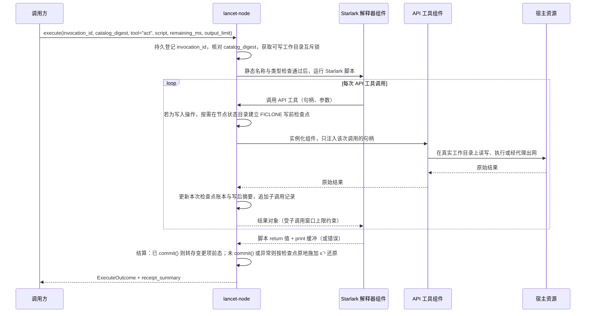

# ADR 0002：`lancet-node` 以 API 工具、宿主资源与写时复制提供 `act`

## 背景

### 来源

- LATTICE 的 [ADR 0009](https://github.com/Skyline10124/lattice/blob/0b261013ceb5f07a3948d2ecc8c8826729e93efa/docs/adr/0009-remove-legacy-lancet-tool-executor.md) 规定新 LANCET 在独立仓库中重写为独立进程 `lancet-node`，对外提供 `act`；方向来自 LATTICE 的 [`#309`](https://github.com/Skyline10124/lattice/issues/309)：模型只有一个入口工具 `act`，脚本在受约束的 API 上组合调用，每个调用声明 `effect` 与 `scope`，结果以回执保存。
- [ADR 0001](0001-lancet-protocol.md) 已将协调层与外部上下文节点的通信契约抽离为通用协议 `lancet-protocol`。本 ADR 规定 `lancet-node` 如何作为该协议在 Linux 软件工作区上的实现，落地编排语言、API 工具、宿主资源隔离与写前写时复制检查点。
- 本 ADR 记录 2026-11-11 至 2026-11-13 维护者与 Agent 的设计讨论及两项原型实验结论。讨论中分期或待实施验证的事项集中在[待裁决](#待裁决)。

### 约束

| 约束 | 出处 |
| --- | --- |
| 节点实现 `hello`、`describe`、`execute`、`cancel`、`receipt`、`revert` 六个操作，遵守持久零重放、目录摘要冻结、五种结局、`output_limit` 载荷上限与后态核对求逆规则 | [ADR 0001 第 3–6 节](0001-lancet-protocol.md#3-六个协议操作) |
| 只支持 Linux 主机 | [项目介绍](../../README.md#环境要求与验证) |

### 已核实的事实

2026-11-11 至 2026-11-13 在开发主机上核实：Rocky Linux 10.2，内核 6.12，SELinux 为 Enforcing，工作区位于 XFS，工具链为 `rustc 1.96.0`。

| 事实 | 核实方式与结果 |
| --- | --- |
| 非特权进程能建立用户、挂载、PID、网络命名空间 | `unshare --user --map-root-user --mount --pid --net --fork` 成功；新网络命名空间内只有 `lo` |
| 非特权进程能设置资源上限 | `systemd-run --user --scope -p MemoryMax=64M` 建出的 cgroup 中 `memory.max` 为 67108864 |
| 工作区所在 XFS 支持 `FICLONE`（reflink）零数据块检查点 | `cp --reflink=always` 与 `ioctl(FICLONE)` 成功；向 512 MiB reflink 副本追加 1 字节耗时 1 ms，磁盘占用不随文件大小增长；在含 3,269 个非 `target/` 条目的克隆仓库上，单线程遍历建立整树 `FICLONE` 检查点耗时 244 ms，清理耗时 97 ms |
| 开发仓库后台写入集中在 `.git/`，源码无持续后台噪声，`bubblewrap` 对不存在路径挂遮蔽点会短暂建删目录 | 实验 2 被动录制真实仓库两段共 23.4 h（8,217 行，`overflow` 为 0）：`.git/` 事件 7,025 条（含 `.git/index*` 34 条），源码与文档 716 条事件全部来自 3 次显式 Git 检出/拉取瞬间，其余时间后台源码写入 0 条；另捕获到外部 `bubblewrap` 沙箱遮蔽不存在路径时在真实目录短暂创建再删除挂载点的事件 474 条 |
| 非特权 `overlayfs` 存在目录改名与 `.git/` 一致性摩擦 | 实验 2 实测：`userxattr` 可挂载，但对下层目录执行 `git mv` 与 `os.rename` 触发 `EXDEV`；`.git/` 进上层时遇宿主后台 Git 活动触发冲突，直通可写绑定时在丢弃草稿后无法恢复 `HEAD` 与分支（6/6 失败）；失败后若丢弃 `target/` 增量产物，单 crate 重建由 0.1 s 增至 4.0 s |
| `bubblewrap` 可从系统软件源取得 | Rocky 10.2 的 baseos 源提供 0.10.0 |
| `starlark-rust` 能编译为 `wasm32-wasip2` 组件 | `starlark` 0.14.2 编译通过，产物 6.5 MB；组件只导入 WASI 的时钟、标准流、环境与随机数接口，不导入文件系统与套接字 |
| Starlark 组件能在 `wasmtime` 中运行，预编译后启动开销小 | `wasmtime` 49.0.5 命令行运行含函数与列表推导的脚本，结果与原生一致；每次现编译时整个进程耗时 1152 ms，预编译后约 12 ms，原生进程约 6 ms（均含进程启动） |
| `starlark` 0.14.2 语法、标准库与静态检查边界 | `Dialect::Standard` 默认关闭顶层语句，开启 `enable_top_level_stmt: true` 后支持顶层 `if` 与 `for`；顶层 `return` 仍是语法错误（“`return` cannot be used outside of a `def` function”），将脚本包裹为单一入口函数即可同时支持顶层 `return` 与顶层绑定静态类型检查；语言无 `while` 与 `try / except`，允许递归；宿主函数返回 `Err` 时调用栈干净退栈；内置 `LibraryExtension` 含 `Json`、`SetType`（已实现 `serde::Serialize`）、`StructType`、`Map`、`Filter` 与可挂自定义 `PrintHandler` 的 `Print`，无内置正则模块与 `sum`；实验性 `enable_f_strings` 仅支持裸标识符插值；内置 `DocModule` 可从宿主签名提取文档结构，`AstModuleTypecheck::typecheck` 可在求值前做静态名称解析与类型求解 |
| Starlark 编排实测通过率与回滚失误分布 | 实验 1 v2（`exp/act-v2` 分支 `prototypes/starlark-pass-rate/REPORT-v2.md`，859 次有效运行）：扣除判定器假阴性后，常规五类任务完成率为 deepseek-flash 359/359、MiniMax-M3.1-Flash 358/360；但在“正常返回即自动保留改动”语义下，MiniMax 在回滚类任务中 0 次调用 `discard`、失败 38/68 次；扣除测试台命令白名单后，单次 `act` 报错集中于未开启 `SetType`/`sum`/`Print`、宿主视图未实现序列化及无括号生成器等少量语法差异 |

### 尚未核实

| 事项 | 影响的决策 |
| --- | --- |
| 节点进程内实例化解释器组件与 API 工具组件的耗时；上面的数字来自命令行，含进程启动 | 第 4 节 |
| 原生进程经节点代理出网的完整链路 | 第 4 节 |
| `bubblewrap` 内对匹配 `hidden` 规则的子路径做遮蔽挂载的具体形态（文件与目录、新建路径） | 第 4、5 节 |

## 决策

### 1. 能力完整

`lancet-node` 让模型在工作区里完成开发者在终端里能完成的事。第一个可用版本就具备下列四类能力：

| 能力 | 内容 |
| --- | --- |
| 读与搜 | 读取文件、列目录、按内容与名称搜索、查看本次调用未提交的变更状态与差异 |
| 改 | 新建、精确替换修改、撤回单文件未提交改动与显式提交 |
| 执行 | 运行原生进程与多阶段进程管道：构建、测试、版本管理与包管理工具 |
| 联网 | 发起 HTTP 请求；原生进程受控访问网络 |

分期交付时推后的是深度：撤销命令、审批、并行调度、远程节点与第三方扩展。能力不因边界机制的实现难度而削减。

### 2. 唯一的定义单元是 API 工具，对外唯一工具是 `act`

`lancet-node` 在 [ADR 0001](0001-lancet-protocol.md#3-六个协议操作) 的 `hello` 中声明 `supports_revert = true`，在 `describe` 的 `tools` 列表中只暴露单一工具 `act`，不把内部单个 API 工具直接暴露为协议层工具。

| 概念 | 规则 |
| --- | --- |
| API 工具 | 节点内部唯一的工具定义单元。每个 API 工具有一份声明：参数与返回类型签名，以及以句柄参数表示的 effect 与 co-effect 模板（见 [ADR 0001 第 4 节](0001-lancet-protocol.md#4-effectco-effect回执与-residue)）。`act` 工具说明中的类型存根、`environment_summary`、受理检查、执行前静态类型检查、沙箱句柄分发、`seam` 边集与回执明细均由这份声明推出 |
| 脚本 | 模型传给 `act` 的一段 Starlark，只做编排：持有授权句柄，调用 API 工具，对内存结果做纯计算筛选与组合，最后把需要进入模型上下文的数据交回。脚本自身不产生、也不声明 effect 与 co-effect，不是工具 |
| `act` | `lancet-node` 对模型可见的唯一工具，输入为脚本字符串。它本身不带任何固有能力 |

effect、co-effect、句柄、`residue` 与 `seam` 的定义见 [ADR 0001 第 4 节](0001-lancet-protocol.md#4-effectco-effect回执与-residue)。本节点的句柄种类就是本 ADR 第 4 节的三类宿主资源：目录、执行环境、网络出口。

首批 API 工具（`d` 为目录句柄，`e` 为执行环境句柄，`n` 为网络出口句柄；`mounts(e)` 为 `e` 挂载的目录及其模式）：

| API 工具 | effect 模板 | co-effect 模板 | 说明 |
| --- | --- | --- | --- |
| `fs.read`、`fs.list`、`fs.search` | 无 | `Uses<d, Read>` | 读取文件、列举目录、按正则与路径模式搜索 |
| `fs.status`、`fs.diff` | 无 | `Uses<d, Read>` | 查看本次 `act` 相对于写前检查点基线的增删改列表与 unified diff |
| `fs.write`、`fs.edit`、`fs.reset` | `Write<d>` | `Uses<d, ReadWrite>` | 整文件写入、精确匹配替换（默认唯一匹配，`all = True` 时替换全部且至少匹配 1 次）、将指定路径恢复到本次 `act` 写前检查点状态 |
| `proc.run`、`proc.pipe` | `Exec<e>`，以及派生的 `Write<d>`（`d` 以可写方式挂载）与 `Emit<n>`（`e` 持有出口） | `Uses<e>` 与 `mounts(e)` | 以参数数组运行单个进程，或用内核 `pipe()` 串联多阶段参数数组（均不经过 `/bin/sh`） |
| `http.fetch` | `Emit<n>` | `Uses<n>` | 经授权出口发起 HTTP 请求 |

### 3. Starlark 编排、类型存根、正交过滤与快速失败

解释器固定采用 Starlark（`enable_top_level_stmt = true`、`enable_load = false`、`enable_f_strings = false`），在保持确定性、有限步终止、脚本自身不产生 effect 的前提下，按下列规则补齐声明呈现、静态拦截、纯计算环境与提交控制：

- **顶层 `return` 与执行前静态检查同构包裹**：
  - 节点将模型传入的脚本包裹在单一入口函数体内（解析、静态检查与运行期报错的行号均映射回原脚本），使脚本可在顶层直接写 `return value` 交回结果（未写 `return` 时返回 `None`），同时让 `AstModuleTypecheck::typecheck` 完整求解顶层绑定的静态类型。
  - `describe` 中 `act` 的 `description` 由 API 工具声明与解释器内置类型自动渲染为紧凑的 `.pyi` 类型存根（区分只读目录类型 `ReadDir` 与可写目录类型 `WriteDir`，以及 `ExecEnv`、`Egress`、`TextView` 和各返回记录类型），只随节点版本变化；`environment_summary.handles` 按节点配置将每个已授予句柄的 `kind` 标为对应存根类型名，并在 `attributes` 中附上 `hidden`、`regenerable`、挂载与允许主机。
  - 解释器在执行第一条语句之前，先对照本次注入的全局环境运行静态名称解析与类型检查；未定义标识符、参数名错误、字段名拼写错误或对 `ReadDir` 调用写方法，均在产生任何子调用与 effect 前以 `Failed(ScriptOrToolError)` 直接退回。对常见 Python 语法差异（无括号生成器、`import`、`is None`、花括号集合推导），解析错误额外附一行修复提示。
- **句柄方法绑定**：节点按配置向脚本全局环境注入授权句柄，并在句柄对象上直接绑定对应方法（例如 `lancet.read(...)` 等价转发给 `fs.read(lancet, ...)`，`dev.run(...)` 等价转发给 `proc.run(dev, ...)`），省去重复传递句柄样板。
- **纯计算标准库、`print` 缓冲、正交过滤与两级体积上限**：
  - 启用 `starlark` 内置扩展 `Json`、`SetType`、`StructType`、`Map`、`Filter` 与 `Print`，并注入无句柄、无 effect 的纯计算函数 `sum` 与 `regex` 命名空间（`match`、`findall`、`replace`）。`print` 通过自定义 `PrintHandler` 写入本次 `act` 的内存缓冲（不写节点标准错误流），随交回结果一并计入 `execute.output_limit`。不注入反射或宿主系统库。
  - API 工具保持单一职责，返回原始领域结构，不在每个 API 工具上重复定义文本裁剪参数；所有宿主返回类型与视图类型（含 `TextView`）均可直接序列化为 JSON。
  - 解释器组件内置基于 Rust `regex` 的链式文本视图（`text(s).grep(pattern, before = 0, after = 0).head(n).tail(n)`，拆行方法与字符串对齐为 `.splitlines()`），不持有任何宿主资源，所有字符串结果均可按自左向右顺序筛选。
  - 两级上限分离：单次 API 工具返回给 Starlark 内存窗口的数据上限设为 MiB 级（建议 8–16 MiB），容纳未过滤的测试日志或响应体供脚本就地筛选；脚本最终交回协调层的序列化载荷（`return` 值与 `print` 缓冲合计）受 `execute.output_limit`（如 64 KiB）约束。超出内存窗口的流式进程输出通过 `proc.pipe` 在内核管道中过滤。
- **默认快速失败与窄显式分支**：
  - 语言层不提供通用 `try / except`，任何未显式声明容忍的错误立即展开调用栈、中止脚本并按写前检查点原地还原全部已改文件。
  - 仅在预期探测点提供正交的显式窄参数：
    1. `fs.read` 与 `fs.list` 的 `missing_ok = False`：仅当 `missing_ok = True` 且目标路径不存在（`ENOENT`）时返回 `None`；命中 `hidden` 排除规则、越界路径或编码错误仍立即报错中止。
    2. `proc.run` / `proc.pipe`：默认 `check = True`，子进程非零退出时立即报错中止并附带尾部输出摘要；显式指定 `check = False` 时才把 `{ code, stdout, stderr }` 作为普通数据交回脚本判断。
    3. `http.fetch`：HTTP 4xx/5xx 状态码作为响应对象字段返回；DNS 失败、连接超时或不在出口白名单内的请求立即报错中止。
- **防盲改、显式 `commit()` 与未提交自动还原**：
  - 节点不提供跨轮次的脚本栈内挂起断点，也不在每次 `edit` 落盘前强制暂停：模型需要先阅读文件内容再推理修改方案时，拆为“第一轮 `act` 读取并筛出上下文，第二轮 `act` 执行修改与验证”两次调用。
  - `fs.edit(dir, path, old, new, all = False)` 默认要求旧片段在目标文件中精确出现且仅出现 1 次；`all = True` 时替换全部出现位置且要求至少匹配 1 次；不满足时立即报错中止，防止批量循环在未进入上下文的文件上误改。
  - 脚本可通过目录句柄调用 `status()`、`diff()` 检查本次调用相对于写前检查点基线的改动，或用 `reset(path)` 原地撤回个别文件的试探性修改。
  - 全局内置 `commit()` 标记保留本次 `act` 对工作目录的修改：只读脚本无需调用；产生了检查点范围内的文件变更时，须显式调用 `commit()` 才会在脚本正常 `return` 后保留变更并在 `receipt_summary` 中填入变更文件列表与裁剪后 unified diff。若脚本未调用 `commit()` 即正常 `return`（例如单测失败后直接返回诊断信息），节点自动按检查点原地施加 $\varepsilon^{-1}$ 还原已改文件，结局仍为 `Succeeded`，`receipt_summary` 标明 `uncommitted_reverted`。

脚本编排形态示意：

```python
cfg = lancet.read("Cargo.toml", missing_ok = True)
if cfg == None:
    fail("missing Cargo.toml")

for hit in lancet.search("OldSymbol", glob = "crates/**/*.rs"):
    lancet.edit(hit.path, "OldSymbol", "NewSymbol")

res = dev.run(["cargo", "test", "--offline"], cwd = lancet, check = False)
if res.code != 0:
    # 未调用 commit()：正常 return 后节点自动按写前检查点还原已编辑的文件
    return {
        "ok": False,
        "code": res.code,
        "failures": text(res.stdout + res.stderr).grep("FAILED|error\\[", after = 5).tail(40),
        "reverted": lancet.status(),
    }

commit()
return {
    "ok": True,
    "summary": text(res.stdout).grep("test result:").tail(5),
    "diff": lancet.diff(),
}
```

### 4. 边界由宿主资源承担

规则：**原生能力一律以宿主资源的形式进入，API 工具只通过句柄使用。** 宿主资源是一个小的封闭集合，由节点实现。

| 宿主资源（句柄种类） | 句柄代表什么 | 实现 |
| --- | --- | --- |
| 目录 | 一个工作目录及其读写级别 | 节点实现的目录资源，在这一层过滤配置中的 `hidden` 路径 |
| 执行环境 | 一组挂载、资源上限与网络出口 | `bubblewrap`：按读写级别绑定挂载句柄列出的真实目录，网络命名空间为空，到期终止整个 PID 命名空间 |
| 网络出口 | 允许访问的主机与 HTTP 方法清单 | 节点内的放行代理 |

- **API 工具与解释器都是 WASM 组件**，在 `wasmtime` 中运行。API 工具组件实例化时只得到本次调用授权的句柄，没有交给它的资源无从引用。
- **解释器组件不持有任何宿主资源**，只导入调用节点子工具分发的接口。
- **组件预编译后加载。** 每次调用现编译的开销在秒级，节点只加载预编译产物。
- **原生进程经执行环境资源运行。** `proc.run` 与 `proc.pipe` 的声明方式与其他 API 工具相同，操作系统级沙箱是执行环境资源的实现。
- **原生进程经节点代理出网。** 执行环境里的进程处于空网络命名空间，节点把代理地址通过 `HTTPS_PROXY` 等环境变量交给进程；代理按网络出口句柄放行，并把每次连接记入回执。不走代理的连接直接失败。
- **依赖缺失时启动失败。** 配置授予了执行环境而主机缺少可用的 `bubblewrap` 或命名空间能力时，节点启动报错，不退回无沙箱执行。

### 5. 工作区与节点配置

| 概念 | 规则 |
| --- | --- |
| 节点 | 一个独立运行的 `lancet-node` 进程，实现 [ADR 0001](0001-lancet-protocol.md) 协议 |
| 工作区 | 一个 `lancet-node` 对应一个软件工作区。工作区是一组互不重叠的工作目录 |
| 工作目录 | 模型操作的对象。每个工作目录对应一个目录句柄，有自己的名称、读写级别与路径规则；互不重叠在节点启动时校验 |
| 环境目录 | 执行环境句柄挂载的只读工具链、系统库以及直接写的构建/包缓存目录。只有 `proc.*` 能看到，`fs.*` 拿不到它们的句柄 |
| 节点配置与状态目录 | 存放在所有工作目录之外的主机路径，不在被挂载的业务仓库内生成配置文件或状态目录 |

- **策略归节点配置。** 授权、路径规则与网络出口清单只写在节点配置里，由机器所有者维护；协议中没有修改它们的操作。
- **路径规则借用 `.gitignore` 的模式语法**：目录后缀 `/`、`**`、`!` 否定、后写的规则优先，路径相对各工作目录的根计算。节点不读取工作区里的 `.gitignore`。
- **规则默认为空，`.git/` 固定排除在文件检查点之外。** 节点不内置默认 `regenerable` 或 `hidden` 规则，配置模板给出示例；各工作目录下的 `.git/` 固定不纳入第 6 节的文件级检查点。

配置形态示意：

```toml
[[dir]]
name = "lancet"
path = "/home/dev/lancet"
access = "write"
regenerable = ["target/"]        # 可再生：不进文件检查点，不留前态，不进 diff 摘要
hidden = [".env"]                # 排除：脚本不可见也不可写

[[dir]]
name = "lattice"
path = "/home/dev/lattice"
access = "read"

[[env]]
name = "dev"
mounts = [{ dir = "lancet", access = "write" }, { dir = "lattice", access = "read" }]
egress = "crates"

[[egress]]
name = "crates"
hosts = ["index.crates.io", "static.crates.io"]
methods = ["GET"]

# 每条推出的 seam 都须写明策略，缺一条节点即拒绝启动（见第 7 节）
[[seam]]
from = "lancet"
to = "dev"
direction = "integrity"          # lancet 上的写入会在 dev 中被执行
policy = "allow"

[[seam]]
from = "lancet"
to = "crates"
direction = "confidentiality"    # lancet 的可读内容可经 crates 外发
policy = "allow"

[[seam]]
from = "lattice"
to = "crates"
direction = "confidentiality"
policy = "allow"
```

### 6. 写前检查点、原地修改、显式 `commit()` 与文件级求逆

`lancet-node` 不在工作目录上挂载合并文件系统做运行期草稿隔离，而是在源目录上原地执行写入，并在写入发生前以 `ioctl(FICLONE)`（reflink）把前态保存到节点状态目录，从而精确算出每次调用的 $\varepsilon$ 与 $\varepsilon^{-1}$。目录上的 `Write` 由 `fs.write`、`fs.edit`、`fs.reset` 与挂载了可写目录的 `proc.*` 共用这一套检查点账本。



- **可写工作目录互斥与同文件系统要求**：节点对每个可写工作目录持互斥锁，同一时间至多一个持有该目录可写权限的 `act` 运行；每个可写工作目录须与节点状态目录下的对应前态区同处支持 `FICLONE` 的文件系统，启动校验不满足时节点报错退出。执行环境内工作目录保持真实路径，跨目录相对引用照常可用。
- **按需懒建立写前检查点**：
  - 只读调用（`fs.read`、`fs.list`、`fs.search`、`fs.status`、`fs.diff`）不建立检查点。
  - `fs.write` / `fs.edit`：首次修改检查点范围内的路径 `p` 前，对原文件执行单文件 `FICLONE` 留存前态并记录写前摘要（原文件不存在则记 `Absent`），随后原子替换目标文件并记录写后摘要。
  - `proc.run` / `proc.pipe`：若执行环境以可写方式挂载了目录 `d`，在本次 `act` 首次对 `d` 启动子进程前，遍历 `d` 的检查点范围，对尚未登记检查点的文件以 `FICLONE` 建立基线检查点并记录元数据；子进程结束后扫描同一范围，对比基线得出新增、修改、删除路径并记录写后摘要。
- **路径分类规则**：

| 路径范围 | 建文件检查点 / 留前态 | 未 `commit()` 或异常时原地还原 | 进回执明细与 diff 摘要 |
| --- | --- | --- | --- |
| 常规路径（非 `regenerable`、非 `hidden`、非 `.git/`） | 是（`FICLONE` 到节点状态目录） | 是（核对写后摘要一致后还原） | 逐个文件列出并生成 diff |
| 匹配 `regenerable`（如 `target/`） | 否（跳过遍历与克隆） | 否（保留增量构建产物） | 只记命中规则 |
| `.git/` | 否（避免混入宿主后台 Git 活动或在回滚时损坏版本库） | 否（不做文件级覆盖回滚） | 子进程改变本地 `HEAD` / `refs/heads/` 时单列版本库变更 |

- **原地还原时的外部写者保护**：节点在原地还原某路径前，核对磁盘当前内容摘要是否等于本次 `act` 记录的写后摘要；相等则原子恢复为前态（`Absent` 则删除），不等说明执行窗口内有工作区外的其他写者改写了同一文件，节点保持该文件现状不动并记录冲突（若脚本原本以正常 `return` 结算，整体转为 `Failed(Conflict)`）。
- **崩溃恢复**：写前检查点在源目录被修改之前已持久化在节点状态目录。节点在 `act` 执行或结算中途崩溃（调用记录处于 `Pending`）时，重启后、响应 `hello` 之前检查遗留记录：凡已记录写后摘要且与磁盘当前摘要一致的路径，按检查点原地还原并结算为 `Failed`；若崩溃发生在可写 `proc.*` 运行中途、尚无写后摘要而无法区分中断残留与停机期间的用户编辑，则不盲目覆盖未知文件，按 [ADR 0001 第 6 节](0001-lancet-protocol.md#6-调用记录的生命周期与对账) 结算为 `Indeterminate` 并保留检查点供核查。

`act` 结束时的结局映射规则：

```text
act 结束时:
    if 脚本正常 return 且 (return 值 + print 缓冲) 序列化字节数 <= output_limit:
        if 本次未产生检查点范围内的文件变更:
            Succeeded { content, receipt_summary }
        elif 脚本已调用 commit():
            核对变更项未被外部并发篡改；清理未变更文件的检查点副本，保留变更项前态
            if 无外部写者冲突:       Succeeded { content, receipt_summary }
            else:                   原地还原无冲突项 -> Failed(Conflict)
        else:                       # 产生了文件变更但未调用 commit()
            按检查点原地施加 ε⁻¹ 还原已改文件
            if 无外部写者冲突:       Succeeded { content, receipt_summary }  # 标明 uncommitted_reverted
            else:                   Failed(Conflict)
    elif 序列化字节数 > output_limit: 按检查点原地还原 -> Failed(OutputLimitExceeded)
    elif 子调用被 seam 闸口拒绝:     按检查点原地还原 -> Failed(SeamBlocked)
    elif 脚本 fail 或子调用报错:     按检查点原地还原 -> Failed(ScriptOrToolError)
    elif 调用方 cancel 或连接断开:  按检查点原地还原 -> Cancelled
    elif remaining_ms 耗尽:        按检查点原地还原 -> Deadline
```

- **文件级求逆实现与保留期**：`lancet-node` 按 [ADR 0001 第 5 节](0001-lancet-protocol.md#5-求逆revert与会话-rewind-的配合) 处理 `revert` 时，复用同一套单文件求逆逻辑：对逆序遍历到的每次已提交调用逐文件核对当前内容摘要是否等于回执记录的写后摘要，相等则以节点状态目录中的 `FICLONE` 前态原子替换（`Restored`），不等则保持不动并报告 `Conflict`。匹配 `regenerable` 的写入、`.git/` 版本库变更、环境目录缓存写入与已发生的联网没有文件级逆，报告 `Irreversible(residue)`。回执明细默认保留 30 天，`FICLONE` 前态默认保留 7 天（均可在节点配置覆盖，前态保留期不长于回执保留期）。

### 7. effect、co-effect、`residue` 与 `seam` 在工具基座中的读取方

这套模型只用于工具基座：API 工具声明、分发层与配置加载。脚本不标注、不感知 effect 与 co-effect。声明只有在有一方读取它并据此作决定时才保留。

| 概念 | 读取方 | 据此作的决定 |
| --- | --- | --- |
| API 工具的 effect 与 co-effect 模板 | 分发层 | 用本次调用实际传入的句柄实例化 κ，核对其中句柄与模式均已授予；回执记录实际发生的 ε，并核对它不越出模板，越出即为节点缺陷，本次 `act` 以 `Failed` 结束 |
| 同上 | 配置加载 | 推出 `seam` 边集与 `environment_summary` 的句柄条目 |
| `residue` | `revert`、协调层与用户 | 哪些项可施加逆，如实报告不可还原项 |
| `seam` | 分发层（完整性闸口）、配置加载（机密性闸口）；审批上线后加上准入 | 放行并记录跨越，或拒绝 |

`lancet-node` 中各类 effect 到协议 `residue`（见 [ADR 0001 第 4 节](0001-lancet-protocol.md#4-effectco-effect回执与-residue)）的映射：

| effect 项 | 协议 `residue` 取值 |
| --- | --- |
| 已 `commit()` 保留在工作目录且留有 `FICLONE` 前态的常规文件变更 | `None`（可施加逆） |
| 匹配 `regenerable` 的工作目录写入 | `Regenerable` |
| 执行环境缓存目录中的写入 | `InternalState` |
| 子进程对 `.git/` 本地版本库引用的变更，以及 `http.fetch` 或子进程经节点代理发出的网络请求 | `External`（记录变更引用或目标主机与方法） |

只读 API 工具没有 effect；未调用 `commit()` 或异常中止后已在 `act` 结束前原地还原的常规文件写入，在结算后对外部世界无残留改变，不产生回执中的 `Write` effect 条目（运行期间已发生的 `Regenerable`、`InternalState` 与 `External` 项仍如实记入回执）。

#### `seam` 边集与闸口

节点加载配置时由句柄关系推出边集：

```text
for 每个执行环境 e, for 每个以可写方式挂载进 e 的目录 d:
    integrity        d ⇒ e     # d 上的 Write 成为 e 中 Exec 的上下文
for 每个网络出口 n, for 每个可读的目录 d（目录句柄或执行环境挂载）:
    confidentiality  d ⇒ n     # 经 Uses<d> 读到的内容可经 n 上的 Emit 外发
```

- **机密性边不限于同一次 `act`。** 第一次 `act` 读到的内容交回模型后，模型可以把它写进下一次 `act` 的 `http.fetch`。中转的是脚本加模型，所以只要授权组合里同时有可读目录和网络出口，就成立一条边。
- **每条边必须在配置中写明策略**（见第 5 节示例），缺失时节点拒绝启动。边集与策略写入 `environment_summary`。

| 方向 | 闸口位置 | 允许的策略 | 规则 |
| --- | --- | --- | --- |
| 完整性 | 运行时：分发层受理 `proc.run` / `proc.pipe` 时 | `Allow`、`Deny` | 见下方伪代码 |
| 机密性 | 加载配置时 | 只能是 `Allow` | 节点追踪不了数据在脚本、模型与原生进程中的流动，运行时无从判定。写成 `Allow` 即显式确认这个授权组合；不接受这个组合时，须撤掉可读目录或网络出口之一 |

完整性闸口按 API 调用粒度判定，本次 `act` 内尚未 `commit()` 的原地写入同样计入。闸口状态持久保存在节点状态目录，跨 `act` 有效：

```text
节点为每个被调用写过的路径 p 记 crossed_digest(p)，首次被写时取写前内容的摘要
p 未过闸 ⇔ p 最近一次写入来自调用，且 digest(p) ≠ crossed_digest(p)

分发 proc.run / proc.pipe(e) 时:
    for 每个以可写方式挂载进 e 的目录 d:
        U[d] = d 中的未过闸路径
        if U[d] 非空 且 边 d ⇒ e 为 Deny: 本次子调用以 SeamBlocked 失败，不放行任何一条
    放行；对每个非空的 U[d]:
        回执记一条跨越 { seam: d ⇒ e, count: |U[d]| }
        对 U[d] 中每个 p: crossed_digest(p) ← digest(p)
```

- **原地还原与求逆无需特殊处理。** 未 `commit()` 自动还原、异常回滚或 `revert` 把文件写回前态后，若前态摘要等于 `crossed_digest`，该路径自然回到已过闸状态。
- **反方向的流动已被覆盖。** `http.fetch` 拿回的内容写进目录 `d`，就是 `d` 上的 `Write`，之后经边 `d ⇒ e` 的完整性闸口处理。

机密性方向的外发控制：

| 层 | 手段 | 读取方与决定 |
| --- | --- | --- |
| 出口清单 | 网络出口句柄限定主机与 HTTP 方法 | 代理逐个请求放行或拒绝 |
| 组合确认 | 机密性边须在配置中显式写为 `Allow` | 配置加载：未写则拒绝启动 |
| 回执 | 每次外发记 `External { host, method }` | 调用方核对，用户事后审计 |
| 审批 | `Emit` 前询问用户 | 准入，审批上线后 |

已接受的残余风险：被允许的主机本身能接收任意数据（如 issue、gist，或塞进 `GET` 查询串的内容）时，出口清单拦不住。`execute` 交回调用方的 `content` 离开节点后流向何处，由调用方负责，不在本节点范围内。

## 待裁决

| 事项 | 建议 |
| --- | --- |
| 第 1 节的能力清单是否完整，例如长时间运行的后台守护进程与交互式输入 | 先按四类实施 |
| API 工具是随节点发布的封闭集合，还是各自独立构建的扩展单元 | 第一个版本作为随节点发布的封闭集合 |
| 完整性闸口计入哪些写入 | 第一个版本计入全部写入，含 `regenerable` 与 `proc.*` 派生的写入；是否按路径规则收窄，按实施后的跨越记录裁决 |
| 完整性边的询问策略 | 审批上线后增加 `Ask`，由准入读取 `environment_summary` 中的边与策略 |
| `hidden` 规则在执行环境内怎样生效；整目录挂载后，原生子进程能看到 `fs.*` 过滤掉的路径 | 待设计（例如在 `bubblewrap` 内仅对磁盘上已存在的匹配路径做空文件/空目录遮蔽挂载，不对不存在的路径建挂载点以免污染宿主目录） |
| `revert` 是否进入第一批实现 | 接口按 [ADR 0001](0001-lancet-protocol.md) 定稿，`FICLONE` 前态从第一个版本开始留存；跨调用 `revert` 执行逻辑排在 `execute` 闭环之后 |

## 归属

协议帧、`node_id`、持久调用去重与会话树的归属见 [ADR 0001 归属表](0001-lancet-protocol.md#归属)；下表列出 `lancet-node` 内部概念的归属。

| 概念 | 状态持有者 | 规则执行者 | 只使用结果的组件 |
| --- | --- | --- | --- |
| 工作区组成、授权、路径规则、网络出口清单与 `seam` 策略 | 节点配置文件 | `lancet-node`（启动校验、推出 `seam` 边集、实例化组件、挂载与代理放行） | 调用方、Starlark 脚本 |
| API 工具声明（签名、effect 与 co-effect 模板） | 随节点发布的静态声明 | `lancet-node`（生成 `act` 类型存根、`environment_summary`、`catalog_digest`，受理检查与句柄绑定） | 模型、调用方、Starlark 静态检查 |
| 脚本静态检查、控制流与纯计算过滤结果 | Starlark 解释器组件线性内存 | Starlark 解释器组件（求值前静态名称与类型检查、求值与正交过滤） | `lancet-node`（接收脚本交回的结果或静态诊断） |
| 单次 `act` 的写前检查点账本与 `commit()` 标记 | 节点状态目录与当次调用内存态 | `lancet-node`（按需 `FICLONE`、`status`/`diff`/`reset` 查询，结束时保留前态或原地施加 $\varepsilon^{-1}$ 还原） | 脚本 |
| 已提交调用的 `FICLONE` 前态文件与写后摘要 | 节点状态目录 | `lancet-node`（结算转存、崩溃恢复与 `revert` 核对还原） | 调用方 |
| 完整性闸口状态（各路径的 `crossed_digest`） | 节点状态目录 | `lancet-node` 分发层 | 调用方（经回执中的跨越记录） |

## 否决的方案

| 方案 | 否决理由 |
| --- | --- |
| 用 TypeScript/QuickJS 或 Python 取代 Starlark，开放通用 `try / catch` 与可选链兜底 | 宽泛 `catch` 会连同方法名拼写错误、`hidden` 越权拒绝与半截失败一并吞掉并继续执行 `commit()`，导致半截脏修改被保留；JS 可选链与空值合并（如拼错字段名退化为 `undefined ?? 0`）会静默掩盖错误 |
| 在工作目录上挂载非特权 `overlayfs` 做运行期草稿隔离 | 节点核心需求是求逆 $\varepsilon^{-1}$ 而非执行中途对外部隔离；实测 `userxattr` `overlayfs` 在下层目录改名时触发 `EXDEV`，`.git/` 无论进上层还是直通绑定都会在宿主后台 Git 活动或丢弃草稿时引发冲突与引用撕裂，且引入挂载命名空间与 whiteout 同步复杂度 |
| 正常 `return` 默认保留文件修改，靠脚本显式调用 `discard()` 放弃脏改动 | 实验 1 v2 实测模型在发现校验不通过时极易直接 `return` 诊断信息而遗漏 `discard()`（MiniMax 回滚任务 0 次调用、失败 38/68 次）；要求写操作显式 `commit()` 才能把默认结局收束到安全侧 |
| 每次调用随上下文附带动态工作区文件树（`workspace_overview`） | 破坏静态上下文前缀缓存；实验 1 v2 对比基线与附带文件树两组，任务完成率无增益，模型按需调一次 `list` / `search` 即可拿到精确结果 |
| 在各个 API 工具参数上分别添加 `grep`、`head`、`tail` 等过滤选项 | 违反单一职责并在工具间重复定义；未专门加过滤参数的工具（如 `http.fetch`）返回中等体积文本时仍无从在沙箱内筛选 |
| 为模型提供跨轮次的解释器栈内挂起断点（`pause / resume`），或在每次 `fs.edit` 落盘前强制暂停确认 | 模型在读到文件内容前无法预写断点下半段的具体修改逻辑，“先读入上下文、推理后再改”天然拆成两次 `act` 即可；已有 `FICLONE` 前态与 `revert` 兜底时，每次编辑强制暂停只会成倍增加推理轮次 |
| `proc.run` 接受 shell 命令字符串以换取管道简写 | 引入命令注入、多层引号转义错误与宿主 shell 环境差异；解释器内的链式正则过滤与参数数组形式的 `proc.pipe` 已覆盖筛选需求 |
| 脚本进程单独设沙箱，API 降为节点内置宿主函数 | 出现两套定义；API 声明的 effect 与 co-effect 模板只剩文档意义 |
| 在 Starlark 中标注 effect，或运行前静态推出脚本的 effect | 句柄作为值在脚本中传递，静态分析只能近似；模型也不会写标注；分发层在每次 API 调用时已拿到精确值 |
| 以污点追踪在运行时拦截机密性方向的外发 | 经长度、正则与分支的隐式流动追踪不住；数据经模型上下文中转时彻底断链，只会造成已拦住的错觉 |
| 机密性边只在同一次 `act` 内成立 | 模型可以把上一次 `act` 读到的内容写进下一次 `act` 的外发请求 |
| 以 Landlock 与 seccomp 的进程沙箱作为统一边界 | 授权是套在进程上的路径规则而非句柄，无法在已授权目录下精细排除 `hidden` 子路径 |
| 第一个版本只做只读 API、不含进程执行或完全断网 | 缺少完成真实软件工程任务所需的基础能力 |
| 进程执行时整体放开宿主网络 | 出口不受白名单约束，也无法按连接记入回执 `residue` |
| 只在 `fs.write` / `fs.edit` 前留前态，可写 `proc.*` 执行前不建检查点 | `proc.run` / `proc.pipe` 改了哪些文件事先不可知；省掉子进程启动前的 `FICLONE` 基线检查点会导致子进程写入无法留前态、未 `commit()` 或失败时无法原地还原 |
| 读取工作区内的 `.gitignore` 作为路径规则，或把规则文件放进工作区版本库 | 被 Git 忽略不等于可再生；规则文件若位于可写工作区内，脚本即可自行篡改边界策略 |
| 一个 `lancet-node` 实例同时服务多个工作区 | 一个节点对应一个工作区身份；多仓库协作由同一工作区内的多个工作目录句柄表达 |
| 以微虚拟机承载执行环境 | LATTICE ADR 0002 的经验表明，工作区投影、保存点与合并机制远多于本场景所需 |

## 影响

### 平台与依赖

| 项 | 影响 |
| --- | --- |
| 内核能力 | 需要非特权用户、挂载、PID、网络命名空间与 cgroup 委派；缺失时节点启动失败 |
| 文件系统 | 每个可写工作目录与节点状态目录下的对应前态区须同处支持 `FICLONE`（reflink）的文件系统（如 XFS）；建检查点与留前态不复制数据块，启动校验不满足时节点报错退出 |
| `bubblewrap` | 授予执行环境时为主机必需依赖，由机器所有者安装 |
| `wasmtime` | 成为 `lancet-node` 的宿主依赖。`wasmtime` 50 要求 `rustc 1.97`，本仓库当前固定 `1.96.0`；引入时选用 49 系列，或先升级工具链 |
| Rust 目标与组件依赖 | 构建解释器与 API 工具组件需要 `wasm32-wasip2`；解释器组件内嵌 `starlark` 0.14 与 `regex` |

### 文档

| 文档 | 处理 |
| --- | --- |
| [领域术语表](../reference/glossary.md) | 本 ADR 与 [ADR 0001](0001-lancet-protocol.md) 接受后写入：工作区、工作目录、环境目录、API 工具、宿主资源、工具基座、闸口、前态 |
| `docs/architecture/` | 随实施建立架构合同：`act` 与 Starlark 编排、宿主资源与沙箱、写前检查点与求逆、节点配置 |
| [项目介绍](../../README.md) | 随第一个业务 crate 更新当前状态 |

### 实施

实施顺序与切片另开实施跟踪票，按票分别授权。在 [ADR 0001](0001-lancet-protocol.md) 与本 ADR 接受之前，仓库不建业务 crate。

### 与其他 ADR 的关系

| ADR | 关系 |
| --- | --- |
| [ADR 0001](0001-lancet-protocol.md) | 本 ADR 是 `lancet-protocol` 在 Linux 软件工作区节点上的首个完整实现设计 |
| LATTICE ADR 0009 | 与 [ADR 0001](0001-lancet-protocol.md) 共同承接其第 7 节，落地独立 `lancet-node` 进程与单一 `act` 工具面 |
