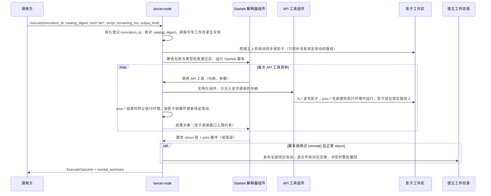

# ADR 0002：`lancet-node` 以 API 工具、宿主资源与写时复制提供 `act`

## 背景

### 来源

- LATTICE 的 [ADR 0009](https://github.com/Skyline10124/lattice/blob/0b261013ceb5f07a3948d2ecc8c8826729e93efa/docs/adr/0009-remove-legacy-lancet-tool-executor.md) 规定新 LANCET 在独立仓库中重写为独立进程 `lancet-node`，对外提供 `act`；方向来自 LATTICE 的 [`#309`](https://github.com/Skyline10124/lattice/issues/309)：模型只有一个入口工具 `act`，脚本在受约束的 API 上组合调用，每个调用声明 `effect` 与 `scope`，结果以回执保存。
- [ADR 0001](0001-lancet-protocol.md) 已将协调层与外部上下文节点的通信契约抽离为通用协议 `lancet-protocol`。本 ADR 规定 `lancet-node` 如何作为该协议在 Linux 软件工作区上的实现，落地编排语言、API 工具、宿主资源隔离与写时复制的影子工作区。
- 本 ADR 记录 2026-11-11 至 2026-11-16 维护者与 Agent 的设计讨论及四项原型实验结论。讨论中分期或待实施验证的事项集中在[待裁决](#待裁决)。

### 约束

| 约束 | 出处 |
| --- | --- |
| 节点实现 `hello`、`describe`、`execute`、`cancel`、`receipt` 五个操作，遵守持久零重放、目录摘要冻结、五种结局与 `output_limit` 载荷上限 | [ADR 0001 第 3–5 节](0001-lancet-protocol.md#3-五个协议操作) |
| 只支持 Linux 主机 | [项目介绍](../../README.md#环境要求与验证) |

### 已核实的事实

2026-11-11 至 2026-11-16 在开发主机上核实：Rocky Linux 10.2，内核 6.12，SELinux 为 Enforcing，工作区位于 XFS，工具链为 `rustc 1.96.0`。

| 事实 | 核实方式与结果 |
| --- | --- |
| 非特权进程能建立用户、挂载、PID、网络命名空间 | `unshare --user --map-root-user --mount --pid --net --fork` 成功；新网络命名空间内只有 `lo` |
| 非特权进程能设置资源上限 | `systemd-run --user --scope -p MemoryMax=64M` 建出的 cgroup 中 `memory.max` 为 67108864 |
| 嵌套的命名空间解除不了只读挂载 | Agent 以最小探针实测：外层用户与挂载命名空间把目录只读绑定挂载后，在其中再建的用户与挂载命名空间里 `mount -o remount,bind,rw` 被拒；写、截断、改权限与时间戳、设 xattr、新建、改名、删除均返回 `EROFS`，向可写目录建硬链接返回 `EXDEV` |
| 工作区所在 XFS 支持 `FICLONE`（reflink）零数据块检查点 | `cp --reflink=always` 与 `ioctl(FICLONE)` 成功；向 512 MiB reflink 副本追加 1 字节耗时 1 ms，磁盘占用不随文件大小增长；在含 3,269 个非 `target/` 条目的克隆仓库上，单线程遍历建立整树 `FICLONE` 检查点耗时 244 ms，清理耗时 97 ms |
| 开发仓库后台写入集中在 `.git/`，源码无持续后台噪声，`bubblewrap` 对不存在路径挂遮蔽点会短暂建删目录 | 实验 2 被动录制真实仓库两段共 23.4 h（8,217 行，`overflow` 为 0）：`.git/` 事件 7,025 条（含 `.git/index*` 34 条），源码与文档 716 条事件全部来自 3 次显式 Git 检出/拉取瞬间，其余时间后台源码写入 0 条；另捕获到外部 `bubblewrap` 沙箱遮蔽不存在路径时在真实目录短暂创建再删除挂载点的事件 474 条 |
| 非特权 `overlayfs` 存在目录改名与 `.git/` 一致性摩擦 | 实验 2 实测：`userxattr` 可挂载，但对下层目录执行 `git mv` 与 `os.rename` 触发 `EXDEV`；`.git/` 进上层时遇宿主后台 Git 活动触发冲突，直通可写绑定时在丢弃草稿后无法恢复 `HEAD` 与分支（6/6 失败）；失败后若丢弃 `target/` 增量产物，单 crate 重建由 0.1 s 增至 4.0 s |
| `bubblewrap` 可从系统软件源取得 | Rocky 10.2 的 baseos 源提供 0.10.0 |
| `starlark-rust` 能编译为 `wasm32-wasip2` 组件 | `starlark` 0.14.2 编译通过，产物 6.5 MB；组件只导入 WASI 的时钟、标准流、环境与随机数接口，不导入文件系统与套接字 |
| Starlark 组件能在 `wasmtime` 中运行，预编译后启动开销小 | `wasmtime` 49.0.5 命令行运行含函数与列表推导的脚本，结果与原生一致；每次现编译时整个进程耗时 1152 ms，预编译后约 12 ms，原生进程约 6 ms（均含进程启动） |
| `starlark` 0.14.2 语法、标准库与静态检查边界 | `Dialect::Standard` 默认关闭顶层语句，开启 `enable_top_level_stmt: true` 后支持顶层 `if` 与 `for`；顶层 `return` 仍是语法错误（“`return` cannot be used outside of a `def` function”），将脚本包裹为单一入口函数即可同时支持顶层 `return` 与顶层绑定静态类型检查；语言无 `while` 与 `try / except`，允许递归；宿主函数返回 `Err` 时调用栈干净退栈；内置 `LibraryExtension` 含 `Json`、`SetType`（已实现 `serde::Serialize`）、`StructType`、`Map`、`Filter` 与可挂自定义 `PrintHandler` 的 `Print`，无内置正则模块与 `sum`；实验性 `enable_f_strings` 仅支持裸标识符插值；内置 `DocModule` 可从宿主签名提取文档结构，`AstModuleTypecheck::typecheck` 可在求值前做静态名称解析与类型求解 |
| `starlark` 0.14.2 自带的资源限制只是尽力而为 | 本地源码 `src/eval/runtime/evaluator.rs`：`set_max_heap_size`、`set_max_tick_count` 与 `set_check_cancelled` 不在分配或执行时即时生效，只在每 1000 个 tick（一次函数调用或一次循环回跳计一个 tick）运行一次的检查点上判断，单个内置函数执行期间不检查；堆上限只计 Starlark 堆，`dict`、`struct` 在 Rust 堆上的存储不计入；源码注释写明这两种上限都不能保证内存或运行时间有界，需要保证时应借助操作系统机制 |
| 隔离网络命名空间监听套接字可经 `SCM_RIGHTS` 传回宿主，写系统调用可跨命名空间 `ptrace` 拦截 | 实测在 `unshare --user --map-root-user --net` 内启用 `lo` 并 `bind("127.0.0.1:0")` 后，经 `socketpair`（`SCM_RIGHTS`）将监听 fd 传回宿主进程 `accept` 成功；SELinux Enforcing（`deny_ptrace = off`）下宿主进程对 `user+pid+mount+net` 子命名空间内进程执行 `PTRACE_SEIZE` 成功（`rc = 0`）；被动监听侧 `fanotify` 的 `FAN_REPORT_PIDFD` 与 FUSE 的 `FUSE_DEV_IOC_BACKING_OPEN`（`FUSE_PASSTHROUGH`）非特权均返回 `EPERM` |
| Starlark 编排实测通过率与回滚失误分布 | 实验 1 v2（`exp/act-v2` 分支 `prototypes/starlark-pass-rate/REPORT-v2.md`，859 次有效运行）：扣除判定器假阴性后，常规五类任务完成率为 deepseek-flash 359/359、MiniMax-M3.1-Flash 358/360；但在“正常返回即自动保留改动”语义下，MiniMax 在回滚类任务中 0 次调用 `discard`、失败 38/68 次；扣除测试台命令白名单后，单次 `act` 报错集中于未开启 `SetType`/`sum`/`Print`、宿主视图未实现序列化及无括号生成器等少量语法差异 |
| 显式 `commit()` 下的遗漏与撤销提示的补救 | 实验 1 v3（`exp/act-v3` 分支 `prototypes/starlark-pass-rate/REPORT-v3.md`；composed/A 组，2 模型 × 24 任务 × 3 次；DeepSeek 为经 OpenRouter 默认路由的 `deepseek/deepseek-v4.1-flash`，MiniMax 为直连的 `MiniMax-M3.1-Flash`）：总完成率 135/143；真正需要写入的运行中遗漏 `commit()` 的，DeepSeek 0/24、MiniMax 17/24；撤销提示交回后，下一次 `act` 重做并提交 15/17，最终全部补救 17/17；回滚任务测试失败后误提交 0/24；出现 1 次撤销后只调用 `commit()`、没有重做修改的误用。任务小、每项只重复 3 次，模型版本与路由也不同于 v2，与 v2 完成率的差异只作参考 |
| 子进程写拦截三种机制的覆盖、竞态与开销 | 实验 3（`exp/write-intercept` 分支 `prototypes/write-intercept/REPORT.md`，234 个覆盖运行、75 个工作负载运行；Agent 另行重跑竞态用例，结果一致）：在检查之后、系统调用之前由另一线程改写参数内存，`SECCOMP_RET_TRACE` 加 `ptrace`（A）与用户态通知后回复 `CONTINUE`（B1）各 600/600 次打开未登记的文件，节点复制参数后代执行（B2）为 0/600；检查之后把路径替换为符号链接，三者均被绕过；A 下沙箱内 `PTRACE_TRACEME` / `PTRACE_ATTACH` 返回 `EPERM`，沙箱内程序再装一个用户态通知过滤器即可绕过外层 `TRACE`，B 下再装监听器返回 `EBUSY`；B 的监听方退出后，被拦截的调用返回 `ENOSYS`，但已打开的 fd 仍可写入；三者都漏记跨规则硬链接、目录、符号链接、权限位与 xattr 的变化，以及装过滤器之前打开的可写 fd；B2 代执行时使用了节点的 umask；LATTICE 副本上的构建开销在噪声范围内，一次被拦截的 `open` 加 `close` 约 60 µs（不拦截时 3.5 µs），改名含 1,000 个文件的目录约 3 s |
| 代执行规则的第二轮验证 | 实验 3 第二轮（同分支 `prototypes/write-intercept/REPORT-v2.md`，Agent 核对了原始数据）：对象绑定后参数改写 0/600 绕过，沙箱内、外把路径替换为符号链接各 20 次均未改动目标；`hidden` 的 15 种新建入口均返回 `EACCES`；启动垫片关闭继承 fd 后 3 种探针均为 `EBADF`；目录项操作后的核对，对沙箱外写者构造的先删后放、目标端替换与符号链接 ABA 共 120/120 漏检；节点被 `SIGKILL` 后 50 次中 49 次子进程仍经旧 fd 写入，被写对象此前均已登记前态；删除已有硬链接别名后的还原拆散了链接关系；每次通知 fork 一个 worker 时，被拦截的 `open` 加 `close` 约 389 µs，LATTICE 全量构建比无沙箱慢约 7%；改名含 1,000 个文件的目录在合并账本落盘后约 1.28 s，即每个前态的 `fsync` 约 1.2 ms |
| 用户态通知往返的下限与 Landlock 可用性 | Agent 以最小基准实测（不 fork、不进命名空间、不建检查点；`open` 加 `close` 各 20,000 次，取 3 次中位数）：不拦截 3.4 µs；回复 `CONTINUE` 21 µs，开启 `SECCOMP_USER_NOTIF_FD_SYNC_WAKE_UP` 后 10.3 µs；读取路径参数后放行 12.3 µs（同步唤醒）；读取路径后代执行并经 `ADDFD` 注入 24 µs，与目标进程同一 CPU 时 14 µs。本机 Landlock ABI 为 6 |
| 子进程写拦截（B3）在前态密集负载上的开销 | 实验 3 第三轮（同分支 `prototypes/write-intercept/REPORT-v3.md`）：LATTICE 全量构建开销 +0.3% 至 +1.7%；子进程密集修改源码时每个文件约 3 ms，4,000 文件 `git checkout` 需 12.6 s |
| 分离工作区（S3）的语义 | 实验 3 第六、七轮（同分支 `prototypes/write-intercept/REPORT-v6.md`、`REPORT-v7.md`，Agent 核对了原始数据）：`act` 期间宿主改同一文件 40/40 报冲突，改不同文件 20/20 正常发布；改动集合与全量扫描、全内容对照一致（继承用例 126/126、随机负载 200/200、宿主同步 45/45，含一次真实的 inotify 队列溢出）；Git 用例 114/114，宿主暂存全部保留，config 与 hooks 不发布；崩溃恢复 27/27（24 次杀进程后恢复，3 次多链接文件在写入前整批报冲突），Git 崩溃恢复 18/18；发布途中宿主改了已发布的文件、后面又有文件冲突时结算为 `Indeterminate`（3/3）；跨类别硬链接返回 `EXDEV`，沙箱看不到宿主家目录，可写挂载来源不在状态目录时拒绝启动 |
| 分离工作区（S3）的性能 | 实验 3 第七轮：10 万条目、无改动的 `act` 0.457 ms（不含 Git 仓库；有 10 万个跟踪文件时，原型的 Git 同步约 42 ms，主要是 Python helper 的启动）；影子与宿主之间无外部改动时，4,000 文件 `git checkout` 1.82 s；LATTICE 全量构建比只有命名空间慢 1.3%；发布时宿主能看到中间状态的时长，1 个文件 0.09 ms、100 个 6.8 ms、4,000 个 0.32 s；初次建立 10 万个文件的影子 67.4 s；私有 cargo 缓存复制压缩包与索引 0.18 s，首次解压源码 4.75 s，`target/` 种子复制 0.30 s |
| 发布的落盘方式 | 实验 3 第七轮审查补充：原型每次发布调用三次 `syncfs`，独立发布基准中 1 个文件 10–307 ms、4,000 个文件 0.89–5.19 s；`syncfs` 要写回整个文件系统的脏数据，另有 1 GiB 无关脏数据时 7.2 s、2 GiB 时 14.5 s，同样条件下只对一个小文件 `fsync` 为 117 ms 与 184 ms |
| 影子与发布依赖的内核和 XFS 行为 | Agent 以最小探针实测：向已脏的 mmap 页面再写入不更新 ctime，`FICLONE` 会先写回源文件的脏页，此后的首次写入重新更新时间戳；`FICLONE` 可跨绑定挂载，`renameat2(RENAME_EXCHANGE)` 跨挂载返回 `EXDEV`；`XFS_IOC_EXCHANGE_RANGE` 返回 `ENOTSUP`。实验 3 第六轮：`IN_CLOSE_WRITE` 收不到经未监听目录的硬链接别名写入与 `O_RDONLY|O_TRUNC` 截断；只读绑定挂载挡不住经可写别名对同一 inode 的写入 |
| 杀掉进程与异步写 | 实验 3 第七轮：进程提交 1 GiB 的 `O_DIRECT` AIO 写入后被 `SIGKILL`，内核等写完才回收进程（两次分别 997 ms 与 1,556 ms，回收时数据已全部写入）；本机 `kernel.io_uring_disabled = 2` |
| 可写的宿主包缓存能把代码送进宿主构建 | Agent 实测：在 cargo 已解压的 registry 源码末尾追加 `compile_error!`，`cargo clean -p` 后重新构建即报该错误；cargo 不重新核对已解压的源码 |
| 跟踪文件中的多链接文件 | Agent 实测：LATTICE 的 514 个、lancet 的 28 个跟踪文件中，链接数大于 1 的都是 0；多链接文件都在 `target/` 中（LATTICE 有 24,848 个，是 cargo 建的硬链接） |
| 工具声明可从组件读出，effect 模板由句柄类型确定 | 实验 4（`exp/tool-declaration` 分支 `prototypes/tool-declaration/REPORT.md`，三次完整运行结论相同、产物逐字节相同）：`wit-component` 0.258.3 从组件解出导出接口的函数、参数名、参数与返回类型与记录；`wit-bindgen` 0.60 构建的组件不含 WIT 注释，把带注释的 WIT 包放进组件顶层自定义段后 9 条注释全部取回，签名与组件一致；宿主接口把句柄的种类与模式定为资源类型时，2,070 份变异的手写 effect 清单中，通过核对的都等于由参数类型推出的模板；`wasmtime` 49 实例化时按链接器核对导入（同一源码的 `wasm32-wasip2` 构建多出 13 个 WASI 导入，实例化失败），调用时核对实参的类型、个数与资源种类，组件把只读句柄当可写句柄使用时陷入，宿主写函数调用 0 次；Rust `#[link_section]` 写入的段落在嵌套核心模块，`wasm-tools strip` 默认删除自定义段，预编译产物也不保留；加载一个工具声明的中位数 0.39 ms |

### 尚未核实

| 事项 | 影响的决策 |
| --- | --- |
| 节点进程内复用 `wasmtime::Engine` 实例化解释器组件与 API 工具组件的耗时；上面的数字来自命令行，含进程启动 | 第 4 节 |
| 以 `wasmtime` 49 的 `ResourceLimiter` 与 epoch 中断对单次组件调用施加内存上限与截止中断，超限后回收该实例、节点继续服务 | 第 4 节 |
| 执行环境的内存超出 `memory.max` 时只终止该执行环境内的进程，节点继续服务 | 第 4 节 |
| 用 `bubblewrap` 建立第 4 节的挂载表；第七轮原型因主机未安装 `bubblewrap`，用自带的 C 启动器建立 | 第 4 节 |
| 发布改为只落盘本批文件与所在目录之后的时延 | 第 6 节 |

## 决策

### 1. 能力完整

`lancet-node` 让模型在工作区里完成开发者在终端里能完成的事。第一个可用版本就具备下列四类能力：

| 能力 | 内容 |
| --- | --- |
| 读与搜 | 读取文件、列目录、按内容与名称搜索、查看待定改动的状态与差异 |
| 改 | 新建、精确替换修改、撤回单文件的待定改动，以及发布或丢弃全部待定改动 |
| 执行 | 运行原生进程与多阶段进程管道：构建、测试、版本管理与包管理工具 |
| 联网 | 发起 HTTP 请求；原生进程受控访问网络 |

分期交付时推后的是深度：撤销命令、审批、并行调度、远程节点与第三方扩展。能力不因边界机制的实现难度而削减。

### 2. 唯一的定义单元是 API 工具，对外唯一工具是 `act`

`lancet-node` 在 [ADR 0001](0001-lancet-protocol.md#3-五个协议操作) 的 `describe` 的 `tools` 列表中只暴露单一工具 `act`，不把内部单个 API 工具直接暴露为协议层工具。

| 概念 | 规则 |
| --- | --- |
| API 工具 | 节点内部唯一的工具定义单元。每个 API 工具有一份声明：参数与返回类型签名，以及以句柄参数表示的 effect 与 co-effect 模板（见 [ADR 0001 第 4 节](0001-lancet-protocol.md#4-effectco-effect回执与-residue)）。`act` 工具说明中的类型存根、`environment_summary`、受理检查、执行前静态类型检查、沙箱句柄分发、`seam` 边集与回执明细均由这份声明推出 |
| 脚本 | 模型传给 `act` 的一段 Starlark，只做编排：持有授权句柄，调用 API 工具，对内存结果做纯计算筛选与组合，最后把需要进入模型上下文的数据交回。脚本自身不产生、也不声明 effect 与 co-effect，不是工具 |
| `act` | `lancet-node` 对模型可见的唯一工具，输入为脚本字符串。它本身不带任何固有能力 |

effect、co-effect、句柄、`residue` 与 `seam` 的定义见 [ADR 0001 第 4 节](0001-lancet-protocol.md#4-effectco-effect回执与-residue)。本节点的句柄种类就是本 ADR 第 4 节的三类宿主资源：目录、执行环境、网络出口。

**API 工具对第三方开放。** 除下表的首批工具外，节点也接受第三方独立构建的 API 工具。节点以同一方式对待全部工具：不信任工具的实现，只按声明分发句柄，隔离与资源上限由第 4 节的组件边界承担。第一个版本只发布首批工具，第三方工具的安装、分发与信任配置按第 1 节推后。

**声明就是组件导出的 WIT 接口。** 第三方工具可以用任何能编译为 WASM 组件的语言编写，声明因此不依赖某种源语言：

- 参数与返回类型签名是工具组件导出的 WIT 接口。工具组件只导入节点的宿主接口 `lancet:host`；句柄的种类与模式各是其中的一种资源类型：`read-dir`、`write-dir`、`exec-env`、`egress`。
- effect 与 co-effect 模板由句柄参数的类型推出（见下表，`d`、`e`、`n` 为该参数），工具不另行声明。授权的单位是节点配置的句柄，更窄的范围靠配置更窄的句柄表达。
- 工具说明取自组件顶层自定义段 `lancet:wit` 中带注释的 WIT 包，节点核对它的签名与组件导出接口相同。构建出的组件只含类型、不含 WIT 注释，说明只能经这个段带入。
- 节点在预编译前从原组件读出声明，与预编译产物一同保存；预编译产物不含自定义段。导入了 `lancet:host` 以外的接口、缺少 `lancet:wit` 段或签名对不上的组件拒绝加载。
- `wasmtime` 强制这些类型：实例化时按节点的链接器核对组件的导入；每次调用时核对实参的类型、个数与资源种类；组件内部把一种句柄当作另一种使用时陷入。
- `.pyi` 类型存根、Starlark 静态检查所用的类型、`environment_summary` 与 `catalog_digest` 都由节点从声明推出，不另行手写。

| 句柄参数的类型 | co-effect 模板 | effect 模板 |
| --- | --- | --- |
| `borrow<read-dir>` | `Uses<d, Read>` | 无 |
| `borrow<write-dir>` | `Uses<d, ReadWrite>` | `Write<d>` |
| `borrow<exec-env>` | `Uses<e>` 与 `mounts(e)` | `Exec<e>`，以及派生的 `Write<d>`（`d` 以可写方式挂载）与 `Emit<n>`（`e` 持有出口） |
| `borrow<egress>` | `Uses<n>` | `Emit<n>` |

首批 API 工具（`d` 为目录句柄，`e` 为执行环境句柄，`n` 为网络出口句柄；`mounts(e)` 为 `e` 挂载的目录及其模式；模板按上表由参数类型推出）：

| API 工具 | effect 模板 | co-effect 模板 | 说明 |
| --- | --- | --- | --- |
| `fs.read`、`fs.list`、`fs.search` | 无 | `Uses<d, Read>` | 读取文件、列举目录、按正则与路径模式搜索 |
| `fs.status`、`fs.diff` | 无 | `Uses<d, Read>` | 查看待定改动（第 6 节）的增删改列表与 unified diff |
| `fs.write`、`fs.edit`、`fs.reset` | `Write<d>` | `Uses<d, ReadWrite>` | 整文件写入、精确匹配替换（默认唯一匹配，`all = True` 时替换全部且至少匹配 1 次）、丢弃指定路径的待定改动 |
| `proc.run`、`proc.pipe` | `Exec<e>`，以及派生的 `Write<d>`（`d` 以可写方式挂载）与 `Emit<n>`（`e` 持有出口） | `Uses<e>` 与 `mounts(e)` | 以参数数组运行单个进程，或用内核 `pipe()` 串联多阶段参数数组（均不经过 `/bin/sh`） |
| `http.fetch` | `Emit<n>` | `Uses<n>` | 经授权出口发起 HTTP 请求 |

### 3. Starlark 编排、类型存根、正交过滤与快速失败

解释器固定采用 Starlark（`enable_top_level_stmt = true`、`enable_load = false`、`enable_f_strings = false`），在保持确定性、有限步终止、脚本自身不产生 effect 的前提下，按下列规则补齐声明呈现、静态拦截、纯计算环境与提交控制：

- **顶层 `return` 与执行前静态检查同构包裹**：
  - 节点将模型传入的脚本包裹在单一入口函数体内（解析、静态检查与运行期报错的行号均映射回原脚本），使脚本可在顶层直接写 `return value` 交回结果（未写 `return` 时返回 `None`），同时让 `AstModuleTypecheck::typecheck` 完整求解顶层绑定的静态类型。
  - `describe` 中 `act` 的 `description` 由 API 工具声明与解释器内置类型自动渲染为紧凑的 `.pyi` 类型存根（区分只读目录类型 `ReadDir` 与可写目录类型 `WriteDir`，以及 `ExecEnv`、`Egress`、`TextView` 和各返回记录类型），只随节点版本变化；`environment_summary.handles` 按节点配置将每个已授予句柄的 `kind` 标为对应存根类型名，并在 `attributes` 中附上 `hidden`、`regenerable`、挂载与允许主机。
  - 解释器在执行第一条语句之前，先对照本次注入的全局环境运行静态名称解析与类型检查；未定义标识符、参数名错误、字段名拼写错误或对 `ReadDir` 调用写方法，均在产生任何子调用与 effect 前以 `Failed(ScriptOrToolError)` 直接退回。对常见 Python 语法差异（无括号生成器、`import`、`is None`、花括号集合推导），解析错误额外附一行修复提示。
- **句柄方法绑定**：节点按配置向脚本全局环境注入授权句柄，并在句柄对象上直接绑定对应方法（例如 `lancet.read(...)` 等价转发给 `fs.read(lancet, ...)`，`dev.run(...)` 等价转发给 `proc.run(dev, ...)`），省去重复传递句柄样板。
- **纯计算标准库、`print` 缓冲、正交过滤与两级体积上限**：
  - 启用 `starlark` 内置扩展 `Json`、`SetType`、`StructType`、`Map`、`Filter` 与 `Print`，并注入无句柄、无 effect 的纯计算函数 `sum` 与 `regex` 命名空间（`match`、`findall`、`replace`）。`print` 通过自定义 `PrintHandler` 写入本次 `act` 的内存缓冲（不写节点标准错误流），随交回结果一并计入 `execute.output_limit`。不注入反射或宿主系统库。
  - API 工具保持单一职责，返回原始领域结构，不在每个 API 工具上重复定义文本裁剪参数；所有宿主返回类型与视图类型（含 `TextView`）均可直接序列化为 JSON。
  - 解释器组件内置基于 Rust `regex` 的链式文本视图（`text(s).grep(pattern, before = 0, after = 0).head(n).tail(n)`，拆行方法与字符串对齐为 `.splitlines()`），不持有任何宿主资源，所有字符串结果均可按自左向右顺序筛选。
  - 两级上限分离：单次 API 工具返回给 Starlark 内存窗口的数据上限设为 MiB 级（建议 8–16 MiB），容纳未过滤的测试日志或响应体供脚本就地筛选；脚本最终交回协调层的序列化载荷（`return` 值与 `print` 缓冲合计）受 `execute.output_limit`（如 64 KiB）约束。超出内存窗口的流式进程输出通过 `proc.pipe` 在内核管道中过滤。
- **默认快速失败与窄显式分支**：
  - 语言层不提供通用 `try / except`，任何未显式声明容忍的错误立即展开调用栈并中止脚本；已做的写入作为待定改动保留（见下）。
  - 仅在预期探测点提供正交的显式窄参数：
    1. `fs.read` 与 `fs.list` 的 `missing_ok = False`：仅当 `missing_ok = True` 且目标路径不存在（`ENOENT`）时返回 `None`；命中 `hidden` 排除规则、越界路径或编码错误仍立即报错中止。
    2. `proc.run` / `proc.pipe`：默认 `check = True`，子进程非零退出时立即报错中止并附带尾部输出摘要；显式指定 `check = False` 时才把 `{ code, stdout, stderr }` 作为普通数据交回脚本判断。
    3. `http.fetch`：HTTP 4xx/5xx 状态码作为响应对象字段返回；DNS 失败、连接超时或不在出口白名单内的请求立即报错中止。
- **防盲改、待定改动与显式 `commit()` / `discard()`**：
  - 节点不提供跨轮次的脚本栈内挂起断点，也不在每次 `edit` 落盘前强制暂停：模型需要先阅读文件内容再推理修改方案时，拆为“第一轮 `act` 读取并筛出上下文，第二轮 `act` 执行修改与验证”两次调用。
  - `fs.edit(dir, path, old, new, all = False)` 默认要求旧片段在目标文件中精确出现且仅出现 1 次；`all = True` 时替换全部出现位置且要求至少匹配 1 次；不满足时立即报错中止，防止批量循环在未进入上下文的文件上误改。
  - 写入先成为待定改动：`fs.*` 与 `proc.*` 的写入都落在第 6 节的影子工作区，`act` 结束后原样保留并跨 `act` 累积，直到某次 `act` 的脚本调用 `commit()` 或 `discard()`。模型看过结果再决定：下一次 `act` 可以只写一行 `commit()` 或 `discard()`，也可以继续修改。
  - 脚本可通过目录句柄调用 `status()`、`diff()` 查看全部待定改动，或用 `reset(path)` 丢弃个别文件的待定改动。
  - 全局内置 `commit()` 标记发布：脚本正常 `return` 且载荷不超限时，节点把全部待定改动作为一批发布到宿主工作目录（第 6 节），并在 `receipt_summary` 中填入发布的文件列表与裁剪后 unified diff。`commit()` 可以在任意一次 `act` 中调用，包括写入发生的那一次（例如测试通过才调用）。脚本出错、取消、超时或载荷超限时不发布，待定改动保留。
  - 全局内置 `discard()` 立即丢弃全部待定改动，影子恢复到基准，脚本继续执行；此后的写入成为新的待定改动。
  - `act` 结束时仍有待定改动的，节点在交回模型的 `content` 末尾附一行提示，写明待定文件数，提醒用 `commit()` 发布或 `discard()` 丢弃。节点为这行提示预留固定字节数并计入 `output_limit`，提示本身不会让结局变为 `OutputLimitExceeded`。

脚本编排形态示意。第一次 `act` 修改并运行测试，改动留在影子里待定：

```python
cfg = lancet.read("Cargo.toml", missing_ok = True)
if cfg == None:
    fail("missing Cargo.toml")

for hit in lancet.search("OldSymbol", glob = "crates/**/*.rs"):
    lancet.edit(hit.path, "OldSymbol", "NewSymbol")

res = dev.run(["cargo", "test", "--offline"], cwd = lancet, check = False)
return {
    "ok": res.code == 0,
    "failures": text(res.stdout + res.stderr).grep("FAILED|error\\[", after = 5).tail(40),
    "pending": lancet.status(),
}
```

模型看过结果后，第二次 `act` 决定发布或丢弃：

```python
commit()  # 或 discard()
```

### 4. 边界由宿主资源承担

规则：**原生能力一律以宿主资源的形式进入，API 工具只通过句柄使用。** 宿主资源是一个小的封闭集合，由节点实现。

| 宿主资源（句柄种类） | 句柄代表什么 | 实现 |
| --- | --- | --- |
| 目录 | 一个工作目录及其读写级别 | 节点实现的目录资源：可写工作目录的读写落在第 6 节的影子工作区；在这一层过滤配置中的 `hidden` 路径 |
| 执行环境 | 一组挂载、内存上限与网络出口 | `bubblewrap`（`user`/`mount`/`pid`/`net` 命名空间）按下方挂载表建立私有根：可写的只有节点状态目录中的影子、私有家目录与临时目录，宿主目录一律只读挂载 |
| 网络出口 | 允许访问的主机域名清单（`hosts`） | 节点内的域名白名单放行代理（首阶段按域名校验，不做 TLS 中间人解包） |

- **API 工具与解释器都是 WASM 组件**，在 `wasmtime` 中运行。API 工具对第三方开放（见第 2 节），节点不信任工具的实现，由组件边界让声明成为强制约束：
  - 工具组件实例化时只得到本次调用注入的句柄，句柄按参数类型收窄：参数为 `borrow<read-dir>` 的工具只拿到 `d` 的只读视图，组件把它当作 `write-dir` 使用时陷入。没有交给它的资源无从引用，工具越不出自己的声明。
  - 节点为每次组件调用设置内存上限，并在截止时间到达时中断该次调用；超限或超时只终止这一个实例，节点继续服务。
- **解释器组件不持有任何宿主资源**，只导入调用节点子工具分发的接口。节点对它同样设置内存上限，并在 `remaining_ms` 耗尽或收到 `cancel` 时中断。`starlark` 自带的堆上限与取消检查只是尽力而为（见[已核实的事实](#已核实的事实)），用于尽早返回可读的错误，不作为边界。
- **组件预编译后加载。** 每次调用现编译的开销在秒级，节点只加载预编译产物。
- **原生进程经执行环境资源运行。** `proc.run` 与 `proc.pipe` 的声明方式与其他 API 工具相同，操作系统级沙箱是执行环境资源的实现。
- **每次 `proc.*` 新建执行环境。** 调用结束、`remaining_ms` 耗尽、收到 `cancel` 或节点退出时，节点终止整个 PID 命名空间；执行环境不跨调用保留进程（否决理由见[否决的方案](#否决的方案)）。
- **执行环境只设内存上限。** 节点把每个执行环境放进单独的 cgroup，设置 `memory.max`；进程数与磁盘占用不设上限，由上一条的终止时机兜底。
- **执行环境不限定可运行的程序。** 子进程能看到、写到、发到哪里由挂载表与网络出口决定，与运行的是哪个程序无关；解释器（如 `python3`）与构建、测试工具一样在这些约束内运行，嵌套的命名空间也解除不了只读挂载（见[已核实的事实](#已核实的事实)）。
- **执行环境的挂载表。** 沙箱里的绝对路径与宿主一致。节点启动时核对全部可写挂载的来源都在节点状态目录内，不满足时启动失败。

  | 沙箱内路径 | 来源 | 读写 |
  | --- | --- | --- |
  | 系统目录（`/usr`、`/etc` 等） | 宿主 | 只读 |
  | `$HOME`（宿主家目录的原路径） | 节点状态目录中的私有家目录；其中的 `.gitconfig` 由节点生成，只含 `user.name` 与 `user.email` | 可写 |
  | 工具链（如 `~/.rustup`、`~/.cargo/bin`，由配置列出） | 宿主，挂进私有家目录中的原路径 | 只读 |
  | 包缓存（如 `~/.cargo/registry`、`~/.npm`，由配置列出） | 私有家目录中的副本，首次从宿主缓存 reflink 复制；cargo 只复制 `registry/cache` 与 `registry/index`，源码由 cargo 在私有目录中重新解压 | 可写 |
  | 可写工作目录（真实路径） | 第 6 节的影子；`regenerable` 目录与 `.git/` 各自单独挂载 | 可写 |
  | 只读工作目录 | 宿主；已存在的 `hidden` 路径以空文件或空目录遮蔽 | 只读 |
  | 影子 `.git/` 引用的宿主对象 | 宿主的 `.git/objects` | 只读 |
  | `/tmp` | 节点状态目录中的私有临时目录 | 可写 |
  | `/proc`、`/dev` | 新 PID 命名空间的 `proc`；`/dev` 只含 `null`、`zero`、`random`、`urandom` | — |

- **宿主家目录不挂进执行环境。** 家目录中有 SSH 密钥与 API 凭据，只读挂载也会被读到，并可经网络出口外发；执行环境只按配置挂入工具链与私有缓存。
- **不拦截写系统调用。** 子进程的写入只落在私有挂载上，执行环境不使用 seccomp 用户态通知、`ptrace` 与 Landlock。`bubblewrap` 的 seccomp 过滤器对 `io_uring_setup` 返回 `ENOSYS`：杀掉进程时内核会等待已提交的 AIO 写入，对 io_uring 尚未核实（本机已全局禁用）。
- **原生进程经 `SCM_RIGHTS` 跨命名空间代理出网。** 子进程处于只有 `lo` 的隔离网络命名空间；启动垫片在命名空间内执行 `bind("127.0.0.1:0")`，经 `socketpair`（`SCM_RIGHTS`）把监听 fd 与端口号传回宿主 `lancet-node` 事件循环，写好 `HTTPS_PROXY` / `https_proxy` 与 `HTTP_PROXY` / `http_proxy` 后直接 `execvp` 目标进程（沙箱内无常驻转发进程，工作目录内不挂套接字文件）。代理对明文 HTTP `Host` 与 HTTPS `CONNECT` 目标域名对照 `egress.hosts` 放行并记入回执，拒绝直连、字面量裸 IP 与解析到回环/链路本地/私网网段的目标。
- **依赖缺失时启动失败。** 配置授予了执行环境而主机缺少可用的 `bubblewrap` 或命名空间，或可写工作目录、私有缓存与节点状态目录不在同一个支持 `FICLONE` 的文件系统上时，节点启动报错，不退回无沙箱执行。

### 5. 工作区与节点配置

| 概念 | 规则 |
| --- | --- |
| 节点 | 一个独立运行的 `lancet-node` 进程，实现 [ADR 0001](0001-lancet-protocol.md) 协议 |
| 工作区 | 一个 `lancet-node` 对应一个软件工作区。工作区是一组互不重叠的工作目录 |
| 工作目录 | 模型操作的对象。每个工作目录对应一个目录句柄，有自己的名称、读写级别与路径规则；互不重叠在节点启动时校验 |
| 环境目录 | 执行环境句柄挂载的目录，分两类：只读挂载的系统目录与工具链；节点私有的缓存目录，首次从宿主缓存 reflink 复制，之后只写私有副本。只有 `proc.*` 能看到，`fs.*` 拿不到它们的句柄 |
| 节点配置与状态目录 | 存放在所有工作目录之外的主机路径，不在被挂载的业务仓库内生成配置文件或状态目录 |

- **策略归节点配置。** 授权、路径规则与网络出口清单只写在节点配置里，由机器所有者维护；协议中没有修改它们的操作。
- **路径规则借用 `.gitignore` 的模式语法**：目录后缀 `/`、`**`、`!` 否定、后写的规则优先，路径相对各工作目录的根计算。节点不读取工作区里的 `.gitignore`。
- **规则默认为空。** 节点不内置默认 `regenerable` 或 `hidden` 规则，配置模板给出示例；各工作目录下的 `.git/` 固定按第 6 节的 Git 规则处理。

配置形态示意：

```toml
[[dir]]
name = "lancet"
path = "/home/dev/lancet"
access = "write"
regenerable = ["target/"]        # 可再生：只存在于影子，单独挂载，不发布
hidden = [".env"]                # 排除：不复制进影子，脚本不可见；待定改动中出现该路径时拒绝发布

[[dir]]
name = "lattice"
path = "/home/dev/lattice"
access = "read"

[[env]]
name = "dev"
mounts = [{ dir = "lancet", access = "write" }, { dir = "lattice", access = "read" }]
tools = ["~/.rustup", "~/.cargo/bin"]   # 只读挂载
caches = ["~/.cargo/registry"]          # 节点私有副本
egress = "crates"

[[egress]]
name = "crates"
hosts = ["index.crates.io", "static.crates.io"]

# seam 边集由上面的授权推出，不在配置中声明（见第 7 节）。本例推出：
#   integrity        lancet ⇒ dev       lancet 上的写入会在 dev 中被执行
#   confidentiality  lancet ⇒ crates    lancet 的可读内容可经 crates 外发
#   confidentiality  lattice ⇒ crates
```

### 6. 影子工作区、待定改动与发布

`lancet-node` 不在宿主工作目录上原地写入，也不拦截子进程的写系统调用。每个可写工作目录在节点状态目录里有一份持久的 reflink 影子：`fs.*` 的写入与执行环境中子进程的写入都落在影子上，宿主工作目录只在发布时被写入。影子相对基准的差异就是待定改动，由模型在后续 `act` 中决定发布或丢弃（第 3 节）。发布完成后不保留前态。



- **可写工作目录互斥与同文件系统要求**：节点对每个可写工作目录持互斥锁，同一时间至多一个持有该目录可写权限的 `act` 运行；可写工作目录、影子、私有缓存与节点状态目录须同处一个支持 `FICLONE` 的文件系统，启动校验不满足时节点报错退出。
- **影子的建立与同步**：
  - 节点首次启动时并行 `FICLONE` 整个工作目录建立影子，是每个节点一次的初始化成本（10 万个文件 67.4 s，不计入 `act`）。`regenerable` 目录同样从宿主复制一份作种子；`hidden` 路径不复制。
  - 节点持续跟踪宿主工作目录的改动（目录 inotify 加后台扫描），扫描不在请求路径上，请求不等待扫描。
  - 每次 `act` 开始时把宿主上的改动同步进影子：没有待定改动的路径直接同步；同一路径在影子里有待定改动时保留影子的版本，标为冲突并在 `status()` 中列出。对冲突路径调用 `reset(path)`，即放弃这条待定改动、接受宿主的版本。
  - 节点外的写者（如外部编辑器）只改宿主工作目录，不会混进待定改动。
- **待定改动的求取**：
  - 基准是每个路径最近一次从宿主同步或发布后的状态。待定改动比较内容、是否存在、类型（常规文件、目录、符号链接及其指向）与权限位，不比较时间戳与所有者。
  - 影子侧监听常规路径与 `.git/` 下的全部目录（包括 `IN_MODIFY`，覆盖只读打开加截断）。每次 `proc.*` 结束、执行环境整个终止后，影子里不再有写者，经 mmap 写过的文件也已随进程退出补发 `IN_CLOSE_WRITE`；节点按事件核对候选路径，不遍历整棵树。事件队列溢出时退回全量扫描。
  - `regenerable` 目录与 `.git/` 各自单独挂载，跨类别建硬链接由内核返回 `EXDEV`，影子里的文件不会经未监听目录的别名被改写。执行环境建立时尚不存在、之后才新建的 `regenerable` 目录按常规路径处理。
- **发布（脚本调用过 `commit()` 并正常 `return` 之后）**：
  - 发布前核对：待定改动中没有 `hidden` 路径；被改的宿主文件链接数为 1；每个宿主文件仍等于基准。任一项不满足，整批不发布，列出冲突路径，待定改动保留。
  - 逐文件把影子版本 `FICLONE` 到宿主同一目录下的临时名，再用 `renameat2(RENAME_EXCHANGE)` 与宿主文件交换；换出的宿主 inode 移进节点状态目录，供本次发布撤回与崩溃恢复使用，发布结束后删除。新建文件用 `RENAME_NOREPLACE`；删除把宿主文件移进状态目录；同类别的目录改名在宿主上执行一次 `rename`。影子 inode 留在原处。
  - 交换后核对换出的 inode 仍是基准；后面的文件冲突时，逆序撤回已发布的项。撤回时发现宿主又改了已发布的文件，保留宿主的修改，结算为 `Indeterminate`，并列出每个文件的状态（已发布、已撤回、保留宿主修改）。
  - 结局只有“全部发布”与“全部不发布”两种，唯一例外是上一条的 `Indeterminate`。不承诺多个文件同时对宿主可见：发布窗口随文件数增长（见[已核实的事实](#已核实的事实)）。
  - 只落盘本批文件与所在目录，不用 `syncfs`。`syncfs` 要写回整个文件系统的脏数据，构建刚写完 `target/` 就发布时要多等数秒。
  - 发布属于 [ADR 0001 第 2 节](0001-lancet-protocol.md#2-连接与帧模型)所说的最终提交临界区：开始后不受 `cancel` 与断连影响，在 `settle_grace_ms` 内完成或撤回。
- **Git**：
  - 影子里的 `.git/` 是私有的：HEAD、index、refs 与 config 是节点的副本，对象经 alternates 只读引用宿主的 `.git/objects`，新对象写在私有目录里。
  - 宿主 HEAD 与 index 不变时，私有 index 跨 `act` 保留；宿主变化而影子里没有待定的 Git 改动时重建。
  - 发布时校验并复制新对象到宿主，在 Git lockfile 下以比较后交换更新引用，只把本批路径写进宿主 index，宿主原有的暂存保留；config 与 hooks 不发布。引用的比较后交换只约束遵守 Git lockfile 的写者。
- **崩溃恢复**：
  - 待定改动保存在影子里，节点重启后照常保留。
  - 发布开始前先持久化发布日志（待发布项、宿主临时名与换出前态的位置）。节点在发布中途崩溃时，重启后、响应 `hello` 之前按日志完成或撤回这次发布，宿主恢复到全部发布或全部未发布；撤回时发现宿主又改了已发布的文件，保留宿主的修改，并按 [ADR 0001 第 5 节](0001-lancet-protocol.md#5-调用记录的生命周期与对账) 结算为 `Indeterminate`。
- **发布后不保留前态**：发布前的改动由 `discard()` 与 `reset(path)` 撤回，发布之后的修正由新的 `act` 完成；协议不提供求逆（[ADR 0001 第 3 节](0001-lancet-protocol.md#3-五个协议操作)）。回执明细默认保留 30 天，可在节点配置覆盖。
- **性能要求**（第七轮原型已达到，作为实施的验收标准）：10 万条目、无改动的 `act` 固定开销 ≤ 50 ms；影子与宿主之间无外部改动时，4,000 文件 `git checkout` 总耗时 ≤ 2 s；LATTICE 全量构建相对“只有命名空间”的开销 ≤ 3%；待定改动与全量扫描完全一致。
- **路径分类规则**：

| 路径范围 | 影子中的形态 | 成为待定改动、随 `commit()` 发布 | `discard()` 撤回 | 进回执明细与 diff 摘要 |
| --- | --- | --- | --- | --- |
| 常规路径（非 `regenerable`、非 `hidden`、非 `.git/`） | reflink 副本 | 是 | 是 | 逐项列出，文件内容生成 diff |
| 匹配 `regenerable`（如 `target/`） | 私有目录，单独挂载，建影子时从宿主复制种子 | 否 | 否（保留增量构建产物） | 只记命中规则 |
| `.git/` | 私有 HEAD、index、refs 与 config，宿主对象只读 | 引用与 index 随 `commit()` 发布；config 与 hooks 不发布 | 是（恢复为宿主的状态） | 单列版本库变更 |
| 匹配 `hidden` | 不复制进影子 | 出现在待定改动中时拒绝发布 | 是 | 只记命中规则 |

`act` 结束时的结局映射规则：

```text
act 结束时:
    if 脚本正常 return 且 (return 值 + print 缓冲) 序列化字节数 <= output_limit:
        if 脚本调用过 commit() 且存在待定改动:
            发布全部待定改动
            if 全部发布:       Succeeded { content, receipt_summary }   # 列出已发布的文件与 diff
            elif 全部撤回:     Failed(Conflict)                         # 一项也没发布，列出冲突路径，待定改动保留
            else:              Indeterminate { reason }                 # 撤回时宿主又改了已发布的文件
        else:                  Succeeded { content, receipt_summary }   # 仍有待定改动时 content 末尾附提示
    elif 序列化字节数 > output_limit:  Failed(OutputLimitExceeded)
    elif 子调用的 seam 询问被拒:       Failed(SeamBlocked)               # 审批上线后
    elif 脚本 fail 或子调用报错:       Failed(ScriptOrToolError)
    elif 调用方 cancel 或连接断开:     Cancelled
    elif remaining_ms 耗尽:           Deadline
# 发布之外的各分支都不写宿主工作目录，待定改动原样保留
```

### 7. effect、co-effect、`residue` 与 `seam` 在工具基座中的读取方

这套模型只用于工具基座：API 工具声明、分发层与配置加载。脚本不标注、不感知 effect 与 co-effect。声明只有在有一方读取它并据此作决定时才保留。

| 概念 | 读取方 | 据此作的决定 |
| --- | --- | --- |
| API 工具的 effect 与 co-effect 模板 | 分发层 | 用本次调用实际传入的句柄实例化 κ，核对其中句柄与模式均已授予；回执记录实际发生的 ε，并核对它不越出模板，越出即为节点缺陷，本次 `act` 以 `Failed` 结束 |
| 同上 | 配置加载 | 推出 `seam` 边集与 `environment_summary` 的句柄条目 |
| `residue` | 协调层与用户 | 哪些改动还能撤回，如实报告不可撤回项 |
| `seam` 边集 | 调用方与用户（经 `environment_summary`）；审批上线后加上准入 | 第一个版本：用户据此决定是否保留相应的授权组合，节点不拦截；审批上线后：准入据此询问用户 |

`lancet-node` 中各类 effect 到协议 `residue`（见 [ADR 0001 第 4 节](0001-lancet-protocol.md#4-effectco-effect回执与-residue)）的映射：

| effect 项 | 协议 `residue` 取值 |
| --- | --- |
| 影子中的待定改动（常规路径，以及 `.git/` 的引用与 index） | `None`（发布前可经 `discard()` 或 `reset(path)` 撤回） |
| 经 `commit()` 发布到宿主工作目录的改动 | `NotRetained`（发布后不保留前态） |
| 匹配 `regenerable` 的写入（只在影子里） | `Regenerable` |
| 私有家目录与包缓存中的写入 | `InternalState` |
| `http.fetch` 或子进程经节点代理发出的网络请求 | `External`（记录目标主机） |

只读 API 工具没有 effect。待定改动在写入它的 `act` 的回执中记为 `Write` 条目（`None`），发布它的 `act` 的回执再记一次发布条目（`NotRetained`）；`discard()` 与 `reset(path)` 本身也是对影子的写入，记入所在 `act` 的回执。

#### `seam` 边集与询问

节点加载配置时由句柄关系推出边集：

```text
for 每个执行环境 e, for 每个以可写方式挂载进 e 的目录 d:
    integrity        d ⇒ e     # d 上的 Write 成为 e 中 Exec 的上下文
for 每个网络出口 n, for 每个可读的目录 d（目录句柄或执行环境挂载）:
    confidentiality  d ⇒ n     # 经 Uses<d> 读到的内容可经 n 上的 Emit 外发
```

- **机密性边不限于同一次 `act`。** 第一次 `act` 读到的内容交回模型后，模型可以把它写进下一次 `act` 的 `http.fetch`。中转的是脚本加模型，所以只要授权组合里同时有可读目录和网络出口，就成立一条边。
- **边集只由授权推出，不在配置中声明。** 边集写入 `environment_summary`，第一个版本每条边的 `policy` 都是 `Allow`。授予可读目录、执行环境与网络出口，就是确认它们之间的组合；不接受某个组合时，撤掉相应的句柄。
- **第一个版本不在运行时拦截，也不记录跨越。** 审批上线前每条边只能放行或拒绝：完整性边一旦拒绝，改完代码再运行测试就会被拦下，开发环境只能放行；机密性方向，节点追踪不了数据在脚本、模型与原生进程之间的流动，运行时无从判定。回执照常记录变更文件与外发主机，供调用方核对与用户事后审计。

审批上线后，完整性方向在分发 `proc.run` / `proc.pipe` 前询问用户（`Ask`），机密性方向按下表的“审批”层在 `Emit` 前询问。完整性询问遵守下列规则：

- **只看常规路径的待定改动。** 询问的内容是：可写挂载进该执行环境的目录中，尚未获批的待定改动（第 6 节），以及将要运行的命令。`regenerable` 与 `.git/` 下的写入不计入。
- **反方向的流动同样覆盖。** `http.fetch` 拿回的内容写进目录 `d` 的常规路径时，与其他写入一样进入询问。
- **结果进回执。** 获批时回执记一条跨越 `{ seam: d ⇒ e, count }`；被拒时本次子调用以 `SeamBlocked` 失败。

机密性方向的外发控制：

| 层 | 手段 | 读取方与决定 |
| --- | --- | --- |
| 出口清单 | 网络出口句柄限定允许访问的主机域名 | 代理逐个请求核对域名放行或拒绝 |
| 组合展示 | 推出的机密性边写入 `environment_summary` | 调用方展示给用户；机器所有者不接受某个组合时，撤掉相应的句柄 |
| 回执 | 每次外发记 `External { host }` | 调用方核对，用户事后审计 |
| 审批 | `Emit` 前询问用户 | 准入，审批上线后 |

已接受的残余风险：首阶段不做 TLS 中间人解包，被允许的主机本身能接收任意数据（如 issue、gist 或查询串载荷）时，域名清单拦不住。`execute` 交回调用方的 `content` 离开节点后流向何处，由调用方负责，不在本节点范围内。

## 待裁决

| 事项 | 建议 |
| --- | --- |
| 第 1 节的能力清单是否还缺交互式输入 | 先按四类实施 |
| 审批上线后的询问怎样配置与记录 | 询问范围按第 7 节；已获批状态的记录方式、各边默认是否询问以及配置写法随审批设计一并裁决，届时在 [ADR 0001](0001-lancet-protocol.md) 的 `policy` 取值中增加 `Ask` |
| 发布的时延验收线 | 发布改为只落盘本批文件与所在目录之后实测再定 |
| 执行环境建立后才新建、匹配 `regenerable` 规则的目录（如嵌套的 `target/`、新建的 `node_modules/`） | 第一个版本按常规路径处理；实施时按实测决定是否在下次建立执行环境时改为单独挂载 |
| 多个工作目录、linked worktree 与 reftable、SHA-256 仓库的 `.git/` | 第七轮原型只覆盖单个工作目录、SHA-1 loose objects 与普通 refs；实施前补验证 |
| 执行环境的进程数与磁盘占用上限 | 第一个版本只设内存上限（第 4 节）；需要时再定 `pids.max` 与磁盘上限的手段 |

## 归属

协议帧、`node_id`、持久调用去重与会话树的归属见 [ADR 0001 归属表](0001-lancet-protocol.md#归属)；下表列出 `lancet-node` 内部概念的归属。

| 概念 | 状态持有者 | 规则执行者 | 只使用结果的组件 |
| --- | --- | --- | --- |
| 工作区组成、授权、路径规则与网络出口清单 | 节点配置文件 | `lancet-node`（启动校验、推出 `seam` 边集、实例化组件、挂载与代理放行） | 调用方、Starlark 脚本 |
| API 工具声明（WIT 接口） | 工具组件二进制：导出的 WIT 接口，与顶层自定义段 `lancet:wit` 中带注释的 WIT 包 | `lancet-node`（预编译前读出并核对声明，由句柄参数类型推出 effect 与 co-effect 模板，生成 `act` 类型存根、`environment_summary`、`catalog_digest`，受理检查、句柄收窄与绑定） | 模型、调用方、Starlark 静态检查 |
| 宿主接口 `lancet:host`（句柄的资源类型与方法） | `lancet-node` 源码中的 WIT 包 | `lancet-node`（链接器只定义它，`wasmtime` 实例化时按它核对工具组件的导入） | 工具组件 |
| 脚本静态检查、控制流与纯计算过滤结果 | Starlark 解释器组件线性内存 | Starlark 解释器组件（求值前静态名称与类型检查、求值与正交过滤） | `lancet-node`（接收脚本交回的结果或静态诊断） |
| 影子工作区与待定改动（基准、改动集合、冲突标记） | 节点状态目录 | `lancet-node`（建立与同步影子、按事件求待定改动、`status`/`diff`/`reset`、`commit()` 与 `discard()` 结算） | 脚本、调用方 |
| 发布事务（发布日志、宿主临时名与换出的前态） | 节点状态目录，发布结束后删除 | `lancet-node`（发布前核对、交换、撤回与崩溃恢复） | 调用方 |
| 执行环境的挂载表、私有家目录与包缓存 | 节点配置与节点状态目录 | `lancet-node`（启动时校验可写挂载来源、建立挂载、首次复制缓存） | 子进程 |

## 否决的方案

| 方案 | 否决理由 |
| --- | --- |
| 用 TypeScript/QuickJS 或 Python 取代 Starlark，开放通用 `try / catch` 与可选链兜底 | 宽泛 `catch` 会连同方法名拼写错误、`hidden` 越权拒绝与半截失败一并吞掉并继续执行 `commit()`，导致半截脏修改被保留；JS 可选链与空值合并（如拼错字段名退化为 `undefined ?? 0`）会静默掩盖错误 |
| 在宿主工作目录上原地写入，子进程的写系统调用经 seccomp 用户态通知由节点代执行并留前态（实验 3 的 B3，及 `ptrace`、回复 `CONTINUE` 等变体） | 前态密集的负载慢：4,000 文件 `git checkout` 需 12.6 s，约每个文件 3 ms；要在用户态重做内核的路径语义（umask、resolve 标志、权限、`/proc` 魔术路径），这层代码属于安全边界；沙箱外写者在检查与执行之间的替换检测不到（第二轮 120/120 漏检），节点退出后子进程仍可经旧 fd 写入（49/50）；子进程可直接写 `.git/`，能改宿主的 hooks 与 `core.fsmonitor`，在用户下次于宿主运行 Git 时执行代码。影子工作区让宿主只经发布写入，这些问题不再出现 |
| 在工作目录上挂载非特权 `overlayfs` 做草稿隔离 | 实测 `userxattr` `overlayfs` 在下层目录改名时触发 `EXDEV`，`.git/` 无论进上层还是直通绑定都会在宿主后台 Git 活动或丢弃草稿时引发冲突与引用撕裂，且引入挂载命名空间与 whiteout 同步复杂度；reflink 影子同样隔离写入，目录改名与 `.git/` 按第 6 节处理 |
| 正常 `return` 默认发布文件修改，靠脚本显式调用 `discard()` 放弃脏改动 | 实验 1 v2 实测模型在发现校验不通过时极易直接 `return` 诊断信息而遗漏 `discard()`（MiniMax 回滚任务 0 次调用、失败 38/68 次）；默认不发布、显式 `commit()` 才发布，把默认结局收束到安全侧 |
| 在写入发生的同一次 `act` 内决定去留，没有调用 `commit()` 就在结束时自动撤销 | 写脚本时模型还没看到执行结果，只能靠脚本里的条件判断；实验 1 v3 中 MiniMax 在需要写入的 24 次运行里漏调 `commit()` 17 次，每次都要在下一次 `act` 重做修改，另有 1 次撤销后只调用 `commit()`，提交为空。待定改动跨 `act` 保留后，模型看过结果再决定，那次只调用 `commit()` 的做法正好正确 |
| 节点提供跨调用的撤销，按逆序还原已发布的改动 | 要长期保留前态，按逆序核对还原，处理保留期过期与还原冲突；发布前的改动已可经 `discard()` 与 `reset(path)` 撤回，发布后的修正由新的 `act` 完成。协议也不定义求逆操作，见 [ADR 0001 否决的方案](0001-lancet-protocol.md#否决的方案) |
| 持久执行环境：两次 `act` 之间冻结进程，或让后台进程继续运行 | 冻结时后台任务在模型思考期间停住，持久化失去意义；继续运行时，后台进程写入的改动不属于任何一次 `act`，若只给后台进程只读的影子，会生成源码的 watcher 等工具又无法使用，还要另防不交还文件租约的进程卡住节点、可写 fd 经套接字传递绕过只读挂载。每次 `proc.*` 结束即终止执行环境 |
| 执行环境可写地挂载宿主的构建与包缓存目录 | 沙箱能改掉 cargo 已解压的依赖源码，cargo 不重新核对（见[已核实的事实](#已核实的事实)），用户之后在宿主上构建会编译并运行这些代码；缓存文件与工作区文件之间的硬链接别名还让沙箱绕过影子写到宿主 inode。改为节点私有的缓存副本 |
| 工作区外存在硬链接别名时拒绝启动执行环境 | 会误伤从本地路径 `git clone` 的仓库（`.git/objects` 默认与源仓库硬链接）；沙箱里不挂可写的宿主目录后，别名够不着宿主 inode，无需检测 |
| 多链接的宿主文件在原 inode 上写回，或用 `XFS_IOC_EXCHANGE_RANGE` 原子交换内容 | 原地写回到一半时崩溃，恢复时分不清内容来自节点还是宿主（实验 3 第六轮 3 次均为 `Indeterminate`）；`XFS_IOC_EXCHANGE_RANGE` 在本机内核返回 `ENOTSUP`。改为整批报冲突，跟踪文件中的多链接文件实测为 0 |
| 发布时用 `syncfs` 落盘 | 要写回整个文件系统的脏数据：另有 1 GiB 无关脏数据时 7.2 s，只对一个小文件 `fsync` 为 117 ms |
| 每次调用随上下文附带动态工作区文件树（`workspace_overview`） | 破坏静态上下文前缀缓存；实验 1 v2 对比基线与附带文件树两组，任务完成率无增益，模型按需调一次 `list` / `search` 即可拿到精确结果 |
| 在各个 API 工具参数上分别添加 `grep`、`head`、`tail` 等过滤选项 | 违反单一职责并在工具间重复定义；未专门加过滤参数的工具（如 `http.fetch`）返回中等体积文本时仍无从在沙箱内筛选 |
| 为模型提供跨轮次的解释器栈内挂起断点（`pause / resume`），或在每次 `fs.edit` 落盘前强制暂停确认 | 模型在读到文件内容前无法预写断点下半段的具体修改逻辑，“先读入上下文、推理后再改”天然拆成两次 `act` 即可；改动在发布前都是待定的，每次编辑强制暂停只会成倍增加推理轮次 |
| `proc.run` 接受 shell 命令字符串以换取管道简写 | 引入命令注入、多层引号转义错误与宿主 shell 环境差异；解释器内的链式正则过滤与参数数组形式的 `proc.pipe` 已覆盖筛选需求 |
| 执行环境按命令白名单限制可运行的程序 | 构建与测试命令本身就执行工作区里的任意代码（`build.rs`、测试、npm 脚本、`make`，以及 Git 的别名与钩子），白名单构不成边界；子进程能做的事由挂载表、网络出口与内存上限决定 |
| 脚本进程单独设沙箱，API 降为节点内置宿主函数 | 第三方 API 工具在节点进程内运行，能触及节点持有的全部资源，声明的 effect 与 co-effect 模板失去强制力，单次调用也无法设置内存与时间上限；解释器放进 `wasmtime` 即获得同样的隔离与上限，不必另设一套进程沙箱 |
| 在 Starlark 中标注 effect，或运行前静态推出脚本的 effect | 句柄作为值在脚本中传递，静态分析只能近似；模型也不会写标注；分发层在每次 API 调用时已拿到精确值 |
| 以 `.pyi` 类型存根作为工具声明的源 | 组件实际导出的 WIT 接口是另一份定义，两处会不一致；节点从 WIT 接口渲染 `.pyi` 即可 |
| 以 Rust 宏声明工具 | 只适用于用 Rust 编写的工具；第三方工具可以用任何能编译为 WASM 组件的语言编写 |
| 在组件自定义段中手写 effect 与 co-effect 清单 | 句柄的种类与模式已是参数类型；要让实际 effect 不越出模板，清单只能等于由类型推出的模板（实验 4：2,070 份变异清单中通过核对的都与之相同），手写只多出一份需要保持一致的副本 |
| 按参数值细化 effect 模板（如只写 `path` 指定的文件） | 授权的单位是配置的句柄，更窄的范围靠配置更窄的句柄表达；分发层与 `seam` 按句柄判断，实际写了哪些路径由回执的 ε 记录，参数级的模板没有读取方（第 7 节） |
| 带注释的 WIT 包作为独立文件与组件分开分发 | 两个文件可以各自被替换，说明与组件可能对不上；放进组件的自定义段，组件就是唯一的产物 |
| 以污点追踪在运行时拦截机密性方向的外发 | 经长度、正则与分支的隐式流动追踪不住；数据经模型上下文中转时彻底断链，只会造成已拦住的错觉 |
| 机密性边只在同一次 `act` 内成立 | 模型可以把上一次 `act` 读到的内容写进下一次 `act` 的外发请求 |
| 第一个版本即在运行时按路径摘要判定完整性边，策略为放行或拒绝 | 放行只是计数；拒绝会让改完代码后的测试、乃至构建之后的测试都被拦下，开发环境只能放行。若计入全部写入，还要为每个 `regenerable` 产物算摘要，并跨 `act` 持久保存每个写过路径的摘要（2026-11-14 实测 LATTICE 仓库的 `target/` 有 101,329 个文件、75 GB）；跨越计数也被构建产物淹没 |
| 在配置中逐条声明 `seam` 边并写明策略 | 第一个版本每条边只有放行一种取值，逐条声明只是重复确认授权；可读目录 n 个、网络出口 m 个时，要写 n×m 条相同的条目 |
| 以 Landlock 与 seccomp 的进程沙箱代替宿主资源作为统一边界 | 授权是套在进程上的路径规则而非句柄，无法在已授权目录下精细排除 `hidden` 子路径 |
| 第一个版本只做只读 API、不含进程执行或完全断网 | 缺少完成真实软件工程任务所需的基础能力 |
| 进程执行时整体放开宿主网络，或直接接入 `passt` / `slirp4netns` 四层网络栈 | 出口不受域名白名单约束，子进程可绕过代理直连任意公网 IP，也无法逐次记入回执 `residue`；首阶段仅需域名校验时，`SCM_RIGHTS` 跨命名空间传递监听 fd 比在进程内维护 `/dev/net/tun` + `smoltcp` 透明协议栈轻得多 |
| 在沙箱挂载命名空间内自建全套用户态透传 FUSE 追踪子进程改动 | 实测内核 `FUSE_PASSTHROUGH` 要求宿主初始命名空间 `CAP_SYS_ADMIN`、非特权不可用；纯用户态透传需维护复杂的 POSIX 状态机且首次构建产物读写全经用户态拷贝，不如 reflink 影子保留原生 XFS 数据面 |
| 读取工作区内的 `.gitignore` 作为路径规则，或把规则文件放进工作区版本库 | 被 Git 忽略不等于可再生；规则文件若位于可写工作区内，脚本即可自行篡改边界策略 |
| 一个 `lancet-node` 实例同时服务多个工作区 | 一个节点对应一个工作区身份；多仓库协作由同一工作区内的多个工作目录句柄表达 |
| 以微虚拟机承载执行环境 | LATTICE ADR 0002 的经验表明，工作区投影、保存点与合并机制远多于本场景所需 |

## 影响

### 平台与依赖

| 项 | 影响 |
| --- | --- |
| 内核能力 | 需要非特权用户、挂载、PID、网络命名空间与 cgroup 委派；缺失时节点启动失败。不需要 seccomp 用户态通知、`ptrace` 访问与 Landlock |
| 文件系统 | 可写工作目录、影子、私有缓存与节点状态目录须同处支持 `FICLONE`（reflink）的文件系统（如 XFS）；影子与私有缓存不复制数据块，启动校验不满足时节点报错退出 |
| `bubblewrap` | 授予执行环境时为主机必需依赖，由机器所有者安装 |
| `wasmtime` | 成为 `lancet-node` 的宿主依赖。`wasmtime` 50 要求 `rustc 1.97`，本仓库当前固定 `1.96.0`；引入时选用 49 系列，或先升级工具链 |
| Rust 目标与组件依赖 | 解释器组件以 `wasm32-wasip2` 构建，内嵌 `starlark` 0.14 与 `regex`；API 工具组件以 `wasm32-unknown-unknown` 构建，再经 `wasm-tools component new` 转为组件，只导入 `lancet:host`；`lancet-node` 用 `wit-component` 与 `wasmparser` 读取工具声明 |

### 文档

| 文档 | 处理 |
| --- | --- |
| [领域术语表](../reference/glossary.md) | 本 ADR 与 [ADR 0001](0001-lancet-protocol.md) 接受后写入：工作区、工作目录、环境目录、API 工具、宿主资源、工具基座、影子工作区、待定改动、发布 |
| `docs/architecture/` | 随实施建立架构合同：`act` 与 Starlark 编排、宿主资源与沙箱、影子工作区与发布、节点配置 |
| [项目介绍](../../README.md) | 随第一个业务 crate 更新当前状态 |

### 实施

实施顺序与切片另开实施跟踪票，按票分别授权。在 [ADR 0001](0001-lancet-protocol.md) 与本 ADR 接受之前，仓库不建业务 crate。

### 与其他 ADR 的关系

| ADR | 关系 |
| --- | --- |
| [ADR 0001](0001-lancet-protocol.md) | 本 ADR 是 `lancet-protocol` 在 Linux 软件工作区节点上的首个完整实现设计；已发布的改动使用其 `residue` 取值 `NotRetained` |
| LATTICE ADR 0009 | 与 [ADR 0001](0001-lancet-protocol.md) 共同承接其第 7 节，落地独立 `lancet-node` 进程与单一 `act` 工具面 |
