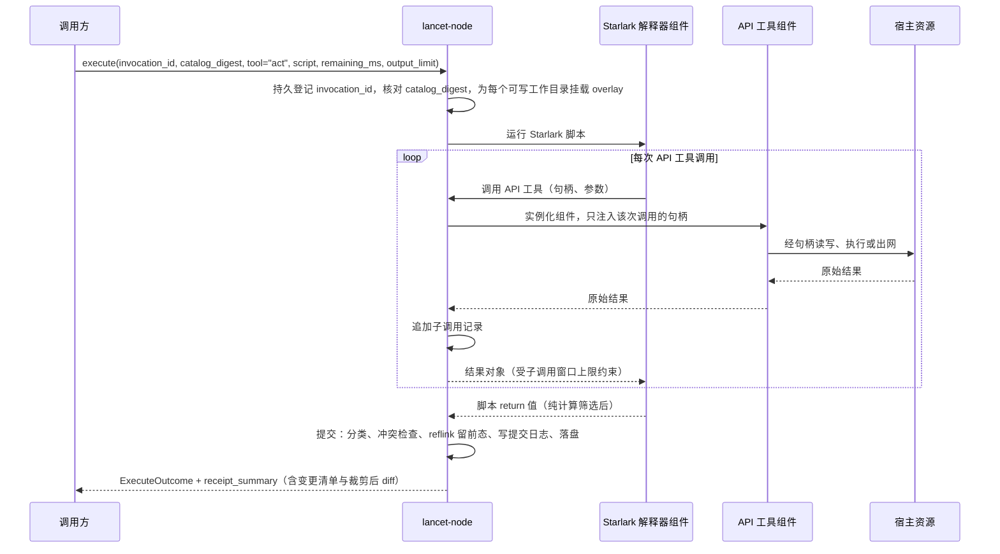

# ADR 0002：`lancet-node` 以 API 工具、宿主资源与写时复制提供 `act`

## 背景

### 来源

- LATTICE 的 [ADR 0009](https://github.com/Skyline10124/lattice/blob/0b261013ceb5f07a3948d2ecc8c8826729e93efa/docs/adr/0009-remove-legacy-lancet-tool-executor.md) 规定新 LANCET 在独立仓库中重写为独立进程 `lancet-node`，对外提供 `act`；方向来自 LATTICE 的 [`#309`](https://github.com/Skyline10124/lattice/issues/309)：模型只有一个入口工具 `act`，脚本在受约束的 API 上组合调用，每个调用声明 `effect` 与 `scope`，结果以回执保存。
- [ADR 0001](0001-lancet-protocol.md) 已将协调层与外部上下文节点的通信契约抽离为通用协议 `lancet-protocol`。本 ADR 规定 `lancet-node` 如何作为该协议在 Linux 软件工作区上的实现，落地编排语言、API 工具、宿主资源隔离与写时复制提交。
- 本 ADR 记录 2026-11-11 维护者与 Agent 的设计讨论结论。讨论中未确认的事项集中在[待裁决](#待裁决)。

### 约束

| 约束 | 出处 |
| --- | --- |
| 节点实现 `hello`、`describe`、`execute`、`cancel`、`receipt`、`revert` 六个操作，遵守持久零重放、目录摘要冻结、五种结局、`output_limit` 载荷上限与后态核对求逆规则 | [ADR 0001 第 3–5 节](0001-lancet-protocol.md#3-六个协议操作) |
| 只支持 Linux 主机 | [项目介绍](../../README.md#环境要求与验证) |

### 已核实的事实

2026-11-11 在开发主机上核实：Rocky Linux 10.2，内核 6.12，SELinux 为 Enforcing，工作区位于 XFS，工具链为 `rustc 1.96.0`。

| 事实 | 核实方式与结果 |
| --- | --- |
| 非特权进程能建立用户、挂载、PID、网络命名空间 | `unshare --user --map-root-user --mount --pid --net --fork` 成功；新网络命名空间内只有 `lo` |
| 非特权进程能设置资源上限 | `systemd-run --user --scope -p MemoryMax=64M` 建出的 cgroup 中 `memory.max` 为 67108864 |
| 非特权进程能在用户命名空间内挂载 `overlayfs` | 以 `userxattr` 选项挂载成功；修改、删除、新建各一个文件后，下层保持原样，上层正好是改动的文件、删除标记与新文件 |
| 上层与下层同在这块 XFS 时，copy-up 不复制数据 | 向 512 MiB 文件追加 1 字节耗时 1 ms，磁盘占用不随文件大小增长 |
| 上层文件能以改名提交到同一文件系统 | 2 万个新文件改名到目标目录耗时 443 ms |
| 工作区所在文件系统支持 reflink | `cp --reflink=always` 成功 |
| `bubblewrap` 可从系统软件源取得，当前未安装 | Rocky 10.2 的 baseos 源提供 0.10.0 |
| `starlark-rust` 能编译为 `wasm32-wasip2` 组件 | `starlark` 0.14.2 编译通过，产物 6.5 MB；组件只导入 WASI 的时钟、标准流、环境与随机数接口，不导入文件系统与套接字 |
| Starlark 组件能在 `wasmtime` 中运行，预编译后启动开销小 | `wasmtime` 49.0.5 命令行运行含函数与列表推导的脚本，结果与原生一致；每次现编译时整个进程耗时 1152 ms，预编译后约 12 ms，原生进程约 6 ms（均含进程启动） |
| `starlark` 0.14.2 语法与标准库边界 | `Dialect::Standard` 默认关闭顶层语句，开启 `enable_top_level_stmt: true` 后支持顶层 `if`、`for` 与提前 `return`；语言无 `while`、递归与 `try / except`，宿主函数返回 `Err` 时调用栈干净退栈；内置 `LibraryExtension::Json`（`json.decode` / `json.encode`），无内置正则模块；实验性 `enable_f_strings` 仅支持裸标识符插值 |

### 尚未核实

| 事项 | 影响的决策 |
| --- | --- |
| 节点进程内实例化解释器组件与 API 工具组件的耗时；上面的数字来自命令行，含进程启动 | 第 4 节 |
| `overlay` 挂载期间下层被其他写者修改时，合并视图是否稳定；内核文档对此不作保证 | 第 6 节 |
| 由节点自行挂载 `overlay` 后交给 `bubblewrap` 使用；软件源中的 0.10.0 没有 `overlay` 参数 | 第 4、6 节 |
| 原生进程经节点代理出网的完整链路 | 第 4 节 |
| 上层与工作目录不在同一文件系统、或文件系统不支持 reflink 时的开销 | 第 6 节 |

## 决策

### 1. 能力完整

`lancet-node` 让模型在工作区里完成开发者在终端里能完成的事。第一个可用版本就具备下列四类能力：

| 能力 | 内容 |
| --- | --- |
| 读与搜 | 读取文件、列目录、按内容与名称搜索、查看当前草稿变更状态与差异 |
| 改 | 新建、精确替换修改与撤回单文件草稿改动 |
| 执行 | 运行原生进程与多阶段进程管道：构建、测试、版本管理与包管理工具 |
| 联网 | 发起 HTTP 请求；原生进程受控访问网络 |

分期交付时推后的是深度：撤销命令、审批、并行调度、远程节点与第三方扩展。能力不因边界机制的实现难度而削减。

### 2. 唯一的定义单元是 API 工具，对外唯一工具是 `act`

`lancet-node` 在 [ADR 0001](0001-lancet-protocol.md#3-六个协议操作) 的 `hello` 中声明 `supports_revert = true`，在 `describe` 的 `tools` 列表中只暴露单一工具 `act`，不把内部单个 API 工具直接暴露为协议层工具。

| 概念 | 规则 |
| --- | --- |
| API 工具 | 节点内部唯一的工具定义单元。每个 API 工具有一份声明：签名、`effect` 类别与 `scope` 类型。`describe` 中的 `environment_summary`、沙箱句柄分发与回执明细均由这份声明推出 |
| 脚本 | 模型传给 `act` 的一段 Starlark，只做编排：持有授权句柄，调用 API 工具，对内存结果做纯计算筛选与组合，最后 `return` 需要进入模型上下文的数据。脚本自身没有 `effect`，也不是工具 |
| `act` | `lancet-node` 对模型可见的唯一工具，输入为脚本字符串。它本身不带任何固有能力 |

除 [ADR 0001 第 4 节](0001-lancet-protocol.md#4-副作用回执与-residue) 定义的 `effect` 与 `residue` 外，节点内部引入两个授权分析术语：

| 术语 | 含义 |
| --- | --- |
| `scope` | 一次 API 调用的副作用被限定的范围。`scope` 类型是一种宿主资源，`scope` 实例是该资源的一个句柄，持有句柄即获得授权 |
| `seam` | 两个 `scope` 的接缝：一次调用产生的副作用，不经额外授权就成为另一个 `scope` 内可被消费的代码或外发材料 |

首批 API 工具：

| API 工具 | `effect` | `scope` 类型 | 说明 |
| --- | --- | --- | --- |
| `fs.read`、`fs.list`、`fs.search` | `Read` | 目录 | 读取文件、列举目录、按正则与路径模式搜索 |
| `fs.status`、`fs.diff` | `Read` | 目录 | 查看当前 `overlay` 草稿相对于工作目录基线的增删改列表与 unified diff |
| `fs.write`、`fs.edit`、`fs.reset` | `Write` | 目录 | 整文件写入、唯一精确匹配替换、将指定路径撤回工作目录基线状态 |
| `proc.run`、`proc.pipe` | `Exec` | 执行环境 | 以参数数组运行单个进程，或用内核 `pipe()` 串联多阶段参数数组（均不经过 `/bin/sh`） |
| `http.fetch` | `Emit` | 网络出口 | 经授权出口发起 HTTP 请求 |

### 3. Starlark 编排、正交过滤与快速失败

解释器固定采用 Starlark（开启 `enable_top_level_stmt = true` 支持顶层 `if`、`for` 与提前 `return`），在保持确定性、有限步终止与无隐式副作用的前提下，按下列规则补齐脚本顺滑度与防错语义：

- **句柄方法绑定**：节点按配置向脚本全局环境注入授权句柄，并在句柄对象上直接绑定对应方法（例如 `lancet.read(...)` 等价转发给 `fs.read(lancet, ...)`，`env.run(...)` 等价转发给 `proc.run(env, ...)`），省去重复传递句柄样板。
- **纯计算正交过滤与两级体积上限**：
  - API 工具保持单一职责，返回原始领域结构，不在每个 API 工具上重复定义文本裁剪参数。
  - 解释器组件内置纯计算的 `json` 模块与基于 Rust `regex` 的链式文本视图（如 `text(s).grep(pattern, before = 0, after = 0).head(n).tail(n)`），不持有任何宿主资源，所有 API 工具返回的字符串均可按自左向右顺序筛选。
  - 两级上限分离：单次 API 工具返回给 Starlark 内存窗口的数据上限设为 MiB 级（建议 8–16 MiB），容纳未过滤的测试日志或响应体供脚本就地筛选；脚本最终 `return` 给协调层的序列化载荷受 `execute.output_limit`（如 64 KiB）约束。超出内存窗口的流式进程输出通过 `proc.pipe` 在内核管道中过滤。
- **默认快速失败与窄显式分支**：
  - 语言层不提供通用 `try / except`，任何未显式声明容忍的错误立即展开调用栈、中止脚本并丢弃整次文件写入草稿。
  - 仅在预期探测点提供显式窄参数：
    1. `fs.read(dir, path, missing_ok = True)`：仅当目标路径不存在（`ENOENT`）时返回 `None`；命中 `hidden` 排除规则、越界路径或编码错误仍立即报错中止。
    2. `proc.run` / `proc.pipe`：默认 `check = True`，子进程非零退出时立即报错中止并附带尾部输出摘要；显式指定 `check = False` 时才把 `{ code, stdout, stderr }` 作为普通数据交回脚本判断。
    3. `http.fetch`：HTTP 4xx/5xx 状态码作为响应对象字段返回；DNS 失败、连接超时或不在出口白名单内的请求立即报错中止。
- **防盲改与草稿关系操作**：
  - 节点不提供跨轮次的脚本栈内挂起断点，也不在每次 `edit` 落盘前强制暂停：模型需要先阅读文件内容再推理修改方案时，拆为“第一轮 `act` 读取并筛出上下文，第二轮 `act` 执行修改与验证”两次调用。
  - `fs.edit` 默认要求旧片段在目标文件中精确出现且仅出现 1 次；匹配 0 次或多于 1 次时立即报错中止，防止批量循环在未进入上下文的文件上误改。
  - 脚本在提交前可通过目录句柄调用 `status()`、`diff()` 检查本次草稿相对于基线的全部改动，或用 `reset(path)` 撤回个别文件的试探性修改；`act` 成功提交后，节点自动在 `receipt_summary` 中填入非 `regenerable` 变更文件列表及受 `output_limit` 裁剪的 unified diff，使真实变更事实进入模型上下文。

脚本编排形态示意：

```python
cfg = lancet.read("Cargo.toml", missing_ok = True)
if cfg == None:
    fail("missing Cargo.toml")

for hit in lancet.search("OldSymbol", glob = "crates/**/*.rs"):
    lancet.edit(hit.path, "OldSymbol", "NewSymbol")

res = env.run(["cargo", "test", "--offline"], cwd = lancet, check = False)
if res.code != 0:
    return {
        "ok": False,
        "code": res.code,
        "failures": text(res.stdout + res.stderr).grep("FAILED|error\\[", after = 5).tail(40),
        "draft_ignored": lancet.status(),
    }
    # 注意：若脚本选择正常 return，overlay 会提交；希望放弃草稿时调用 fail(...) 或 reset(...)

return {
    "ok": True,
    "summary": text(res.stdout).grep("test result:").tail(5),
    "diff": lancet.diff(),
}
```

### 4. 边界由宿主资源承担

规则：**原生能力一律以宿主资源的形式进入，API 工具只通过句柄使用。** 宿主资源是一个小的封闭集合，由节点实现。

| 宿主资源（`scope` 类型） | 句柄代表什么 | 实现 |
| --- | --- | --- |
| 目录 | 一个工作目录及其读写级别 | 节点实现的目录资源，在这一层过滤配置中的 `hidden` 路径 |
| 执行环境 | 一组挂载、资源上限与网络出口 | `bubblewrap`：只挂载句柄列出的目录，网络命名空间为空，到期终止整个 PID 命名空间 |
| 网络出口 | 允许访问的主机清单 | 节点内的放行代理 |

- **API 工具与解释器都是 WASM 组件**，在 `wasmtime` 中运行。API 工具组件实例化时只得到本次调用授权的句柄，没有交给它的资源无从引用。
- **解释器组件不持有任何宿主资源**，只导入调用节点子工具分发的接口。
- **组件预编译后加载。** 每次调用现编译的开销在秒级，节点只加载预编译产物。
- **原生进程经执行环境资源运行。** `proc.run` 与 `proc.pipe` 的声明方式与其他 API 工具相同，操作系统级沙箱是执行环境资源的实现。
- **原生进程经节点代理出网。** 执行环境里的进程处于空网络命名空间，节点把代理地址通过 `HTTPS_PROXY` 等环境变量交给进程；代理按网络出口句柄放行，并把每次连接记入回执。不走代理的连接直接失败。
- **依赖缺失时启动失败。** 配置授予了执行环境而主机缺少可用的 `bubblewrap` 或命名空间能力时，节点启动报错，不退回无沙箱执行。

### 5. 工作区与节点配置

| 概念 | 规则 |
| --- | --- |
| 节点 | 一个独立运行的 `lancet-node` 进程，实现 [ADR 0001](0001-lancet-protocol.md) 协议 |
| 工作区 | 一个 `lancet-node` 对应一个软件工作区。工作区是一组互不重叠的工作目录 |
| 工作目录 | 模型操作的对象。每个工作目录对应一个目录句柄，有自己的名称、读写级别与路径规则；互不重叠在节点启动时校验 |
| 环境目录 | 执行环境句柄挂载的只读工具链、系统库以及直接写的构建/包缓存目录。只有 `proc.*` 能看到，`fs.*` 拿不到它们的句柄 |
| 节点配置与状态目录 | 存放在所有工作目录之外的主机路径，不在被挂载的业务仓库内生成配置文件或状态目录 |

- **策略归节点配置。** 授权、路径规则与网络出口清单只写在节点配置里，由机器所有者维护；协议中没有修改它们的操作。
- **路径规则借用 `.gitignore` 的模式语法**：目录后缀 `/`、`**`、`!` 否定、后写的规则优先，路径相对各工作目录的根计算。节点不读取工作区里的 `.gitignore`。
- **规则默认为空。** 节点不内置默认路径规则，配置模板给出示例。

配置形态示意：

```toml
[[dir]]
name = "lancet"
path = "/home/dev/lancet"
access = "write"
regenerable = ["target/"]        # 可再生：提交时不留前态，不进 diff 摘要
hidden = [".env"]                # 排除：脚本不可见也不可写

[[dir]]
name = "lattice"
path = "/home/dev/lattice"
access = "read"
```

### 6. 文件副作用经写时复制提交与文件级求逆

一次 `act` 的全部工作目录写入先落在 `overlay` 的上层，脚本正常返回时统一提交。文件副作用只有这一条路径，`fs.write`、`fs.edit`、`fs.reset` 与 `proc.*` 共用。



- **每个可写工作目录一个 `overlay`。** 下层是工作目录，上层建在该目录所在的文件系统上；无法满足时节点启动报错。只读工作目录直接只读挂载。
- **执行环境里工作目录保持真实路径**，跨目录的相对引用照常可用。
- **提交时按规则分类。** 节点取得上层的变更清单，逐条按 `regenerable` 规则处理：

| 变更路径 | 留前态 | 进回执明细与 diff 摘要 | 外部写者冲突检查 |
| --- | --- | --- | --- |
| 不匹配 `regenerable` | 留（reflink 到节点状态目录） | 逐个文件列出并生成 diff | 做 |
| 匹配 `regenerable` | 不留 | 只记数量与总字节数 | 不做 |

- **外部写者冲突检查**：非 `regenerable` 目标文件在 `act` 开始之后被工作区外的其他写者改过时，本次提交整体拒绝并丢弃上层，不覆盖外部修改。
- **提交日志与崩溃恢复**：多个文件逐个落盘前先写入持久化提交日志；节点在提交临界区内崩溃时，调用方因断连按 [ADR 0001](0001-lancet-protocol.md#3-六个协议操作) 记为 `Indeterminate`，节点重启重放或回退提交日志后，`receipt` 给出确定的最终事实。

`act` 结束时的结局映射规则：

```text
act 结束时:
    if 脚本正常 return 且序列化字节数 <= output_limit:
        提交全部可写工作目录的 overlay
        if 提交完成:               Succeeded { content, receipt_summary }
        elif 存在外部写者冲突:      丢弃上层 -> Failed(Conflict)
    elif return 值超出 output_limit: 丢弃上层 -> Failed(OutputLimitExceeded)
    elif 脚本 fail 或子调用报错:     丢弃上层 -> Failed(ScriptOrToolError)
    elif 调用方 cancel 或连接断开:  丢弃上层 -> Cancelled
    elif remaining_ms 耗尽:        丢弃上层 -> Deadline
```

- 丢弃上层后，工作目录中的文件副作用未发生；脚本运行期间已发出的网络请求与环境目录缓存写入按实情记入回执的 `residue`。
- **文件级求逆实现**：`lancet-node` 按 [ADR 0001 第 5 节](0001-lancet-protocol.md#5-求逆revert与会话-rewind-的配合) 处理 `revert` 时，对逆序遍历到的每次调用逐文件核对当前文件内容与回执记录的写后摘要：一致则用状态目录中的 reflink 前态原子替换恢复（`Restored`），不一致则保持不动并报告 `Conflict`；匹配 `regenerable` 的文件变更、环境目录缓存写入与已发生的联网报告 `Irreversible(residue)`。

### 7. `scope`、`effect`、`residue` 与 `seam` 在节点内的读取方

声明只有在有一方读取它并据此作决定时才保留。

| 概念 | 节点或外部读取方 | 据此作的决定 |
| --- | --- | --- |
| `scope` | `lancet-node` | 实例化 API 工具组件时注入哪些句柄；回执记录副作用落在哪个目录、环境或出口 |
| `effect` | `lancet-node` | 核对目录句柄的 `read` / `write` 级别是否满足调用；中断丢弃 `overlay` 后判定还剩哪些副作用 |
| `residue` | `lancet-node` 的 `revert`、协调层与用户 | 判定哪些文件可恢复前态，如实报告不可还原项 |
| `seam` | `lancet-node`（及后续审批准入） | 加载配置时识别跨 `scope` 的隐式权限升级并写入日志与 `environment_summary` |

`lancet-node` 中各类副作用到协议 `residue`（见 [ADR 0001 第 4 节](0001-lancet-protocol.md#4-副作用回执与-residue)）的映射：

| 具体副作用 | 协议 `residue` 取值 |
| --- | --- |
| `fs.read` / `list` / `search` / `status` / `diff`，或被丢弃的 `overlay` 草稿 | `None` |
| 已提交到工作目录且留有 reflink 前态的非 `regenerable` 文件变更 | `None`（可经 `revert` 核对后态还原） |
| 已提交到工作目录、匹配 `regenerable` 的文件变更 | `Regenerable` |
| 执行环境缓存目录中的写入 | `InternalState` |
| `http.fetch` 或原生子进程经节点代理发出的网络请求 | `External`（记录目标主机与方法） |

已识别的两类 `seam`：

| `seam` | 例子 |
| --- | --- |
| 可写的工作目录同时挂载进执行环境 | 一次可撤销的 `fs.write` 修改了 `build.rs` 或测试代码，紧接着的 `proc.run` 使其带着执行环境的全部权限运行 |
| 目录读权限与网络出口同时授予同一脚本 | `fs.read` 读到的工作区内容可在同一段脚本内经 `http.fetch` 或代理发出 |

## 待裁决

| 事项 | 建议 |
| --- | --- |
| 第 1 节的能力清单是否完整，例如长时间运行的后台守护进程与交互式输入 | 先按四类实施 |
| 整次 `act` 共享同一组 `overlay`、结束时统一提交 | 采用；代价是脚本运行中的写入在提交前对节点外不可见 |
| API 工具是随节点发布的封闭集合，还是各自独立构建的扩展单元 | 第一个版本作为随节点发布的封闭集合 |
| `seam` 在第一个版本里的处置 | 节点加载配置时列出授权组合产生的 `seam`，写入日志与 `describe` 的 `environment_summary`；审批上线后由准入读取 |
| `hidden` 规则在执行环境内怎样生效；整目录挂载后，原生子进程能看到 `fs.*` 过滤掉的路径 | 待设计（例如在 `bubblewrap` 内对匹配路径做空文件/空目录遮蔽挂载） |
| `revert` 是否进入第一批实现 | 接口按 [ADR 0001](0001-lancet-protocol.md) 定稿，前态从第一个版本开始留存；`revert` 执行逻辑排在 `execute` 闭环之后 |

## 归属

协议帧、`node_id`、持久调用去重与会话树的归属见 [ADR 0001 归属表](0001-lancet-protocol.md#归属)；下表列出 `lancet-node` 内部概念的归属。

| 概念 | 状态持有者 | 规则执行者 | 只使用结果的组件 |
| --- | --- | --- | --- |
| 工作区组成、授权、路径规则与网络白名单 | 节点配置文件 | `lancet-node`（启动校验、实例化组件、挂载与代理放行） | 调用方、Starlark 脚本 |
| API 工具声明 | 随节点发布的静态声明 | `lancet-node`（生成 `act` 说明、`catalog_digest` 与句柄绑定） | 模型、调用方 |
| 脚本控制流与纯计算过滤结果 | Starlark 解释器组件线性内存 | Starlark 解释器组件 | `lancet-node`（接收最终 `return` 值） |
| 单次 `act` 未提交的文件草稿 | 该次调用各可写目录的 `overlay` 上层 | `lancet-node`（`status`/`diff`/`reset` 查询，结束时提交或丢弃） | 脚本 |
| reflink 前态文件与提交日志 | 节点状态目录 | `lancet-node`（提交落盘、崩溃恢复与 `revert` 还原） | 调用方 |

## 否决的方案

| 方案 | 否决理由 |
| --- | --- |
| 用 TypeScript/QuickJS 或 Python 取代 Starlark，开放通用 `try / catch` 与可选链兜底 | 宽泛 `catch` 会连同方法名拼写错误、`hidden` 越权拒绝与半截失败一并吞掉并正常返回，导致脏 `overlay` 被误提交；JS 可选链与空值合并（如拼错字段名退化为 `undefined ?? 0`）会静默掩盖错误 |
| 在各个 API 工具参数上分别添加 `grep`、`head`、`tail` 等过滤选项 | 违反单一职责并在工具间重复定义；未专门加过滤参数的工具（如 `http.fetch`）返回中等体积文本时仍无从在沙箱内筛选 |
| 为模型提供跨轮次的解释器栈内挂起断点（`pause / resume`），或在每次 `fs.edit` 落盘前强制暂停确认 | 模型在读到文件内容前无法预写断点下半段的具体修改逻辑，“先读入上下文、推理后再改”天然拆成两次 `act` 即可；已有 reflink 前态与 `revert` 兜底时，每次编辑强制暂停只会成倍增加推理轮次 |
| `proc.run` 接受 shell 命令字符串以换取管道简写 | 引入命令注入、多层引号转义错误与宿主 shell 环境差异；解释器内的链式正则过滤与参数数组形式的 `proc.pipe` 已覆盖筛选需求 |
| 脚本进程单独设沙箱，API 降为节点内置宿主函数 | 出现两套定义；API 声明的 `effect` 与 `scope` 只剩文档意义 |
| 以 Landlock 与 seccomp 的进程沙箱作为统一边界 | 授权是套在进程上的路径规则而非句柄，无法在已授权目录下精细排除 `hidden` 子路径 |
| 第一个版本只做只读 API、不含进程执行或完全断网 | 缺少完成真实软件工程任务所需的基础能力 |
| 进程执行时整体放开宿主网络 | 出口不受白名单约束，也无法按连接记入回执 `residue` |
| 原生进程直接写工作目录，只对 `fs.write` / `fs.edit` 留前态 | `proc.run` 改了哪些文件事先不可知，无法留前态，中断后只能记为不确定 |
| 目录按挂载分成写时复制与直接写两种 | `regenerable` 按文件模式匹配，而挂载只能按目录划分；同文件系统上的 `overlay` 提交实测开销可接受 |
| 读取工作区内的 `.gitignore` 作为路径规则，或把规则文件放进工作区版本库 | 被 Git 忽略不等于可再生；规则文件若位于可写工作区内，脚本即可自行篡改边界策略 |
| 一个 `lancet-node` 实例同时服务多个工作区 | 一个节点对应一个工作区身份；多仓库协作由同一工作区内的多个工作目录句柄表达 |
| 以微虚拟机承载执行环境 | LATTICE ADR 0002 的经验表明，工作区投影、保存点与合并机制远多于本场景所需 |

## 影响

### 平台与依赖

| 项 | 影响 |
| --- | --- |
| 内核能力 | 需要非特权用户命名空间、用户命名空间内的 `overlayfs`（`userxattr`）与 cgroup 委派；缺失时节点启动失败 |
| 文件系统 | `overlay` 上层与对应工作目录须同处一个文件系统；支持 reflink 时 copy-up 与前态留存不复制数据块 |
| `bubblewrap` | 授予执行环境时为主机必需依赖，由机器所有者安装 |
| `wasmtime` | 成为 `lancet-node` 的宿主依赖。`wasmtime` 50 要求 `rustc 1.97`，本仓库当前固定 `1.96.0`；引入时选用 49 系列，或先升级工具链 |
| Rust 目标与组件依赖 | 构建解释器与 API 工具组件需要 `wasm32-wasip2`；解释器组件内嵌 `starlark` 0.14 与 `regex` |

### 文档

| 文档 | 处理 |
| --- | --- |
| [领域术语表](../reference/glossary.md) | 本 ADR 与 [ADR 0001](0001-lancet-protocol.md) 接受后写入：工作区、工作目录、环境目录、API 工具、宿主资源、`scope`、`seam`、前态 |
| `docs/architecture/` | 随实施建立架构合同：`act` 与 Starlark 编排、宿主资源与沙箱、写时复制提交与求逆、节点配置 |
| [项目介绍](../../README.md) | 随第一个业务 crate 更新当前状态 |

### 实施

实施顺序与切片另开实施跟踪票，按票分别授权。在 [ADR 0001](0001-lancet-protocol.md) 与本 ADR 接受之前，仓库不建业务 crate。

### 与其他 ADR 的关系

| ADR | 关系 |
| --- | --- |
| [ADR 0001](0001-lancet-protocol.md) | 本 ADR 是 `lancet-protocol` 在 Linux 软件工作区节点上的首个完整实现设计 |
| LATTICE ADR 0009 | 与 [ADR 0001](0001-lancet-protocol.md) 共同承接其第 7 节，落地独立 `lancet-node` 进程与单一 `act` 工具面 |
