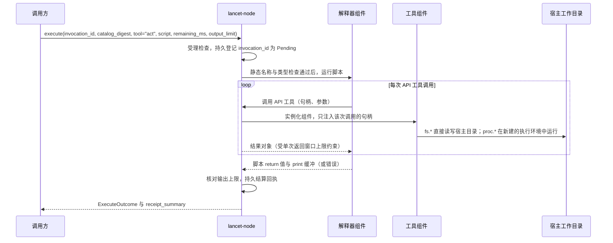

# `lancet-node`

`lancet-node` 是[外部上下文节点协议](../lancet-protocol.md)在 Linux 软件工作区上的实现。它对外只提供一个工具 `act`：模型传入一段 Starlark 脚本，脚本持有授权句柄，组合调用 API 工具。可写目录的写入直接落在宿主工作目录上并立即生效；原生进程在每次调用新建的执行环境中运行。

术语的定义见[领域术语表](../../reference/glossary.md#lancet-node)，决策理由与取代关系见 [ADR 0002](../../adr/0002-lancet-node-api-tools-and-act.md) 与 [ADR 0003](../../adr/0003-direct-workspace-and-per-call-sandbox.md)。

| 合同 | 内容 |
| --- | --- |
| [节点配置与工作区](config.md) | 配置文件、启动校验、节点状态目录、环境简述与 `seam` 边集 |
| [API 工具与工具基座](tools.md) | 工具声明与宿主接口 `lancet:host`、声明加载、分发、组件运行时、首批 API 工具、effect 与 `residue` |
| [`act` 与 Starlark 编排](act.md) | 解释器、`act` 的说明与全局环境、快速失败、交回载荷与上限、`act` 的结局 |
| [宿主资源](host-resources.md) | 目录、执行环境与网络出口 |

## 能力

节点让模型在工作区里完成开发者在终端里能完成的事。第一个可用版本具备下列四类能力：

| 能力 | 内容 | 提供者 |
| --- | --- | --- |
| 读与搜 | 读取文件、列目录、按内容与名称搜索 | `fs.read`、`fs.list`、`fs.search` |
| 改 | 新建、覆盖写入与精确替换修改（直接写宿主，立即生效） | `fs.write`、`fs.edit` |
| 执行 | 运行原生进程与多阶段进程管道：构建、测试、版本管理与包管理工具 | `proc.run`、`proc.pipe` |
| 联网 | 发起 HTTP 请求；原生进程受控访问网络 | `http.fetch`；执行环境经网络出口代理出网 |

分期交付时推后的是深度（见[范围之外](#范围之外)）；能力不因边界机制的实现难度而削减。

## 概念

| 概念 | 含义 | 状态持有者 | 生命周期 |
| --- | --- | --- | --- |
| `act` | 节点在 `describe` 中暴露的唯一工具，输入是一段 Starlark 脚本，本身不带固有能力 | 节点 | 随节点版本 |
| 脚本 | 模型传给 `act` 的 Starlark：持有授权句柄、调用 API 工具、对内存结果做纯计算并交回结果；自身不产生 effect，不是工具 | 解释器组件 | 一次 `act` |
| API 工具 | 节点内部唯一的工具定义单元：一个 WASM 组件，声明是它导出的 WIT 接口 | 工具组件二进制 | 随节点版本 |
| 宿主资源 | 原生能力进入节点的唯一形式，即句柄的种类：目录、执行环境、网络出口 | 节点实现，封闭集合 | 随节点版本 |
| 句柄 | 节点配置授予的一个宿主资源实例 | 节点配置 | 随配置 |
| 工作区 | 一组互不重叠的工作目录；一个节点只对应一个工作区 | 节点配置 | 随配置 |
| 工作目录 | 模型操作的对象：宿主上的一个目录，对应一个目录句柄 | 节点配置 | 随配置 |
| 执行环境实例 | 一次 `proc.*` 调用的隔离执行环境与进程组 | 节点 | 一次 `proc.*` 调用 |

## 组件与职责

| 组件 | 持有的状态 | 执行的规则 | 对外接口 |
| --- | --- | --- | --- |
| 协议服务 | `node_id`、调用记录账本与回执（节点状态目录） | [协议合同](../lancet-protocol.md)中节点一侧的规则 | Unix 域套接字上的五个协议操作 |
| 配置加载 | 解析后的节点配置 | 启动校验；推出环境简述、`seam` 边集与 `catalog_digest`（[配置](config.md)） | 节点内部 |
| 声明加载 | 读出的工具声明与预编译产物 | 读出并核对声明，推出 effect 与 co-effect 模板，渲染 `act` 的类型存根与 Starlark 类型（[声明加载](tools.md#声明加载)） | 节点内部 |
| 分发层 | 本次 `act` 已记录的 ε | 核对 κ，只注入本次调用的句柄，核对 ε 不越出模板（[分发](tools.md#分发)） | 解释器组件导入的子工具分发接口 |
| 解释器组件 | 脚本的求值状态（组件线性内存） | 静态名称与类型检查、求值、纯计算过滤（[`act`](act.md)） | `act` 的脚本 |
| 工具组件 | 无跨调用的状态 | 工具自身的逻辑，只经注入的句柄触及宿主资源 | 导出的 WIT 接口 |
| 宿主资源实现 | 宿主目录根 fd、执行环境实例、出口代理 | 目录直接读写与根内边界约束、执行环境的建立与终止、出口放行（[宿主资源](host-resources.md)） | 宿主接口 `lancet:host` |

工具基座由 API 工具声明、分发层与配置加载组成。effect、co-effect、`residue` 与 `seam` 只在工具基座中读取并据以决定，脚本不标注、不感知它们。

## 流程

### 一次 `act` 的执行

| 步骤 | 规则所在 |
| --- | --- |
| 受理检查、登记与结算 | [协议合同](../lancet-protocol.md#execute-的受理与结局) |
| 静态检查与运行脚本 | [`act` 与 Starlark 编排](act.md#执行流程) |
| API 工具的分发 | [API 工具与工具基座](tools.md#分发) |
| 目录读写与执行环境 | [宿主资源](host-resources.md#目录) |
| 结局 | [`act` 与 Starlark 编排](act.md#结局) |

## 状态

| 有状态的对象 | 状态与迁移 |
| --- | --- |
| 调用记录 | [协议合同](../lancet-protocol.md#调用记录) |
| 执行环境实例 | [宿主资源](host-resources.md#执行环境) |

## 范围之外

| 职责 | 现状 |
| --- | --- |
| 撤回已发生的改动 | 不提供；写入直接生效，节点不保留前态、不提供求逆 |
| 审批 | 推后，见[尚未承接](#尚未承接) |
| 并行调度 | 推后 |
| 远程节点 | 推后；远程传输尚待裁决，见[协议合同](../lancet-protocol.md#尚未承接) |
| 第三方 API 工具的安装、分发与信任配置 | 推后；第一个版本只发布首批工具，见 [API 工具与工具基座](tools.md) |
| `act` 交回的 `content` 离开节点后的去向 | 调用方 |

## 尚未承接

| 事项 | 现状 |
| --- | --- |
| 能力清单是否还缺交互式输入 | 待裁决，先按四类能力实施，见 [ADR 0002 待裁决](../../adr/0002-lancet-node-api-tools-and-act.md#待裁决) |
| 审批：依据什么、在哪里询问用户 | 待设计审批时裁决；[ADR 0002 第 7 节](../../adr/0002-lancet-node-api-tools-and-act.md#seam-边集与询问)以 `seam` 为依据的询问设想，届时重新考虑 |

其余待裁决与尚未核实的事项列在各子合同的“尚未承接”与“保证”中。

## 验证

- `cargo xtask docs-check`：各合同的链接与锚点有效。
- 各子合同的“验证”一节列出对应的验证入口。
