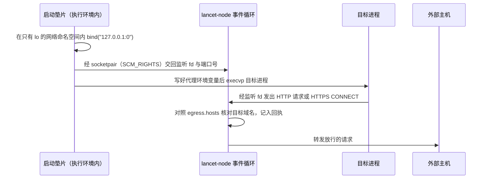

# 宿主资源

原生能力只以宿主资源的形式进入 `lancet-node`，API 工具只经句柄使用它们。宿主资源是由节点实现的封闭集合：目录、执行环境与网络出口。它们的实现决定脚本与子进程能看到、写到、发到哪里。

## 概念

| 宿主资源（句柄种类） | 句柄代表什么 | `lancet:host` 资源类型 | 实现 |
| --- | --- | --- | --- |
| 目录 | 宿主上的一个工作目录及其读写级别 | `read-dir`、`write-dir` | 节点实现的目录资源（读与写共用同一个经核验的宿主根 fd） |
| 执行环境 | 一组工作目录挂载、只读工具、私有缓存、环境变量与资源隔离 | `exec-env` | 每次 `proc.run` 或 `proc.pipe` 新建的 `bubblewrap` 沙箱、Landlock 与 cgroup v2 叶组 |
| 网络出口 | 允许访问的主机域名清单（`hosts`） | `egress` | 节点内的域名白名单放行代理，随 [#9](https://github.com/Skyline10124/lancet/issues/9) 实现 |

| 概念 | 含义 | 状态持有者 | 生命周期 |
| --- | --- | --- | --- |
| 执行环境实例 | 一次 `proc.run` 或 `proc.pipe` 调用的隔离 `bubblewrap` 沙箱与 cgroup v2 叶组 | 节点 | 一次 `proc.run` 或 `proc.pipe` 调用 |
| 出口代理 | 节点内按域名放行的 HTTP 代理（归 [#9](https://github.com/Skyline10124/lancet/issues/9)） | 节点 | 节点进程 |
| 启动垫片 | 挂入 `/run/lancet-init` 的 PID 1 程序：施加 Landlock、按阶段建立内核管道并启动和回收前台进程、监听控制管道并经状态 fd 报告启动结果 | 执行环境实例 | 一次 `proc.run` 或 `proc.pipe` 调用 |

## 组件与职责

| 组件 | 持有的状态 | 执行的规则 | 对外接口 |
| --- | --- | --- | --- |
| 目录资源 | 经核验的宿主目录根 fd | 按根内约束直接读写宿主目录 | `read-dir`、`write-dir` 的方法 |
| 执行环境资源 | 已解析的挂载槽位、私有家目录根 fd、固定来源的工具 fd、私有缓存根 fd、cgroup 委派根与垫片 fd | 每次 `proc.run` 或 `proc.pipe` 新建沙箱与叶组，调用结束、取消、断连或超时整组终止并回收 | `exec-env` 的方法 |
| 出口代理 | 代理的监听与连接（归 [#9](https://github.com/Skyline10124/lancet/issues/9)） | 对照 `egress.hosts` 放行，每次外发记入回执 | `egress` 的方法；执行环境内的代理端口 |

## 目录

- 只读与可写工作目录都直接对应宿主目录，读和写共用同一个经核验的宿主根 fd。
- 目录中所有路径一视同仁，包括 `.git`、点文件与构建目录，不做路径规则过滤。
- `fs.*` 只能拿到工作目录的句柄；[环境目录](config.md#概念)只在执行环境中可见。

目录资源按下面的规则解析工具给出的路径：

```text
解析 path:
    if path 是绝对路径，或含 ..:                      报错：越出目录
    自根逐个分量解析，内核不跟随符号链接:
        遇到符号链接:                                 读出目标，接在其余分量之前继续解析
            目标是绝对路径，或其中的 .. 越过根:       报错：越出目录
        目标不存在（ENOENT）:
            读取与列举:                               返回 none
            写入:                                     建立缺少的上级目录和目标文件；路径末尾要求目录时报错
    按方法读取、列举或写入
```

- 路径相对工作目录的根，`""` 与 `"."` 都表示根。
- 每个分量都从根目录的 fd 以 `RESOLVE_BENEATH | RESOLVE_NO_SYMLINKS` 打开，在同一个 fd 上取类型、读出链接目标。一次解析最多跟随 40 个符号链接，超出即报错。
- 列举中的符号链接子项，按“列举目录的访问路径加子项名”从根解析，与直接访问的结论一致。
- 报错写明调用者给出的路径与原因，不写出链接目标或宿主绝对路径。
- `read` 只读取普通文件；内容须是 UTF-8 文本，大小不超过工具实例的内存上限 128 MiB（[组件运行时](tools.md#组件运行时)）。
- `write` 直接写宿主目录：在已核验的上级目录内写临时文件，再 `rename` 就位；内容与已有文件相同时不发生写入；缺少的上级目录自动创建；替换已有普通文件时保留其权限。
- 写入在修改之前核对解析后的真实根相对路径是否为有效 UTF-8，并核对路径长度不超过系统上限：任一分量不超过 255 字节，目标绝对路径不超过 4,095 字节（`PATH_MAX` 为 4,096 字节，含结尾的 NUL）。
- `entries` 只列出按上面的规则可以访问的普通文件、目录与指向它们的链接。以下子项不列出：取不到类型的子项；解析失败、悬空或越出目录的链接；FIFO、套接字与设备文件。可见子项的名称不是 UTF-8 时，`entries` 报错。

## 执行环境

每次 `proc.run` 或 `proc.pipe` 调用新建一个 `bubblewrap` 沙箱与独占的 cgroup v2 叶组；执行环境不跨调用保留进程。

### 沙箱建立与挂载表

节点直接启动 `/usr/bin/bwrap`（非 setuid，使用用户命名空间），参数为 `--unshare-all --unshare-user --die-with-parent --as-pid-1 --new-session --clearenv --uid <节点 uid> --gid <节点 gid>`，按下方挂载表挂入文件系统，最后 `--remount-ro / --chdir <已解析的 cwd> -- /run/lancet-init …`。节点新建的 fd 一律设置 `CLOEXEC`，子进程仅在 `pre_exec` 中对列明的挂载 fd、控制 fd 与状态 fd 清除 `CLOEXEC`。

| 沙箱内位置 | 来源与权限 |
| --- | --- |
| `/usr` | 宿主，只读 |
| `/bin`、`/sbin`、`/lib`、`/lib64` | 宿主上是指向 `usr/…` 的链接时用 `--symlink` 重建，是独立目录时只读绑定 |
| `/etc` | 宿主，整体只读 |
| 宿主家目录的原绝对路径 | 私有家目录，来源 `<state_dir>/envs/<env.name>/home`，权限 `0700`，可写；跨调用、跨节点重启保留文件 |
| `env.tools` | 每个目录或普通文件按展开后的原路径只读挂入，先固定来源 fd 再经 `--ro-bind-fd` 交给 bwrap |
| `env.mounts` | 只挂列名的工作目录，目的地是工作目录的真实绝对路径；`read` 用 `--ro-bind-fd`，`write` 用 `--bind-fd`，写入直接落到宿主 |
| `env.caches` | 每个环境自己的私有副本，挂在配置的原路径，可写；来源位于 `<state_dir>/envs/<env.name>/caches/` |
| `/tmp` | `--tmpfs /tmp`，权限 `01777`，每次调用新建，随命名空间销毁 |
| `/proc` | `--proc /proc` |
| `/dev` | 私有 tmpfs，再用 `--dev-bind` 挂 `null`、`zero`、`random`、`urandom` 四个设备 |
| `/run/lancet-init` | 节点自带的垫片，只读，最后挂 |

- **挂载顺序与符号链接防护：** 私有家目录里的子挂载按“父先子后”建立。挂载前从私有家目录的根 fd 逐级打开挂载点路径、不跟随符号链接；遇到符号链接时本次调用报错。
- **缓存播种：** 每个私有缓存只播种一次，在状态目录的独占锁内完成。播种先在同级临时目录里构造副本，普通文件用 `FICLONE` 写时复制克隆，遍历不跟随符号链接；成功后原子改名就位，失败清掉临时目录，已就位的副本直接复用。Cargo registry（`…/.cargo/registry` 或 `…/cargo/registry`）只播种 `cache/` 与 `index/`，`src/` 留给 Cargo 在私有目录内自行解压。
- **环境变量：** 从空环境开始，只设三类：
  - `HOME`：宿主家目录的原路径；
  - `PATH`：`/usr/local/bin:/usr/bin:/bin`，后面按配置顺序追加 `env.path`；
  - `env.vars`。

  垫片自身运行在 `--clearenv` 的空环境里，配置的环境变量只传给目标进程。

### 启动垫片与 Landlock

随包提供的 `/run/lancet-init` 作为沙箱内的 PID 1，按顺序执行：

1. 在最终挂载视图里建立 Landlock 规则集：处理 `WRITE_FILE`、`TRUNCATE`、`REFER`、`REMOVE_DIR`、`REMOVE_FILE` 与全部 `MAKE_*` 权限；向可写工作目录、私有家目录、私有缓存与 `/tmp` 授予普通文件树写权限（不含 `MAKE_CHAR` 与 `MAKE_BLOCK`）；向 `/dev/null` 单独授予 `WRITE_FILE`。设置 `PR_SET_NO_NEW_PRIVS` 并调用 `landlock_restrict_self`。
2. Landlock 生效后自左向右逐段启动前台子进程，确认当前阶段已 `execve` 成功才启动下一段。相邻阶段间滚动建立 `pipe2(O_CLOEXEC)`（首段 stdin 继承 `/dev/null`，末段 stdout 继承节点输出管道，各段继承同一 stderr）；子进程恢复信号掩码与默认 `SIGPIPE`，关闭 0、1、2 与本段启动报告写端以外的全部 fd，按目标 `envp` 中的 `PATH` 查找可执行文件并直接 `execve`（不经过 shell）；父进程立即关闭上一段读端与本段写端，使下游退出后上游写入收到 `SIGPIPE`。
3. 首段确认启动后立即经专用状态 fd 向节点发送 `O`；任一段启动失败（如 `ENOENT`、`ENOEXEC`、`EACCES`）时报告阶段序号与错误、不再启动后续阶段并立即退出。
4. 回收全部前台阶段（及收养的后代）并同时监听节点持有的控制管道。所有前台阶段都退出后，PID 1 以 pipefail 退出码（自右向左首个非零码，全零为 `0`）退出；控制管道到达 EOF（节点消失）时立即退出，内核随之终止 PID 命名空间里的全部其余进程。

### cgroup v2、中断与回收

- 节点配置了 `[[env]]` 时，启动期要求取得全新的专用 cgroup v2 委派根 `D`（除节点自身外无其他进程，且不含任何已有子组）：创建 `D/node` 并将节点自身迁入，再向无内部进程的 `D/cgroup.subtree_control` 写入 `+memory`。
- 每次 `proc.run` 或 `proc.pipe` 在 `D` 下创建独占叶组 `call-<唯一编号>`，写入固定的 `memory.max = 8589934592`（8 GiB）与 `memory.oom.group = 1`；在启动 `bwrap` 的 `pre_exec` 中向预先打开的叶组 `cgroup.procs` 写 `0`，使 `bwrap` 在首次 fork 前即位于该叶组中。
- 宿主在执行线程中通过单次最多等待 10 ms 的 `poll` 循环并行排空 stdout 与 stderr（每路每轮最多读 64 KiB 即回到 `poll`）、观察状态 fd 与 `bwrap` 退出，并检查取消标志与截止时间。
- 节点活着时，正常结束、取消、断连、截止与异常收尾都在统一的结算时限（截止时间加 5 秒结算宽限）内完成：向叶组 `cgroup.kill` 写 `1`、回收 `bwrap`、将状态管道读到 EOF、等待 `cgroup.events` 出现 `populated 0`、读取 `memory.events.local` 判断是否 OOM，然后删除叶组再结算。
- 节点被 `SIGKILL` 强制终止时，`--die-with-parent` 与控制管道 EOF 使沙箱 PID 1 退出，内核立即终止命名空间内的全部进程。
- 触发 cgroup OOM 时返回 `Failed(ScriptOrToolError)`，诊断写明沙箱内存上限；节点自身的挂载、垫片、cgroup 或回收故障结算为 `Failed(InternalError)`。

### 网络隔离

当前阶段执行环境处于独立的网络命名空间，其中只有回环接口 `lo`，与宿主回环监听器隔离且无法直连外部网络。受控出网代理归 [#9](https://github.com/Skyline10124/lancet/issues/9)。

## 网络出口

网络出口代理随 [#9](https://github.com/Skyline10124/lancet/issues/9) 实现。当前版本中执行环境使用独立的网络命名空间，仅含 `lo`；待 [#9](https://github.com/Skyline10124/lancet/issues/9) 实施后按下列设计经节点代理出网：



- 执行环境的子进程处于只有 `lo` 的隔离网络命名空间，只能经节点的出口代理出网。沙箱内没有常驻的转发进程，工作目录内不挂套接字文件。
- 启动垫片设置 `HTTPS_PROXY` / `https_proxy` 与 `HTTP_PROXY` / `http_proxy`。
- 出口代理对明文 HTTP 的 `Host` 与 HTTPS `CONNECT` 的目标域名对照 `egress.hosts` 放行，每次外发在回执中记一条 `External { host }`；拒绝直连、字面量裸 IP，以及解析到回环、链路本地与私网网段的目标。
- `http.fetch` 经网络出口句柄外发，适用同样的放行与记录规则。
- 首阶段只按域名校验，不做 TLS 中间人解包。

| 外发控制层 | 手段 | 读取方与决定 |
| --- | --- | --- |
| 出口清单 | 网络出口句柄限定允许访问的主机域名 | 出口代理逐个请求放行或拒绝 |
| 组合展示 | 推出的机密性边写入环境简述（[`seam` 边集](config.md#环境简述与-seam-边集)） | 调用方展示给用户；机器所有者据此在配置中收窄授权 |
| 回执 | 每次外发记 `External { host }` | 调用方核对，用户事后审计 |

已接受的残余风险：首阶段不做 TLS 中间人解包，被允许的主机本身能接收任意数据（如 issue、gist 或查询串载荷）时，域名清单拦不住。

## 保证

| 保证 | 适用范围 | 成立条件 | 依据或验证 |
| --- | --- | --- | --- |
| 每次 `proc.*` 结束后，执行环境内没有存活的进程 | 每次 `proc.*` | 每次新建沙箱与 cgroup 叶组，结束、取消、断连或超时写 `cgroup.kill` 并等 `populated 0`；节点异常退出时 `--die-with-parent` 与控制管道 EOF 触发 PID 1 退出 | [ADR 0002 第 4 节](../../adr/0002-lancet-node-api-tools-and-act.md#4-边界由宿主资源承担)、[ADR 0003](../../adr/0003-direct-workspace-and-per-call-sandbox.md)；`crates/lancet-node/tests/node/exec_env.rs` |
| 子进程只能经出口代理出网，每次外发都记入回执 | 持有网络出口的执行环境 | 隔离网络命名空间只有 `lo`；代理放行时记录 | ADR 0002 第 4 节；已核实 `SCM_RIGHTS` 跨命名空间传递监听 fd |
| 只读目录句柄读不到工作目录以外的内容 | 每个只读目录句柄 | 每个分量都从根目录的 fd 以 `RESOLVE_BENEATH` 与 `RESOLVE_NO_SYMLINKS` 打开；符号链接由节点解析，`..` 不越过根，绝对路径的链接报越界 | `crates/lancet-node/tests/node/calls.rs::symlinks_follow_only_within_dir` |

## 范围之外

| 职责 | 现状 |
| --- | --- |
| 跨调用保留的执行环境与后台进程 | 不提供；每次 `proc.*` 结束即终止执行环境 |
| 按命令白名单限制可运行的程序 | 不提供 |
| TLS 中间人解包 | 不做，见上文的残余风险 |
| 审批 | 推后，见 [`lancet-node` 尚未承接](README.md#尚未承接) |
| `act` 交回的 `content` 离开节点后的去向 | 调用方 |

## 尚未承接

| 事项 | 现状 |
| --- | --- |
| 网络出口代理与 `egress` 句柄 | 由 [#9](https://github.com/Skyline10124/lancet/issues/9) 实现 |

## 验证

- `cargo xtask docs-check`：本合同的链接与锚点有效。
- `cargo test -p lancet-node --lib --bin lancet-init`：状态管道解析器时序，以及垫片多阶段参数解码与 pipefail 退出码。
- `cargo test -p lancet-node --test node`：目录资源的路径解析、符号链接边界与直接读写宿主，以及执行环境的挂载隔离、环境与网络隔离、私有家目录与缓存持久化、取消/断连/截止/SIGKILL 回收（含多阶段管道与 `setsid` 后代）、cgroup OOM 隔离与 `proc.run` / `proc.pipe` 回执。
- 网络出口的测试随 [#9](https://github.com/Skyline10124/lancet/issues/9) 建立；建立后写入保证表。
