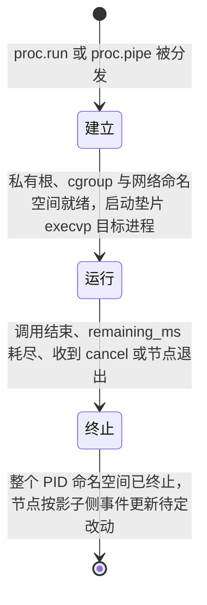
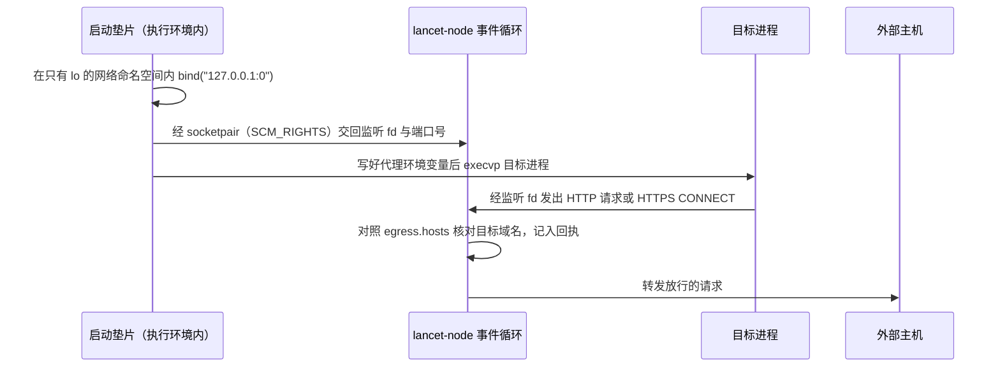

# 宿主资源

原生能力只以宿主资源的形式进入 `lancet-node`，API 工具只经句柄使用它们。宿主资源是由节点实现的封闭集合：目录、执行环境与网络出口。它们的实现决定脚本与子进程能看到、写到、发到哪里。

## 概念

| 宿主资源（句柄种类） | 句柄代表什么 | `lancet:host` 资源类型 | 实现 |
| --- | --- | --- | --- |
| 目录 | 一个工作目录及其读写级别 | `read-dir`、`write-dir` | 节点实现的目录资源 |
| 执行环境 | 一组挂载、内存上限与网络出口 | `exec-env` | `bubblewrap` 按[挂载表](#挂载表)建立的私有根（`user`、`mount`、`pid`、`net` 命名空间），以及单独的 cgroup |
| 网络出口 | 允许访问的主机域名清单（`hosts`） | `egress` | 节点内的域名白名单放行代理 |

| 概念 | 含义 | 状态持有者 | 生命周期 |
| --- | --- | --- | --- |
| 执行环境实例 | 一次 `proc.*` 调用的私有根、cgroup 与进程 | 节点 | 一次 `proc.*` 调用 |
| 私有家目录 | 执行环境中的 `$HOME` | 节点状态目录 | 跨调用保留 |
| 私有包缓存 | 宿主包缓存的私有副本，放在私有家目录中 | 节点状态目录 | 首次从宿主缓存 reflink 复制，之后只写私有副本 |
| 出口代理 | 节点内按域名放行的 HTTP 代理 | 节点 | 节点进程 |
| 启动垫片 | 执行环境内交回监听 fd、再执行目标进程的程序 | 执行环境实例 | 一次 `proc.*` 调用 |

## 组件与职责

| 组件 | 持有的状态 | 执行的规则 | 对外接口 |
| --- | --- | --- | --- |
| 目录资源 | 无（可写工作目录的状态在影子中） | 只读目录读宿主，可写目录读写影子；过滤 `hidden` 路径 | `read-dir`、`write-dir` 的方法 |
| 执行环境资源 | 执行环境实例 | 按挂载表建立私有根，设 `memory.max`，在终止时机终止整个 PID 命名空间 | `exec-env` 的方法 |
| 出口代理 | 代理的监听与连接 | 对照 `egress.hosts` 放行，每次外发记入回执 | `egress` 的方法；执行环境内的代理端口 |

## 目录

- 只读工作目录直接读宿主；可写工作目录的读写都落在[影子工作区](shadow-workspace.md)上。
- 目录资源在这一层过滤配置中的 `hidden` 路径：`fs.*` 访问 `hidden` 路径时报错，列举与搜索的结果不含它们。
- `fs.*` 只能拿到工作目录的句柄；[环境目录](config.md#概念)只在执行环境中可见。

## 执行环境

- **每次 `proc.*` 新建执行环境。** 调用结束、`remaining_ms` 耗尽、收到 `cancel` 或节点退出时，节点终止整个 PID 命名空间；执行环境不跨调用保留进程。
- **只设内存上限。** 每个执行环境放在单独的 cgroup 中，节点设置 `memory.max`；进程数与磁盘占用不设上限，由上一条的终止时机兜底。
- **不限定可运行的程序。** 子进程能看到、写到、发到哪里，由挂载表与网络出口决定，与运行的是哪个程序无关。解释器（如 `python3`）与构建、测试工具一样在这些约束内运行；嵌套的命名空间也解除不了只读挂载。
- **不拦截写系统调用。** 子进程的写入只落在私有挂载上，执行环境不使用 seccomp 用户态通知、`ptrace` 与 Landlock。执行环境经 `bubblewrap` 装入的 seccomp 过滤器对 `io_uring_setup` 返回 `ENOSYS`。
- **原生进程只经执行环境运行。** `proc.run` 与 `proc.pipe` 的声明方式与其他 API 工具相同，操作系统级沙箱是执行环境资源的实现。

### 挂载表

沙箱里的绝对路径与宿主一致。全部可写挂载的来源都在节点状态目录内，由[启动校验](config.md#启动校验)核对。

| 沙箱内路径 | 来源 | 读写 |
| --- | --- | --- |
| 系统目录（`/usr`、`/etc` 等） | 宿主 | 只读 |
| `$HOME`（宿主家目录的原路径） | 节点状态目录中的私有家目录；其中的 `.gitconfig` 由节点生成，只含 `user.name` 与 `user.email` | 可写 |
| `tools` 列出的路径（目录或单个文件，如 `~/.rustup`、`~/.cargo/bin`） | 宿主，按原路径挂载；家目录下的路径挂进私有家目录中的原路径 | 只读 |
| 包缓存（`caches` 列出的路径，如 `~/.cargo/registry`、`~/.npm`） | 私有家目录中的副本，首次从宿主缓存 reflink 复制；cargo 只复制 `registry/cache` 与 `registry/index`，源码由 cargo 在私有目录中重新解压 | 可写 |
| `mounts` 中的可写工作目录（真实路径） | [影子](shadow-workspace.md)；`regenerable` 目录与 `.git/` 各自单独挂载 | 可写 |
| `mounts` 中的只读工作目录 | 宿主；已存在的 `hidden` 路径以空文件或空目录遮蔽 | 只读 |
| 影子 `.git/` 引用的宿主对象 | 宿主的 `.git/objects` | 只读 |
| `/tmp` | 节点状态目录中的私有临时目录 | 可写 |
| `/proc`、`/dev` | 新 PID 命名空间的 `proc`；`/dev` 只含 `null`、`zero`、`random`、`urandom` | — |

宿主家目录不整体挂进执行环境：家目录下只有 `mounts` 中的工作目录与 `tools` 列出的路径挂进来，`caches` 列出的路径复制成私有副本，其余内容（如 SSH 密钥与 API 凭据）读不到。`tools` 与 `caches` 不能是家目录本身或它的上级，也不能与工作目录重叠（[启动校验](config.md#启动校验)）。

`tools` 列出的内容，执行环境里的进程都能读到，并可经网络出口外发（[`seam` 边](config.md#环境简述与-seam-边集) `e ⇒ n`）。配置模板建议列最窄的路径，例如单个程序，而不是整个 `bin` 目录。

### 环境变量

执行环境不继承 `lancet-node` 进程的环境变量，因为其中常有 API 密钥。节点从空环境开始设置：

| 变量 | 取值 |
| --- | --- |
| `HOME` | 宿主家目录的原路径，私有家目录挂在这里 |
| `PATH` | 系统目录中的可执行路径，再追加 `[[env]].path` 列出的目录 |
| `HTTPS_PROXY`、`https_proxy`、`HTTP_PROXY`、`http_proxy` | 执行环境持有网络出口时，由启动垫片设置，见[网络出口](#网络出口) |
| 其他变量 | `[[env]].vars` 显式列出的变量 |

`path` 只设置 `PATH`，不挂载任何路径；它可以指向工作目录中的目录（如 `node_modules/.bin`），工作目录本身经 `mounts` 挂入。

## 网络出口

- 执行环境的子进程处于只有 `lo` 的隔离网络命名空间，只能经节点的出口代理出网。沙箱内没有常驻的转发进程，工作目录内不挂套接字文件。
- 启动垫片设置 `HTTPS_PROXY` / `https_proxy` 与 `HTTP_PROXY` / `http_proxy`。
- 出口代理对明文 HTTP 的 `Host` 与 HTTPS `CONNECT` 的目标域名对照 `egress.hosts` 放行，每次外发在回执中记一条 `External { host }`；拒绝直连、字面量裸 IP，以及解析到回环、链路本地与私网网段的目标。
- `http.fetch` 经网络出口句柄外发，适用同样的放行与记录规则。
- 首阶段只按域名校验，不做 TLS 中间人解包。

| 外发控制层 | 手段 | 读取方与决定 |
| --- | --- | --- |
| 出口清单 | 网络出口句柄限定允许访问的主机域名 | 出口代理逐个请求放行或拒绝 |
| 组合展示 | 推出的机密性边写入环境简述（[`seam` 边集](config.md#环境简述与-seam-边集)） | 调用方展示给用户；机器所有者据此在配置中收窄授权 |
| 回执 | 每次外发记 `External { host }` | 调用方核对，用户事后审计 |

已接受的残余风险：首阶段不做 TLS 中间人解包，被允许的主机本身能接收任意数据（如 issue、gist 或查询串载荷）时，域名清单拦不住。

## 保证

| 保证 | 适用范围 | 成立条件 | 依据或验证 |
| --- | --- | --- | --- |
| 子进程的写入只落在私有挂载上，宿主目录只读 | 每个执行环境 | 挂载表；可写挂载的来源都在节点状态目录内 | [ADR 0002 第 4 节](../../adr/0002-lancet-node-api-tools-and-act.md#4-边界由宿主资源承担)；实验 3 第七轮 |
| 嵌套的命名空间解除不了只读挂载 | 每个执行环境 | 内核行为 | [已核实的事实](../../adr/0002-lancet-node-api-tools-and-act.md#已核实的事实)：嵌套命名空间中 `remount,rw` 被拒，写操作返回 `EROFS`，向可写目录建硬链接返回 `EXDEV` |
| 宿主家目录下，执行环境只能看到 `mounts` 中的工作目录（`hidden` 路径按[挂载表](#挂载表)处理）、`tools` 列出的路径，以及 `caches` 列出的路径的私有副本 | 每个执行环境 | 挂载表；启动校验拒绝把家目录本身或它的上级列进 `tools` 与 `caches` | ADR 0002 第 4 节；实验 3 第七轮 |
| 执行环境不继承节点进程的环境变量 | 每个执行环境 | 节点从空环境设置变量 | PR #10 评审 |
| 每次 `proc.*` 结束后，执行环境内没有存活的进程 | 每次 `proc.*` | 终止整个 PID 命名空间 | ADR 0002 第 4 节 |
| 内存超出 `memory.max` 时只终止该执行环境内的进程，节点继续服务 | 每个执行环境 | 单独的 cgroup | ADR 0002 第 4 节；尚未核实（[ADR 0002 尚未核实](../../adr/0002-lancet-node-api-tools-and-act.md#尚未核实)） |
| 挂载表由 `bubblewrap` 建立 | 每个执行环境 | 主机有可用的 `bubblewrap` | ADR 0002 第 4 节；尚未核实（第七轮原型用自带的 C 启动器建立） |
| 子进程只能经出口代理出网，每次外发都记入回执 | 持有网络出口的执行环境 | 隔离网络命名空间只有 `lo`；代理放行时记录 | ADR 0002 第 4 节；已核实 `SCM_RIGHTS` 跨命名空间传递监听 fd |
| `hidden` 路径经 `fs.*` 不可见 | 每个目录句柄 | 目录资源过滤 | ADR 0002 第 4 节 |

## 范围之外

| 职责 | 现状 |
| --- | --- |
| 跨调用保留的执行环境与后台进程 | 不提供；每次 `proc.*` 结束即终止执行环境 |
| 按命令白名单限制可运行的程序 | 不提供；边界由挂载表、网络出口与内存上限承担 |
| TLS 中间人解包 | 不做，见上文的残余风险 |
| 审批 | 推后，见 [`lancet-node` 尚未承接](README.md#尚未承接) |
| `act` 交回的 `content` 离开节点后的去向 | 调用方 |

## 尚未承接

| 事项 | 现状 |
| --- | --- |
| 执行环境的进程数与磁盘占用上限 | 待裁决，第一个版本只设内存上限，见 [ADR 0002 待裁决](../../adr/0002-lancet-node-api-tools-and-act.md#待裁决) |
| 执行环境固定挂载的系统目录清单，以及 `PATH` 中系统路径的取值 | 由 [#8](https://github.com/Skyline10124/lancet/issues/8) 确定 |
| 杀掉进程时内核对 io_uring 已提交写入的处理 | 尚未核实：开发主机已全局禁用 io_uring；已核实的是内核等 AIO 写完才回收进程 |

## 验证

- `cargo xtask docs-check`：本合同的链接与锚点有效。
- 目录资源与 `hidden` 过滤的测试随 [#6](https://github.com/Skyline10124/lancet/issues/6) 建立，执行环境的隔离用例随 [#8](https://github.com/Skyline10124/lancet/issues/8) 建立，网络出口的测试随 [#9](https://github.com/Skyline10124/lancet/issues/9) 建立；建立后写入保证表。
