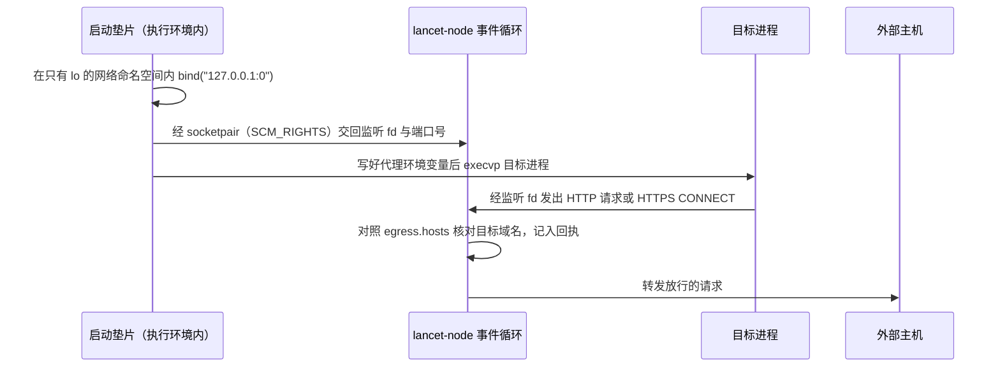

# 宿主资源

原生能力只以宿主资源的形式进入 `lancet-node`，API 工具只经句柄使用它们。宿主资源是由节点实现的封闭集合：目录、执行环境与网络出口。它们的实现决定脚本与子进程能看到、写到、发到哪里。

## 概念

| 宿主资源（句柄种类） | 句柄代表什么 | `lancet:host` 资源类型 | 实现 |
| --- | --- | --- | --- |
| 目录 | 宿主上的一个工作目录及其读写级别 | `read-dir`、`write-dir` | 节点实现的目录资源（读与写共用同一个经核验的宿主根 fd） |
| 执行环境 | 一组挂载与网络出口（细节随 [#8](https://github.com/Skyline10124/lancet/issues/8) 定） | `exec-env` | 按调用新建的执行环境，随 [#8](https://github.com/Skyline10124/lancet/issues/8) 实现 |
| 网络出口 | 允许访问的主机域名清单（`hosts`） | `egress` | 节点内的域名白名单放行代理，随 [#9](https://github.com/Skyline10124/lancet/issues/9) 实现 |

| 概念 | 含义 | 状态持有者 | 生命周期 |
| --- | --- | --- | --- |
| 执行环境实例 | 一次 `proc.*` 调用的隔离执行环境与进程组 | 节点 | 一次 `proc.*` 调用 |
| 出口代理 | 节点内按域名放行的 HTTP 代理 | 节点 | 节点进程 |
| 启动垫片 | 执行环境内交回监听 fd、再执行目标进程的程序 | 执行环境实例 | 一次 `proc.*` 调用 |

## 组件与职责

| 组件 | 持有的状态 | 执行的规则 | 对外接口 |
| --- | --- | --- | --- |
| 目录资源 | 经核验的宿主目录根 fd | 按根内约束直接读写宿主目录 | `read-dir`、`write-dir` 的方法 |
| 执行环境资源 | 执行环境实例 | 每次 `proc.*` 新建，调用结束整组终止（细节随 [#8](https://github.com/Skyline10124/lancet/issues/8) 定） | `exec-env` 的方法 |
| 出口代理 | 代理的监听与连接 | 对照 `egress.hosts` 放行，每次外发记入回执 | `egress` 的方法；执行环境内的代理端口 |

## 目录

- 只读与可写工作目录都直接对应宿主目录，读和写共用同一个经核验的宿主根 fd。
- 目录中所有路径一视同仁，包括 `.git`、点文件与构建目录，不做路径规则过滤。
- `fs.*` 只能拿到工作目录的句柄；[环境目录](config.md#概念)只在执行环境中可见。

目录资源按下面的规则解析工具给出的路径：

```text
解析 path:
    if path 是绝对路径，或含 ..:                      报错：越出目录
    自根逐个分量解析，内核不跟随符号链接:
        遇到符号链接:                                 读出目标，接在其余分量之前继续解析
            目标是绝对路径，或其中的 .. 越过根:       报错：越出目录
        目标不存在（ENOENT）:
            读取与列举:                               返回 none
            写入:                                     建立缺少的上级目录和目标文件；路径末尾要求目录时报错
    按方法读取、列举或写入
```

- 路径相对工作目录的根，`""` 与 `"."` 都表示根。
- 每个分量都从根目录的 fd 以 `RESOLVE_BENEATH | RESOLVE_NO_SYMLINKS` 打开，在同一个 fd 上取类型、读出链接目标。一次解析最多跟随 40 个符号链接，超出即报错。
- 列举中的符号链接子项，按“列举目录的访问路径加子项名”从根解析，与直接访问的结论一致。
- 报错写明调用者给出的路径与原因，不写出链接目标或宿主绝对路径。
- `read` 只读取普通文件；内容须是 UTF-8 文本，大小不超过工具实例的内存上限 128 MiB（[组件运行时](tools.md#组件运行时)）。
- `write` 直接写宿主目录：在已核验的上级目录内写临时文件，再 `rename` 就位；内容与已有文件相同时不发生写入；缺少的上级目录自动创建；替换已有普通文件时保留其权限。
- 写入在修改之前核对解析后的真实根相对路径是否为有效 UTF-8，并核对路径长度不超过系统上限：任一分量不超过 255 字节，目标绝对路径不超过 4,095 字节（`PATH_MAX` 为 4,096 字节，含结尾的 NUL）。
- `entries` 只列出按上面的规则可以访问的普通文件、目录与指向它们的链接。以下子项不列出：取不到类型的子项；解析失败、悬空或越出目录的链接；FIFO、套接字与设备文件。可见子项的名称不是 UTF-8 时，`entries` 报错。

## 执行环境

- 每次 `proc.*` 调用新建执行环境；调用结束、`remaining_ms` 耗尽、收到 `cancel` 或节点退出时，节点整组终止其中的进程，不跨调用保留进程。
- 执行环境的挂载表、环境变量、隔离机制与资源上限细节随 [#8](https://github.com/Skyline10124/lancet/issues/8) 定，见 [ADR 0003](../../adr/0003-direct-workspace-and-per-call-sandbox.md)。

## 网络出口



- 执行环境的子进程处于只有 `lo` 的隔离网络命名空间，只能经节点的出口代理出网。沙箱内没有常驻的转发进程，工作目录内不挂套接字文件。
- 启动垫片设置 `HTTPS_PROXY` / `https_proxy` 与 `HTTP_PROXY` / `http_proxy`。
- 出口代理对明文 HTTP 的 `Host` 与 HTTPS `CONNECT` 的目标域名对照 `egress.hosts` 放行，每次外发在回执中记一条 `External { host }`；拒绝直连、字面量裸 IP，以及解析到回环、链路本地与私网网段的目标。
- `http.fetch` 经网络出口句柄外发，适用同样的放行与记录规则。
- 首阶段只按域名校验，不做 TLS 中间人解包。

| 外发控制层 | 手段 | 读取方与决定 |
| --- | --- | --- |
| 出口清单 | 网络出口句柄限定允许访问的主机域名 | 出口代理逐个请求放行或拒绝 |
| 组合展示 | 推出的机密性边写入环境简述（[`seam` 边集](config.md#环境简述与-seam-边集)） | 调用方展示给用户；机器所有者据此在配置中收窄授权 |
| 回执 | 每次外发记 `External { host }` | 调用方核对，用户事后审计 |

已接受的残余风险：首阶段不做 TLS 中间人解包，被允许的主机本身能接收任意数据（如 issue、gist 或查询串载荷）时，域名清单拦不住。

## 保证

| 保证 | 适用范围 | 成立条件 | 依据或验证 |
| --- | --- | --- | --- |
| 每次 `proc.*` 结束后，执行环境内没有存活的进程 | 每次 `proc.*` | 每次新建，调用结束时整组终止（机制随 [#8](https://github.com/Skyline10124/lancet/issues/8) 定） | [ADR 0002 第 4 节](../../adr/0002-lancet-node-api-tools-and-act.md#4-边界由宿主资源承担)、[ADR 0003](../../adr/0003-direct-workspace-and-per-call-sandbox.md) |
| 子进程只能经出口代理出网，每次外发都记入回执 | 持有网络出口的执行环境 | 隔离网络命名空间只有 `lo`；代理放行时记录 | ADR 0002 第 4 节；已核实 `SCM_RIGHTS` 跨命名空间传递监听 fd |
| 只读目录句柄读不到工作目录以外的内容 | 每个只读目录句柄 | 每个分量都从根目录的 fd 以 `RESOLVE_BENEATH` 与 `RESOLVE_NO_SYMLINKS` 打开；符号链接由节点解析，`..` 不越过根，绝对路径的链接报越界 | `crates/lancet-node/tests/node/calls.rs::symlinks_follow_only_within_dir` |

## 范围之外

| 职责 | 现状 |
| --- | --- |
| 跨调用保留的执行环境与后台进程 | 不提供；每次 `proc.*` 结束即终止执行环境 |
| 按命令白名单限制可运行的程序 | 不提供 |
| TLS 中间人解包 | 不做，见上文的残余风险 |
| 审批 | 推后，见 [`lancet-node` 尚未承接](README.md#尚未承接) |
| `act` 交回的 `content` 离开节点后的去向 | 调用方 |

## 尚未承接

| 事项 | 现状 |
| --- | --- |
| 执行环境的挂载、环境变量、隔离与资源上限细节 | 由 [#8](https://github.com/Skyline10124/lancet/issues/8) 确定 |

## 验证

- `cargo xtask docs-check`：本合同的链接与锚点有效。
- `cargo test -p lancet-node --test node`：目录资源的路径解析、符号链接边界与直接读写宿主。
- 执行环境的隔离用例随 [#8](https://github.com/Skyline10124/lancet/issues/8) 建立，网络出口的测试随 [#9](https://github.com/Skyline10124/lancet/issues/9) 建立；建立后写入保证表。
