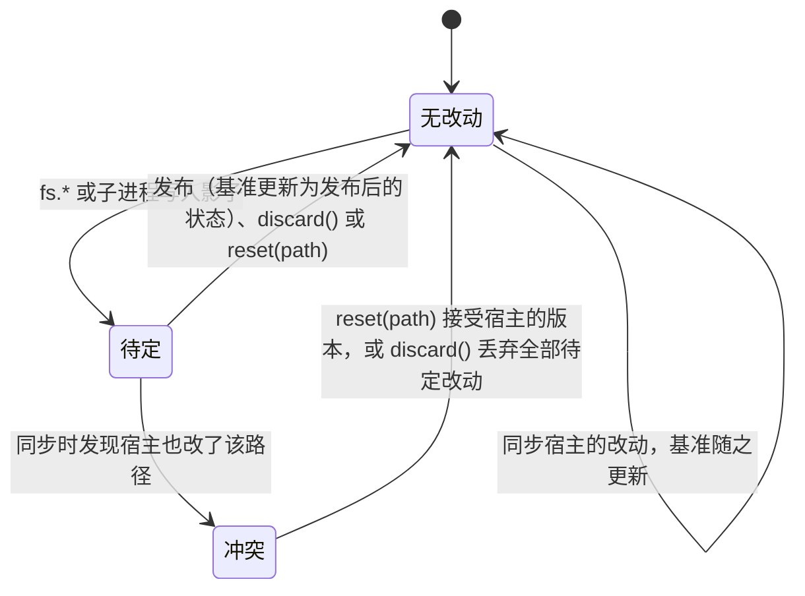
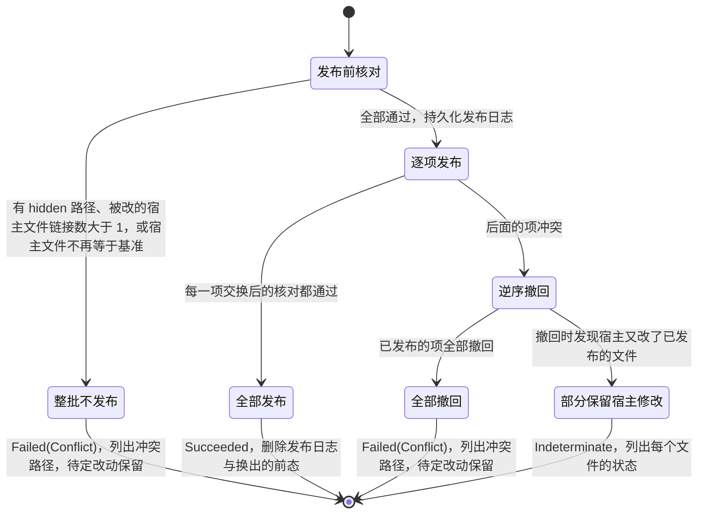

# 影子工作区、待定改动与发布

`lancet-node` 不在宿主工作目录上原地写入。每个可写工作目录在节点状态目录里有一份持久的 reflink 影子，`fs.*` 的写入与执行环境中子进程的写入都落在影子上，宿主工作目录只在发布时被写入。影子相对基准的差异是待定改动，跨 `act` 保留；脚本调用 `commit()` 后，节点把待定改动作为一批发布到宿主工作目录，发布后不保留前态。

## 概念

| 概念 | 含义 | 状态持有者 | 生命周期 |
| --- | --- | --- | --- |
| 影子 | 一个可写工作目录的持久 reflink 副本，在执行环境中挂在真实路径上 | 节点状态目录 | 节点首次启动时建立，跨重启保留 |
| 基准 | 每个路径最近一次从宿主同步或发布后的状态 | 节点状态目录 | 同步或发布该路径时更新 |
| 待定改动 | 影子相对基准的差异 | 节点状态目录 | 写入时产生；随发布、`discard()` 或 `reset(path)` 消除 |
| 冲突 | 影子里有待定改动的路径，在宿主上也被改了 | 节点状态目录 | 同步时标记，在 `status()` 中列出 |
| 发布日志 | 一次发布的待发布项、宿主临时名与换出前态的位置 | 节点状态目录 | 发布开始前持久化，发布结束后删除 |
| 换出的前态 | 发布时从宿主换出或移走的 inode | 节点状态目录 | 供本次发布撤回与崩溃恢复使用，发布结束后删除 |
| 私有 `.git/` | 影子中节点自己的 HEAD、index、refs 与 config | 节点状态目录 | 随影子 |

## 组件与职责

| 组件 | 持有的状态 | 执行的规则 | 对外接口 |
| --- | --- | --- | --- |
| 宿主跟踪 | 宿主上改动过的候选路径 | 目录 inotify 加后台扫描，不在请求路径上 | 影子同步 |
| 影子管理 | 影子、基准、待定改动、冲突标记 | 建立与同步影子、求待定改动、`status`/`diff`/`reset`、`discard()` | 目录资源（`write-dir`） |
| 发布事务 | 发布日志、换出的前态 | 发布前核对、交换、撤回、落盘与崩溃恢复 | `commit()` 之后由 `act` 的结算触发（[结局](act.md#结局)） |

## 路径分类

| 路径范围 | 影子中的形态 | 成为待定改动、随 `commit()` 发布 | `discard()` 撤回 | 进回执明细与 diff 摘要 |
| --- | --- | --- | --- | --- |
| 常规路径（非 `regenerable`、非 `hidden`、非 `.git/`） | reflink 副本 | 是 | 是 | 逐项列出，文件内容生成 diff |
| 匹配 `regenerable`（如 `target/`） | 私有目录，单独挂载，建影子时从宿主复制种子 | 否 | 否，保留增量构建产物 | 只记命中规则 |
| `.git/` | 私有 HEAD、index、refs 与 config，宿主对象只读（见 [Git](#git)） | 引用与 index 随 `commit()` 发布；config 与 hooks 不发布 | 是，恢复为宿主的状态 | 单列版本库变更 |
| 匹配 `hidden` | 不复制进影子 | 出现在待定改动中时拒绝发布 | 是 | 只记命中规则 |

路径规则的语法见[节点配置](config.md#路径规则)。

## 影子的建立与同步

- 节点首次启动时并行 `FICLONE` 整个工作目录，建立影子；这是每个节点一次的初始化成本，不计入 `act`。`regenerable` 目录同样从宿主复制一份作种子；`hidden` 路径不复制。
- 节点持续跟踪宿主工作目录的改动（目录 inotify 加后台扫描）。扫描不在请求路径上，请求不等待扫描。
- 每次 `act` 开始时，节点把宿主上的改动同步进影子：

```text
for 宿主上改动过的每个路径 p:
    if p 在影子里没有待定改动:
        把宿主的版本同步进影子，p 的基准更新为宿主的版本
    else:
        保留影子的版本，把 p 标为冲突，在 status() 中列出
```

- 对冲突路径调用 `reset(path)`，即放弃这条待定改动，接受宿主的版本。
- 节点之外的写者（如外部编辑器）只改宿主工作目录，不会混进待定改动。

## 可写工作目录的互斥

节点对每个可写工作目录持一把互斥锁：同一时间至多一个持有该目录可写句柄的 `act` 运行。`act` 在受理之后、同步影子之前获取锁；等锁的时间计入该次调用的 `remaining_ms`。

## 待定改动

- 待定改动比较内容、是否存在、类型（常规文件、目录、符号链接及其指向）与权限位，不比较时间戳与所有者。
- 影子侧监听常规路径与 `.git/` 下的全部目录，包括 `IN_MODIFY`，覆盖只读打开加截断。
- 每次 `proc.*` 结束、执行环境整个终止后，影子里不再有写者，经 mmap 写过的文件也已随进程退出补发 `IN_CLOSE_WRITE`；节点按事件核对候选路径，不遍历整棵树。事件队列溢出时，退回全量扫描。
- `regenerable` 目录与 `.git/` 各自单独挂载，跨类别建硬链接由内核返回 `EXDEV`，影子里的文件因此不会经未监听目录的别名被改写。
- 执行环境建立时尚不存在、之后才新建的 `regenerable` 目录，按常规路径处理。

## 状态

一个常规路径在影子中的状态：




## 发布

脚本调用过 `commit()` 并正常 `return`、载荷不超限之后，节点发布全部待定改动：



| 步骤 | 规则 |
| --- | --- |
| 发布前核对 | 待定改动中没有 `hidden` 路径；被改的宿主文件链接数为 1；每个宿主文件仍等于基准。任一项不满足时整批不发布，列出冲突路径，待定改动保留 |
| 修改文件 | 把影子版本 `FICLONE` 到宿主同一目录下的临时名，再用 `renameat2(RENAME_EXCHANGE)` 与宿主文件交换；换出的宿主 inode 移进节点状态目录 |
| 新建文件 | 用 `RENAME_NOREPLACE` 放到宿主路径上 |
| 删除文件 | 把宿主文件移进节点状态目录 |
| 同类别的目录改名 | 在宿主上执行一次 `rename` |
| 交换后核对 | 换出的 inode 仍是基准 |
| 撤回 | 后面的项冲突时，逆序撤回已发布的项。撤回时发现宿主又改了已发布的文件，保留宿主的修改，结算为 `Indeterminate`，并列出每个文件的状态：已发布、已撤回、保留宿主修改 |
| 落盘 | 只落盘本批文件与所在目录，不用 `syncfs` |

- 影子 inode 留在原处。发布成功后，发布的路径的基准更新为发布后的状态。
- 结局只有“全部发布”与“全部不发布”两种，唯一的例外是撤回时宿主又改了已发布文件的 `Indeterminate`。多个文件不保证同时对宿主可见：发布窗口随文件数增长。
- 发布属于协议的最终提交临界区：开始后不受 `cancel` 与断连影响，在 `settle_grace_ms` 内完成或撤回（[协议合同](../lancet-protocol.md#execute-的受理与结局)）。
- 发布后不保留前态。发布前的改动由 `discard()` 与 `reset(path)` 撤回；发布之后的修正由新的 `act` 完成。

## Git

- 影子里的 `.git/` 是私有的：HEAD、index、refs 与 config 是节点的副本，对象经 alternates 只读引用宿主的 `.git/objects`，新对象写在私有目录里。
- 宿主 HEAD 与 index 不变时，私有 index 跨 `act` 保留；宿主变化、而影子里没有待定的 Git 改动时，节点重建私有 index。
- 发布时，节点校验新对象并复制到宿主，在 Git lockfile 下以比较后交换更新引用，只把本批路径写进宿主 index，宿主原有的暂存保留；config 与 hooks 不发布。
- 引用的比较后交换只约束遵守 Git lockfile 的写者。

## 崩溃恢复

- 待定改动保存在影子里，节点重启后照常保留。
- 节点在发布中途崩溃时，重启后、响应 `hello` 之前，按发布日志完成或撤回这次发布，宿主恢复到全部发布或全部未发布。撤回时发现宿主又改了已发布的文件，保留宿主的修改，并把该调用结算为 `Indeterminate`（[调用记录](../lancet-protocol.md#调用记录)）。

## 保证

| 保证 | 适用范围 | 成立条件 | 依据或验证 |
| --- | --- | --- | --- |
| 宿主工作目录只在发布时被写入 | 每个可写工作目录 | 写入落在影子；执行环境中的可写挂载来源都在节点状态目录内 | [ADR 0002 第 6 节](../../adr/0002-lancet-node-api-tools-and-act.md#6-影子工作区待定改动与发布) |
| 发布要么全部生效，要么全部不生效；唯一的例外结算为 `Indeterminate`，并列出每个文件的状态 | 每次发布 | 发布前核对、交换后核对与逆序撤回 | ADR 0002 第 6 节；实验 3 第六、七轮（[已核实的事实](../../adr/0002-lancet-node-api-tools-and-act.md#已核实的事实)）：发布途中宿主改了已发布的文件、后面又有文件冲突时结算为 `Indeterminate`，3/3 |
| 发布中途崩溃后，宿主恢复到全部发布或全部未发布；唯一的例外是撤回时宿主又改了已发布的文件，保留宿主的修改，结算为 `Indeterminate` | 每次发布 | 发布日志在交换之前持久化 | ADR 0002 第 6 节；实验 3：崩溃恢复 27/27（24 次杀进程后恢复，3 次多链接文件在写入前整批报冲突），Git 崩溃恢复 18/18 |
| 待定改动与全量扫描、全内容对照完全一致 | 每个可写工作目录 | 影子侧事件；队列溢出时全量扫描 | ADR 0002 第 6 节；实验 3：继承用例 126/126、随机负载 200/200、宿主同步 45/45 |
| 节点之外的写者不会混进待定改动；两边改了同一文件时报冲突 | 每个可写工作目录 | 外部写者只改宿主；同步时有待定改动的路径标为冲突 | ADR 0002 第 6 节；实验 3：`act` 期间宿主改同一文件 40/40 报冲突，改不同文件 20/20 正常发布 |
| 宿主原有的暂存保留，config 与 hooks 不发布 | 每次发布 | 只把本批路径写进宿主 index | ADR 0002 第 6 节；实验 3：Git 用例 114/114 |
| 10 万条目、无改动的 `act` 固定开销不超过 50 ms | 性能 | — | ADR 0002 第 6 节的性能要求；第七轮原型 0.457 ms，不含 Git 仓库（有 10 万个跟踪文件时，原型的 Git 同步约 42 ms，主要是 Python helper 的启动） |
| 影子与宿主之间无外部改动时，4,000 个文件的 `git checkout` 总耗时不超过 2 s | 性能 | — | 同上；第七轮原型 1.82 s |
| LATTICE 全量构建相对“只有命名空间”的开销不超过 3% | 性能 | — | 同上；第七轮原型 1.3% |

## 范围之外

| 职责 | 现状 |
| --- | --- |
| 撤销已发布的改动 | 由新的 `act` 完成；协议不提供求逆 |
| 多个文件同时对宿主可见 | 不承诺，发布窗口随文件数增长 |

## 尚未承接

| 事项 | 现状 |
| --- | --- |
| 发布的时延验收线 | 待裁决：发布改为只落盘本批文件与所在目录之后实测再定，见 [ADR 0002 待裁决](../../adr/0002-lancet-node-api-tools-and-act.md#待裁决) |
| 多个工作目录、linked worktree、reftable 与 SHA-256 仓库的 `.git/` | 待裁决：第七轮原型只覆盖单个工作目录、SHA-1 loose objects 与普通 refs，实施前补验证 |
| 冲突标记的重新计算：例如宿主之后又恢复为基准时，冲突标记是否消除 | 待定：ADR 只规定同步时标记冲突、发布前核对宿主文件是否仍等于基准，随 [#7](https://github.com/Skyline10124/lancet/issues/7) 决定 |
| 执行环境建立后才新建的 `regenerable` 目录，是否在下次建立执行环境时改为单独挂载 | 待裁决：第一个版本按常规路径处理（见[待定改动](#待定改动)），实施时按实测决定 |

## 验证

- `cargo xtask docs-check`：本合同的链接与锚点有效。
- 影子、待定改动、发布与 Git 的测试随 [#7](https://github.com/Skyline10124/lancet/issues/7) 建立，移植实验 3 第六、七轮的语义用例；性能要求的基准随 #7、[#8](https://github.com/Skyline10124/lancet/issues/8) 建立；建立后写入保证表。
