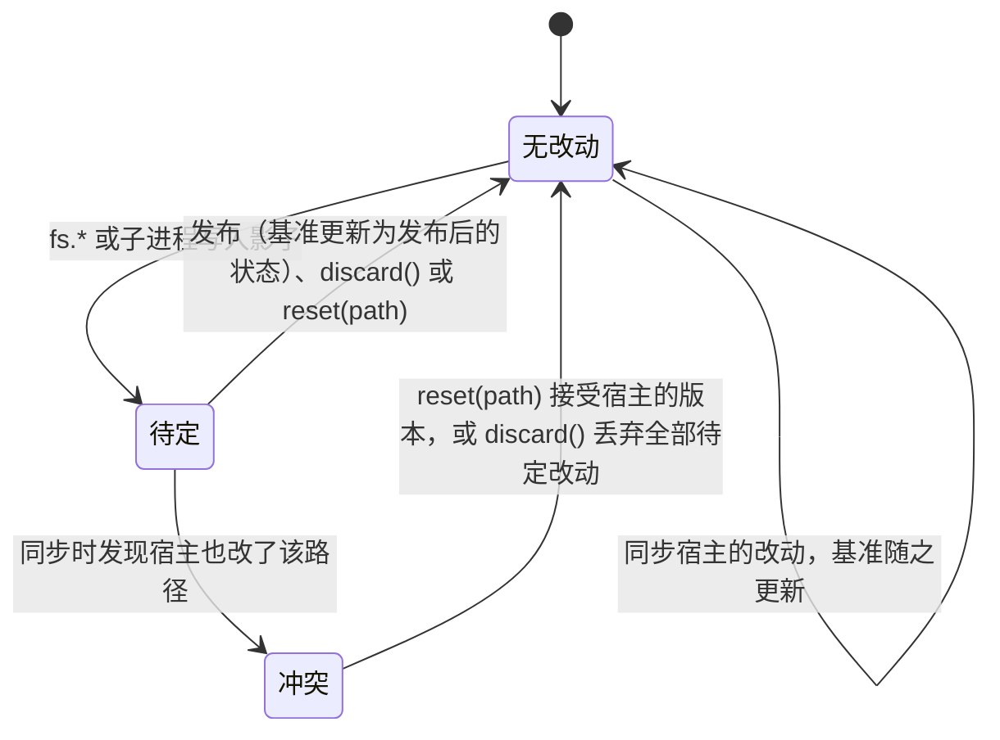
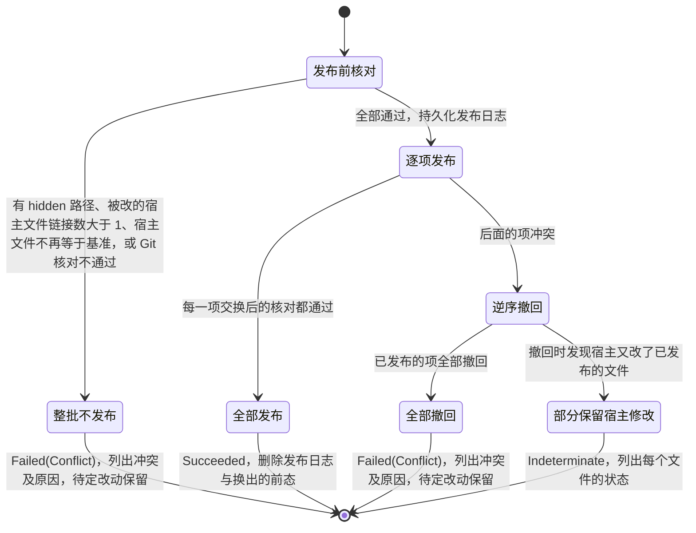

# 影子工作区、待定改动与发布

`lancet-node` 不在宿主工作目录上原地写入。每个可写工作目录在节点状态目录里有一份持久的 reflink 影子，`fs.*` 的写入与执行环境中子进程的写入都落在影子上，宿主工作目录只在发布时被写入。影子相对基准的差异是待定改动，跨 `act` 保留；脚本调用过 `commit()` 并正常 `return`、载荷不超限时，节点把待定改动作为一批发布到宿主工作目录，发布后不保留前态。

## 概念

| 概念 | 含义 | 状态持有者 | 生命周期 |
| --- | --- | --- | --- |
| 影子 | 一个可写工作目录的持久 reflink 副本，在执行环境中挂在真实路径上 | 节点状态目录 | 节点首次启动时建立，跨重启保留 |
| 基准 | 每个路径最近一次从宿主同步或发布后的状态 | 节点状态目录 | 同步或发布该路径时更新 |
| 待定改动 | 影子相对基准的差异 | 节点状态目录 | 写入时产生；随发布、`discard()` 或 `reset(path)` 消除 |
| 冲突 | 影子里有待定改动的路径，在宿主上也被改了 | 节点状态目录 | 同步时标记，在 `status()` 中列出 |
| 发布日志 | 一次发布的待发布项、宿主临时名与换出前态的位置 | 节点状态目录 | 发布开始前持久化，发布结束后删除 |
| 换出的前态 | 发布时从宿主换出或移走的 inode | 节点状态目录 | 供本次发布撤回与崩溃恢复使用，发布结束后删除 |
| 私有 `.git/` | 影子中节点自己的 HEAD、index、refs 与 config | 节点状态目录 | 随影子 |

## 组件与职责

| 组件 | 持有的状态 | 执行的规则 | 对外接口 |
| --- | --- | --- | --- |
| 宿主跟踪 | 宿主上改动过的候选路径 | 目录 inotify 加后台扫描，不在请求路径上 | 影子同步 |
| 影子管理 | 影子、基准、待定改动、冲突标记 | 建立与同步影子、求待定改动、`status`/`diff`/`reset`、`discard()` | 目录资源（`write-dir`） |
| 发布事务 | 发布日志、换出的前态 | 发布前核对、交换、撤回、落盘与崩溃恢复 | `commit()` 之后由 `act` 的结算触发（[结局](act.md#结局)） |

## 路径分类

| 路径范围 | 影子中的形态 | 成为待定改动、随 `commit()` 发布 | `discard()` 撤回 | 进回执明细与 diff 摘要 |
| --- | --- | --- | --- | --- |
| 常规路径（非 `regenerable`、非 `hidden`、非 `.git/`） | reflink 副本 | 是 | 是 | 逐项列出，文件内容生成 diff |
| 匹配 `regenerable`（如 `target/`） | 私有目录，单独挂载，建影子时从宿主复制种子 | 否 | 否，保留增量构建产物 | 只记命中规则 |
| `.git/` | 私有 HEAD、index、refs 与 config，宿主对象只读（见 [Git](#git)） | 引用随 `commit()` 发布，宿主 index 随之更新本批路径（见 [Git](#git)）；config 与 hooks 不发布 | 是，恢复为宿主的状态 | 单列版本库变更 |
| 匹配 `hidden` | 不复制进影子 | 出现在待定改动中时拒绝发布 | 是 | 只记命中规则 |

路径规则的语法见[节点配置](config.md#路径规则)。

## 影子的建立与同步

- 节点首次启动时并行 `FICLONE` 整个工作目录，建立影子；这是每个节点一次的初始化成本，不计入 `act`。`regenerable` 目录同样从宿主复制一份作种子；`hidden` 路径不复制。
- 影子与基准是节点状态目录中 `shadows/<key>/` 下的两棵目录树：`tree/` 是影子；`base/` 保存各常规路径的基准版本，即字节、目录、链接文本与权限。`<key>` 由工作目录的规范化路径与两组路径规则推出：路径或规则改变时，节点改用一份新影子，旧影子保留不用。待定改动、冲突与各项索引都由宿主、基准与影子推出，不另存。
- 建立时，常规文件先克隆进 `base/`，再从 `base/` 克隆进 `tree/`；`regenerable` 种子只进 `tree/`。每个路径独立克隆，不重建硬链接组。节点重启后复用已有的影子，重新对照宿主。
- 节点持续跟踪宿主工作目录的改动（目录 inotify 加后台扫描）。扫描不在请求路径上，请求不等待扫描。
- 后台扫描每轮间隔 1 秒，按 stat（设备、inode、权限、链接数、大小、mtime、ctime）判断变化；stat 变了，或时间戳落在上一轮扫描附近，才读取内容与基准比较。读取前先 `FICLONE` 出一份快照，使经 `mmap` 持续写入的写者，下一次写入时重新更新时间戳。
- 每次 `act` 开始时，节点把宿主上的改动同步进影子：

```text
for 宿主上改动过的每个路径 p:
    if p 在影子里没有待定改动:
        把宿主的版本同步进影子，再把 p 的基准更新为宿主的版本     # 先影子、后基准
    else:
        保留影子的版本
for 每个有待定改动的路径 p:                                       # 每次同步重算
    p 是冲突 = 宿主的版本不等于 p 的基准                         # 在 status() 中列出
```

- 对冲突路径调用 `reset(path)`，即放弃这条待定改动，接受宿主的版本。
- 宿主恢复为基准时冲突消除，影子的版本仍是待定改动。
- 同步先更新影子、再更新基准。两步之间节点崩溃时，重启后该路径表现为冲突，可用 `reset(path)` 消除；影子里不会出现覆盖宿主改动的草稿。
- 同步与写入的临时文件建在 `shadows/<key>/tmp/`，再 `rename` 就位；节点启动时清空 `tmp/`。需要临时放宽只读目录的权限时，先把原权限记入 `shadows/<key>/widened` 并落盘，恢复后删去该条目；节点启动时先按它恢复目录的权限，再重建索引。
- 节点之外的写者（如外部编辑器）只改宿主工作目录，不会混进待定改动。

## 可写工作目录的互斥

节点对每个可写工作目录持一把互斥锁：同一时间至多一个持有该目录可写句柄的 `act` 运行。`act` 在受理之后、同步影子之前获取锁；等锁的时间计入该次调用的 `remaining_ms`。

- 节点按配置顺序，为本次 `act` 授予的全部可写目录取锁。当前每次 `act` 都被授予全部目录，配置中有可写目录时，各次 `act` 依次运行。
- 等锁时被取消、断连或 `remaining_ms` 耗尽，结算为 `Cancelled` 或 `Deadline`，不发生写入。
- 锁一直持有到本次调用结算完成。

## 待定改动

- 待定改动比较内容、是否存在、类型（常规文件、目录、符号链接及其指向）与权限位，不比较时间戳与所有者。每个路径单独比较，不比较硬链接关系；FIFO、套接字与设备文件不计入待定改动，也不发布。
- 影子侧监听常规路径与 `.git/` 下的全部目录，包括 `IN_MODIFY`，覆盖只读打开加截断。
- 每次 `proc.*` 结束、执行环境整个终止后，影子里不再有写者，经 mmap 写过的文件也已随进程退出补发 `IN_CLOSE_WRITE`；节点按事件核对候选路径，不遍历整棵树。事件队列溢出时，退回全量扫描。
- 新建或从监听范围外移入的目录，补装监听后核实其子树；事件队列溢出或监听丢失时，按基准与影子的路径并集全量核对。
- `regenerable` 目录与 `.git/` 各自单独挂载，跨类别建硬链接由内核返回 `EXDEV`，影子里的文件因此不会经未监听目录的别名被改写。
- 执行环境建立时尚不存在、之后才新建的 `regenerable` 目录，按常规路径处理。

## 状态

一个常规路径在影子中的状态：




## 发布

脚本调用过 `commit()` 并正常 `return`、载荷不超限之后，节点发布全部待定改动：



| 步骤 | 规则 |
| --- | --- |
| 发布前核对 | 逐项核对[发布冲突的原因](#发布冲突的原因)中时机为“发布前”的条件。任一条件成立时整批不发布，列出冲突及原因，待定改动保留 |
| 修改文件 | 临界区之前，把影子版本 `FICLONE` 到私有暂存处；`Undo` 落盘之后，把它移到宿主同一目录下的临时名，再用 `renameat2(RENAME_EXCHANGE)` 与宿主文件交换，换出的宿主对象移进前态槽 |
| 新建文件 | 用 `RENAME_NOREPLACE` 放到宿主路径上 |
| 删除文件 | 把宿主文件移进节点状态目录 |
| 目录 | 新建时先父后子，删除时先子后父；只移走已经空了的目录，宿主上有本批以外的子项时报“宿主已改”。影子中的目录改名，按旧路径下的删除与新路径下的新建逐项发布 |
| 符号链接与类型变化 | 按实际的前后类型准备对象，用 `RENAME_EXCHANGE` 或 `RENAME_NOREPLACE` 放置；全程不解引用链接 |
| 交换后核对 | 实际换出的对象仍等于基准：类型、权限、内容与链接目标 |
| 撤回 | 后面的项冲突时，逆序撤回已发布的项。撤回时发现宿主又改了已发布的文件，保留宿主的修改，结算为 `Indeterminate`，并列出每个文件的状态：已发布、已撤回、保留宿主修改，或未执行（宿主未被本调用写入） |
| 落盘 | 只落盘本批文件与所在目录，不用 `syncfs` |

- 一次 `act` 发布一批：本次 `act` 获授的全部可写工作目录在结算时的常规待定改动。`regenerable` 内容留在影子，特殊文件不发布。
- 影子 inode 留在原处。发布成功后，发布的路径的基准更新为发布后的状态；基准的后态在临界区之前准备好并落盘。
- 结局只有“全部发布”与“全部不发布”两种，唯一的例外是撤回时宿主又改了已发布文件的 `Indeterminate`。多个文件不保证同时对宿主可见：发布窗口随文件数增长。
- 确定批次、发布前核对、生成 diff 与准备暂存对象，都在最终提交临界区之前完成，可以被截止与取消打断。进入临界区之前，节点在调用记录的锁内对截止与取消做最后一次判定。
- 临界区内执行宿主上的交换与核对、目录权限的调整，以及撤回或推进基准；克隆文件与生成 diff 都在临界区之前完成。临界区开始后不受 `cancel` 与断连影响，在 `settle_grace_ms` 内完成或撤回（[协议合同](../lancet-protocol.md#execute-的受理与结局)）。临界区按实测约每个文件 0.5 ms（见[保证](#保证)），约 1 万个文件以上的批次可能超过 5,000 ms 的宽限。
- 发布后不保留前态。发布前的改动由 `discard()` 与 `reset(path)` 撤回；发布之后的修正由新的 `act` 完成。

### 发布冲突的原因

发布前核对或交换后核对不通过时，这次发布以 `Failed(Conflict)` 结束；撤回时宿主又改了已发布文件的，结算为 `Indeterminate`（见上表的“撤回”）。错误信息逐条列出冲突的路径或引用，以及原因，每条一行，写作 `<句柄> "<路径>"：<原因>`，路径加双引号并转义，例如 `w "linked.txt"：多个链接（2）`。整条消息不超过 16,384 字节：冲突列表放不下时在整行处截断，末行写“另有 N 条未列出”；仍有可见的待定改动时，其后另起一行附待定提示，提示计入这 16,384 字节。`Indeterminate` 中逐个文件的状态也按这条上限截断。

| 原因 | 条件 | 核对时机 |
| --- | --- | --- |
| `hidden` 路径 | 待定改动中有匹配 `hidden` 的路径 | 发布前 |
| 多个链接 | 被改的宿主文件链接数大于 1 | 发布前 |
| 宿主已改 | 本批路径在宿主上的状态不再等于基准；不在本批中的上级目录只要求可以访问 | 发布前；交换后 |
| 引用已变 | 宿主 HEAD 或要更新的引用不再等于基准 | 发布前 |
| Git 锁被占用 | 宿主 HEAD、index 或要更新的引用的 lockfile 已存在 | 发布前 |
| 宿主已暂存 | 本批路径在宿主上有暂存，见 [Git](#git) | 发布前 |

引用已变、Git 锁被占用与宿主已暂存三种原因，随影子 `.git/` 实施（见[尚未承接](#尚未承接)）。

模型据原因选择处理方式。例如“宿主已改”时用 `reset(path)` 接受宿主的版本后重做；“宿主已暂存”时把该路径移出自己的提交，或请用户在宿主上取消暂存。

## Git

- 影子里的 `.git/` 是私有的：HEAD、index、refs 与 config 是节点的副本，对象经 alternates 只读引用宿主的 `.git/objects`，新对象写在私有目录里。
- 宿主 HEAD 与 index 不变时，私有 index 跨 `act` 保留；宿主变化、而影子里没有待定的 Git 改动时，节点重建私有 index。
- 发布时，节点校验新对象并复制到宿主，在 Git lockfile 下以比较后交换更新引用；config 与 hooks 不发布。引用的比较后交换只约束遵守 Git lockfile 的写者。
- 宿主 index 只更新本批路径，即影子 HEAD 与宿主 HEAD 两个提交之间改动的路径，写入影子 HEAD 中的版本；其余路径的宿主 index 项保持原样。影子中只暂存、未提交的改动不写进宿主 index。
- 发布前核对本批路径的宿主 index 项：任一路径在宿主上有暂存（宿主 index 项不等于宿主 HEAD 中的版本）时，整批不发布，冲突原因为“宿主已暂存”。

## 崩溃恢复

- 待定改动保存在影子里，节点重启后照常保留。
- 发布日志记在该调用的 `Pending` 调用记录里，分两段：`Undo` 在发布前核对通过之后、宿主操作开始之前落盘；`Finish` 在宿主结果落盘之后写入。私有对象放在节点状态目录的 `publish/<调用散列>/` 下：`stage/` 是待放到宿主上的暂存对象，`pre/` 是换出的宿主对象（前态槽），`base/` 是普通文件与符号链接的基准后态。
- 节点在发布中途崩溃时，重启后、打开影子与响应 `hello` 之前处理日志：
  - `Undo`：按对象的实际位置逆序撤回；
  - `Finish`：只补齐基准并结算，不再改写宿主。

  宿主恢复到全部发布或全部未发布；撤回时发现宿主又改了已发布的文件，保留宿主的修改。
- 这类调用结算为 `Indeterminate`（[调用记录](../lancet-protocol.md#调用记录)）。原因写明宿主的实际结果：发布未开始、已撤回、已完成，或部分保留宿主修改；宿主上留有发布项时，回执列出这些路径。
- 日志记录的工作目录根与当前配置不符时，节点启动失败，报错写明调用与日志的位置。

## 保证

| 保证 | 适用范围 | 成立条件 | 依据或验证 |
| --- | --- | --- | --- |
| 宿主工作目录只在发布时被写入 | 每个可写工作目录 | 写入落在影子；执行环境中的可写挂载来源都在节点状态目录内 | [ADR 0002 第 6 节](../../adr/0002-lancet-node-api-tools-and-act.md#6-影子工作区待定改动与发布)；`crates/lancet-node/tests/node/writable.rs::write_tools_obey_paths_and_edit_cardinality`、`discard_is_immediate`；`crates/lancet-node/tests/node/publish.rs::commit_requires_valid_return_and_preserves_drafts` |
| 发布要么全部生效，要么全部不生效；唯一的例外结算为 `Indeterminate`，并列出每个文件的状态 | 每次发布 | 发布前核对、交换后核对与逆序撤回 | ADR 0002 第 6 节；实验 3 第六、七轮（[已核实的事实](../../adr/0002-lancet-node-api-tools-and-act.md#已核实的事实)）：发布途中宿主改了已发布的文件、后面又有文件冲突时结算为 `Indeterminate`，3/3；`crates/lancet-node/tests/node/publish.rs::publish_reports_each_conflict_before_writing`、`late_conflict_reverses_the_batch`、`rollback_preserves_host_edit_and_lists_every_path`；`crates/lancet-node/tests/shadow.rs::publish_path_kinds` |
| 发布中途崩溃后，宿主恢复到全部发布或全部未发布；唯一的例外是撤回时宿主又改了已发布的文件，保留宿主的修改，结算为 `Indeterminate` | 每次发布 | 发布日志在交换之前持久化 | ADR 0002 第 6 节；实验 3：崩溃恢复 27/27（24 次杀进程后恢复，3 次多链接文件在写入前整批报冲突），Git 崩溃恢复 18/18；`crates/lancet-node/tests/node/publish.rs::publish_recovery_before_first_hello`（各崩溃窗口的磁盘现场）、`publish_survives_random_kill`（发布中随机与指定时刻 `SIGKILL` 真节点） |
| 待定改动与全量扫描、全内容对照完全一致 | 每个可写工作目录 | 影子侧事件；队列溢出时全量扫描 | ADR 0002 第 6 节；实验 3：继承用例 126/126、随机负载 200/200、宿主同步 45/45；`crates/lancet-node/tests/shadow.rs::shadow_status_matches_inherited_cases`（实验 3 的 63 个原始输入，按本合同的比较口径；与原对照结论不同的 8 项涉及硬链接关系与 FIFO，在测试中列明）、`shadow_random_batches_match_full_contents`、`shadow_queue_overflow_matches_full_scan`、`shadow_reopens_pending_without_reseeding` |
| 节点之外的写者不会混进待定改动；两边改了同一文件时报冲突 | 每个可写工作目录 | 外部写者只改宿主；同步时有待定改动的路径标为冲突 | ADR 0002 第 6 节；实验 3：`act` 期间宿主改同一文件 40/40 报冲突，改不同文件 20/20 正常发布；`crates/lancet-node/tests/shadow.rs::host_sync_converges_after_unnotified_writes`；`crates/lancet-node/tests/node/writable.rs::conflict_reset_and_discard_use_distinct_versions`；`crates/lancet-node/tests/node/publish.rs::commit_rechecks_host_after_script_started` |
| 宿主原有的暂存保留，config 与 hooks 不发布 | 每次发布 | 只把本批路径写进宿主 index；本批路径在宿主上有暂存时整批不发布 | ADR 0002 第 6 节；实验 3：Git 用例 114/114，其中宿主在 `act` 期间暂存同一路径 3/3 整批不发布、影子只暂存未提交 3/3 不写宿主 index；宿主在 `act` 之前已暂存同一路径的情形未覆盖，原型的实现在这一情形下会用影子 HEAD 中的版本覆盖宿主的暂存 |
| 10 万条目、无改动的 `act` 固定开销不超过 50 ms | 性能 | — | ADR 0002 第 6 节的性能要求；第七轮原型 0.457 ms，不含 Git 仓库（有 10 万个跟踪文件时，原型的 Git 同步约 42 ms，主要是 Python helper 的启动）；实测（2026-11-19，AMD EPYC 9B14，Linux 6.12，release 构建）：100,000 个文件、1,000 个目录，不含 Git，同一连接 11 次 `execute("return 1")` 的中位数 7.39 ms；首次建立影子约 42 s，不计入 `act`（`crates/lancet-node/tests/node/writable.rs::measure_empty_act_100k`） |
| 影子与宿主之间无外部改动时，4,000 个文件的 `git checkout` 总耗时不超过 2 s | 性能 | — | 同上；第七轮原型 1.82 s |
| LATTICE 全量构建相对“只有命名空间”的开销不超过 3% | 性能 | — | 同上；第七轮原型 1.3% |
| 发布时延按中位数：1 个文件不超过 50 ms，100 个文件不超过 1 s | 性能 | 只落盘本批文件与所在目录 | 维护者 2026-11-20 定的验收线；实测（2026-11-20，AMD EPYC 9B14，Linux 6.12，XFS，release 构建，4,000 个小文本文件、40 个目录）：1 个文件 15.7 ms，100 个文件 354 ms；4,000 个文件 12.5 s，另以库层分段计时测得临界区 1.97 s；200 个文件中后项冲突、整批撤回 822 ms（`crates/lancet-node/tests/node/publish.rs::measure_publish_latency`） |

## 范围之外

| 职责 | 现状 |
| --- | --- |
| 撤销已发布的改动 | 由新的 `act` 完成；协议不提供求逆 |
| 多个文件同时对宿主可见 | 不承诺，发布窗口随文件数增长 |

## 尚未承接

| 事项 | 现状 |
| --- | --- |
| 影子 `.git/` | 排在 [#8](https://github.com/Skyline10124/lancet/issues/8) 的执行环境之后实施，连同引用已变、Git 锁被占用与宿主已暂存三种冲突原因（维护者 2026-11-20 决定）：执行环境之前没有写者会改影子的 `.git/`，含 Git 的发布只有模拟执行环境的测试能走到。在此之前，可写工作目录根下的 `.git` 不进影子，也不发布，`fs.*` 读写时报错 |
| 影子 `.git/` 的支持范围 | 已定（维护者 2026-11-20，依据 Git 2.52.0 上 24 个组合的验证），随影子 `.git/` 实施：只支持工作目录本身就是仓库根的仓库，可以是多个各自独立的仓库，引用为 files 后端（普通或 packed refs），对象为 SHA-1 或 SHA-256。其余形态（linked worktree、登记了其他 worktree 的主工作树、reftable、`.git` 为符号链接或无效）保留 `.git`，普通文件照常发布，节点启动时警告。工作目录只是仓库中的子目录时按普通目录处理，不向上查找仓库。验证结果与其余已定的取值见 [#7](https://github.com/Skyline10124/lancet/issues/7) 的待决定 |
| 影子中的目录改名作为一次 `rename` 发布 | 随 [#8](https://github.com/Skyline10124/lancet/issues/8) 实施，需要记录目录的移动来源；在此之前按逐路径的删除与新建发布（见[发布](#发布)） |
| 执行环境建立后才新建的 `regenerable` 目录，是否在下次建立执行环境时改为单独挂载 | 待裁决：第一个版本按常规路径处理（见[待定改动](#待定改动)），实施时按实测决定 |
| 新目录补装监听之前，经其中的短命硬链接改写目录外的文件 | 子树核实发现不了这类写入：链接已经删除，被改写文件所在的目录也收不到事件。在 [#8](https://github.com/Skyline10124/lancet/issues/8) 之前只有节点写影子，节点不建硬链接；随 #8 的执行环境决定处理方式 |
| 名称不是 UTF-8 的待定路径在 `status()`、`diff()` 与回执中的表示 | 随 [#8](https://github.com/Skyline10124/lancet/issues/8) 决定：只有执行环境会产生这类待定路径，`fs.*` 的写入与重置不会（见[目录](host-resources.md#目录)） |

## 验证

- `cargo xtask docs-check`：本合同的链接与锚点有效。
- `cargo test -p lancet-node --test shadow`：影子的建立与重启、待定改动与全量对照，含实验 3 的继承、随机、宿主同步与溢出用例；发布的路径种类与基准推进。
- `cargo test -p lancet-node --test node`：可写目录与写入工具、冲突与 `reset`、`discard()`、互斥锁、待定提示与重启恢复；`commit()` 与发布、冲突原因、后项冲突与撤回、崩溃恢复与随机杀进程。
- `cargo test --release -p lancet-node --test node measure_empty_act_100k -- --ignored --nocapture --test-threads=1`：10 万条目、无改动的 `act` 实测。
- `cargo test --release -p lancet-node --test node measure_publish_latency -- --ignored --nocapture --test-threads=1`：发布时延与临界区实测。
- Git 的测试随影子 `.git/` 建立（见[尚未承接](#尚未承接)）；执行环境的性能基准随 [#8](https://github.com/Skyline10124/lancet/issues/8) 建立；建立后写入保证表。
