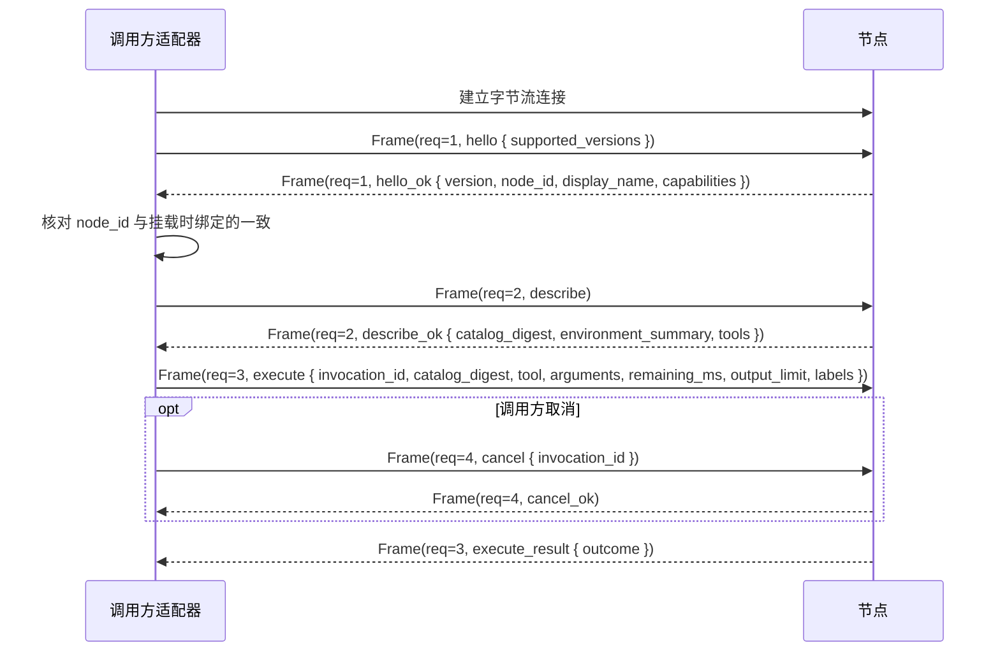
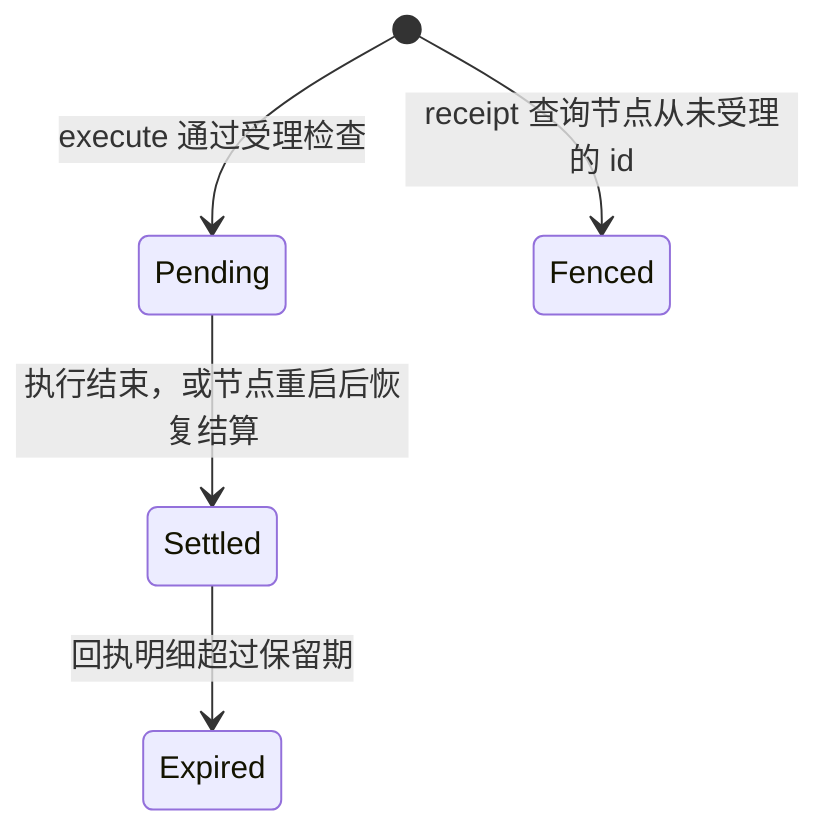

# 外部上下文节点协议

`lancet-protocol` 规定调用方与外部上下文节点之间的连接、五个操作与回执。调用方按轮冻结节点的目录，以持久的 `invocation_id` 投递调用；节点对每个 id 至多执行一次，并为每次受理的调用保存回执。断连或超时之后，调用方经回执对账，取得节点记录的结局。

术语的定义见[领域术语表](../reference/glossary.md#外部上下文节点协议)，决策理由与否决的方案见 [ADR 0001](../adr/0001-lancet-protocol.md)。`lancet-node` 怎样实现本协议，见 [`lancet-node` 合同](lancet-node/README.md)。

## 概念

| 概念 | 含义 | 状态持有者 | 生命周期 |
| --- | --- | --- | --- |
| `node_id` | 节点实例的持久身份，UUID v4；调用方以它绑定挂载目标 | 节点状态存储 | 首次初始化状态目录时生成，跨重启不变 |
| `display_name` | 节点的人类可读名称 | 节点配置 | 随配置 |
| 连接 | 调用方与节点之间的一条双向有序字节流 | 调用方与节点 | 建连到断开；断开时其上的在途 `execute` 按[断连规则](#连接与握手)视为取消 |
| 操作定义（`tools`） | 节点可执行的操作及其说明 | 节点 | 随节点版本 |
| 环境简述 | 已授予的句柄与 `seam` 边集 | 节点配置，经单一构造入口推出 | 随配置、授权与节点版本 |
| `catalog_digest` | 操作定义、环境简述与当前授权的规范摘要 | 节点计算；调用方按轮冻结 | 随三者之一变化 |
| 句柄 | 节点授予的具名资源实例，是 effect 与 co-effect 的参数 | 节点配置 | 随配置 |
| effect（ε） | 调用结束后仍可被观察到的改变 | 回执的 effect 条目 | 随回执 |
| co-effect（κ） | 调用需要的句柄及其使用模式 | 节点的操作声明 | 随节点版本 |
| `residue` | 变更项中没有逆、或逆所需材料未被保留的部分 | 回执的变更项 | 随回执 |
| `seam` | 跨句柄连接 effect 与 co-effect 的边 | 环境简述中的边集 | 随配置、授权与节点版本 |
| 调用记录 | 每个 `invocation_id` 的持久记录 | 节点的记录账本 | 见[调用记录](#调用记录) |
| 回执（`Receipt`） | 一次受理的 `execute` 的完整记录 | 节点状态存储 | 结算时写成；明细在保留期满后清理 |
| `receipt_summary` | 回执的紧凑摘要 | `execute_result` 回包 | 单次回包 |
| `content` | 交回模型上下文的数据，是返回值，不是 effect | `execute_result` 回包 | 单次回包 |
| `labels` | 会话、轮次等记账标签，对节点不透明 | 调用方；节点原样写入回执 | 随调用 |
| 本轮目录 | 调用方在一轮开始时冻结的 `catalog_digest`、环境简述与 `tools` | 调用方适配器 | 一轮 |

## 组件与职责

| 组件 | 持有的状态 | 执行的规则 | 对外接口 |
| --- | --- | --- | --- |
| `lancet-protocol` crate | 无 | 帧编解码；消息、结局与错误码类型；effect、co-effect、环境简述、回执与 `residue` 的数据结构；解码时的形状校验；规范摘要计算 | Rust 库，节点与调用方适配器共同依赖 |
| 节点 | `node_id`；调用记录账本（已受理与已围栏的 `invocation_id`、状态与结局种类）；回执 | 握手、受理检查、严格零重放、围栏、结算、重启恢复与保留期清理；推出环境简述与 `catalog_digest` | 五个协议操作 |
| 调用方适配器 | 本轮目录；在途调用的本地计时 | 握手时核对 `node_id`；`describe_ok` 的形状校验；拒绝到结局的映射；等待上限与本地 `Indeterminate` 判定；对账；核对回执不越出本轮环境简述 | 协调层的上下文操作接口 |

- `lancet-protocol` 只依赖序列化与摘要计算所需的 crate，不依赖 `wasmtime`、操作系统沙箱或特定存储引擎。节点与调用方共用这一份消息定义。
- 协议只规定节点对外的行为。软件工作区节点经单一编排操作 `act` 提供能力（见 [`lancet-node`](lancet-node/README.md)）；硬件节点或只读数据源可以直接暴露一组类型化的原子操作。
- 节点不感知 Agent 配置、模型、系统提示词与会话树结构；会话与轮次标识只作为 `labels` 记账。

## 流程

### 连接与握手



| 规则 | 内容 |
| --- | --- |
| 传输 | 双向有序字节流。本地为 Unix 域套接字；远程可承载于 SSH 隧道或 TLS 连接 |
| 帧 | 4 字节大端长度前缀，后接 UTF-8 JSON 负载。负载有单帧字节上限，接收方不为超限的帧分配内存 |
| 多路复用 | 每个请求帧带连接内唯一的 `request_id`，回复帧带同一个 `request_id`。`execute` 等待完成期间，调用方可在同一连接上并发发送 `cancel` 与 `receipt` |
| 握手 | 建连后的首个请求是 `hello`：调用方给出支持的协议版本列表，节点选定一个版本，返回 `node_id`、`display_name` 与 `capabilities`。版本协商完成之前收到其他请求，或没有双方都支持的版本时，节点立即关闭连接；调用方发现 `node_id` 与挂载时绑定的不一致时，调用方立即关闭连接 |
| 断连 | 连接意外断开时，节点把这条连接上尚未进入最终提交临界区的在途 `execute` 视为收到 `cancel` |

### 五个操作

节点对外只有下列五个操作。

| 操作 | 输入 | 输出 | 语义 |
| --- | --- | --- | --- |
| `hello` | 支持的协议版本列表 | 选定的版本、`node_id`、`display_name`、`capabilities`（`settle_grace_ms`、回执保留期） | 握手与身份核验 |
| `describe` | 无 | `catalog_digest`、`environment_summary`、`tools` | 返回当前的操作定义与环境简述 |
| `execute` | `invocation_id`、`catalog_digest`、`tool`、`arguments`、`remaining_ms`、`output_limit`、`labels` | `execute_result { outcome }` 或 `rejected { code, message }` | 执行一次操作，见 [`execute` 的受理与结局](#execute-的受理与结局) |
| `cancel` | `invocation_id` | `cancel_ok` | 幂等地请求中止进行中的调用；目标不存在或已结束时同样返回 `cancel_ok` |
| `receipt` | `invocation_id` | `ReceiptLookup` | 查询调用记录；查询节点从未受理的 id 时登记围栏，见[调用记录](#调用记录) |

### `describe` 与环境简述

```text
EnvironmentSummary = { handles: Vec<Handle>, seams: Vec<Seam> }
Handle = { name, kind: String, effects: Vec<EffectKind>, modes: Vec<Mode>, attributes: Map<String, Value> }
Seam   = { from: 句柄名, to: 句柄名, direction: Integrity | Confidentiality, policy: Allow | Deny }
```

- 节点只经单一构造入口，由节点配置与操作声明推出环境简述。环境简述只随配置、授权与节点版本变化，不含随调用变化的内容（如文件树）。
- 环境简述序列化后不超过 4 KiB。
- `catalog_digest` 是操作定义、环境简述与当前授权的规范摘要：与 JSON 字段顺序和空白无关，三者任一变化时随之变化。

| 内容 | 说明什么 | 随什么变化 | 使用方式 |
| --- | --- | --- | --- |
| `tools[].description` | 操作怎样用 | 节点版本 | 交给模型 |
| `environment_summary` | 本实例授予了什么 | 配置与授权 | 调用方原样交给模型，并依据其中的结构字段决策 |
| `hello.capabilities` | 调用方据以决策的类型化事实 | 节点版本与配置 | 调用方决策 |

调用方只依据 `name`、`effects`、`modes` 与 `seams` 作决定；`kind` 与 `attributes` 只供模型阅读。

| 检查层 | 检查内容 | 执行方 | 不通过时 |
| --- | --- | --- | --- |
| 形状 | 解码 `describe_ok` 时由 `lancet-protocol` 类型校验：`name` 非空且唯一；枚举字段取值合法；`seam` 两端指向已列出的句柄；序列化字节数不超上限 | 调用方 | `describe` 失败，本轮不挂载该节点 |
| 与声明一致 | 环境简述等于配置与操作声明推出的结果 | 节点 | 由单一构造入口保证 |
| 与实际行为一致 | 回执每条 effect 条目的句柄与种类在本轮环境简述中被允许 | 调用方 | 协议错误：调用方把该节点标为不可信并报告 |
| 语义 | `kind` 与 `attributes` 的含义 | 无 | 不检查，调用方因此不依赖它们 |

### `execute` 的受理与结局

```text
受理检查（节点按顺序执行）:
    if invocation_id 已有调用记录（Pending、Settled、Expired 或 Fenced）:
        rejected { DuplicateInvocation }
    elif catalog_digest 不等于节点当前的摘要:
        rejected { CatalogMismatch }
    elif tool 不存在，或 arguments 不合法:
        rejected { InvalidRequest }
    else:
        持久登记 invocation_id 为 Pending，然后开始执行
```

```text
execute 的回复 = execute_result { outcome: ExecuteOutcome }   # 已受理：id 已持久登记，节点必定生成回执
              | rejected { code: RejectCode, message }        # 未受理：未登记 id，未发生任何 effect，没有回执
RejectCode    = DuplicateInvocation | CatalogMismatch | InvalidRequest

ExecuteOutcome = Succeeded     { content: Value, receipt_summary: ReceiptSummary }
               | Failed        { error: ToolError, receipt_summary: Option<ReceiptSummary> }
               | Cancelled     { receipt_summary: Option<ReceiptSummary> }
               | Deadline      { receipt_summary: Option<ReceiptSummary> }
               | Indeterminate { reason: String, receipt_summary: Option<ReceiptSummary> }
```

- **严格零重放。** 同一个 `invocation_id` 第二次到达时，节点以 `DuplicateInvocation` 拒绝，不再执行；调用方需要找回结局时调用 `receipt`。
- **目录冻结。** 节点不维护跨请求的轮次状态。调用方每次 `execute` 带上本轮冻结的 `catalog_digest`，与节点当前的摘要不一致时，节点以 `CatalogMismatch` 拒绝。
- **相对时限。** `remaining_ms` 是剩余的毫秒预算，不传绝对时间戳。预算耗尽时，节点中止内部活动，进入安全状态，返回 `Deadline`。
- **结算时限。** 节点在 `hello` 中声明 `settle_grace_ms`：预算耗尽、收到 `cancel` 或连接断开之后，节点最迟在这段时间内结束内部活动（包括最终提交临界区）并结算调用记录。
- **调用方等待上限。** 调用方从发出 `execute` 起用本地单调时钟计时，等待上限为 `remaining_ms + settle_grace_ms`，再加调用方配置的传输余量。到期仍未收到回复时，调用方停止等待，本地判定为 `Indeterminate`，随后按[对账](#对账)收敛。是否同时关闭连接由调用方决定；关闭连接会按断连规则取消同一连接上的其他在途调用。
- **载荷与回执分开。** `content` 序列化后不超过 `output_limit`。完整的执行轨迹与外部连接明细保存在节点；回包只附 `receipt_summary`，序列化后不超过 16 KiB，超出时节点裁剪 diff 等摘要，并标明完整内容经 `receipt` 查询。
- **`Indeterminate` 有两类来源。** 连接中断、进程崩溃或超过等待上限仍未收到回复时，由调用方本地判定，可经对账收敛；节点驱动的下游硬件或外部桥接器丢失确认、无法断定 effect 是否发生时，由节点在结局中返回。

调用方把回复映射为五种结局：

```text
match execute 的回复:
    execute_result { outcome }        → outcome
    rejected { DuplicateInvocation }  → 不是本次投递的结局：该 id 已被先前的投递受理，或已被围栏；
                                        调用方按对账规则收敛，以对账结果为准
    rejected { 其他 code }            → Failed { ToolError { code, message } }，确定未发生 effect
```

### effect、co-effect 与回执

节点的每个操作，一次调用都按 effect 与 co-effect 两条轴描述：

```text
call : arguments → result ! ε @ κ
```

| 轴 | 取值 | 规则 |
| --- | --- | --- |
| effect（ε） | `Write<h>`（可寻址状态变更）、`Exec<h>`（子进程或设备动作执行）、`Emit<h>`（网络外发或物理信号输出） | 交回调用方的 `content` 是返回值，不是 effect；只读调用的 ε 为空 |
| co-effect（κ） | `Uses<h>`，或 `Uses<h, mode>`，`mode` 为 `Read` 或 `ReadWrite` | `mode` 只用于带可寻址状态的句柄；只读调用的 κ 不为空 |

句柄有 `name` 与 `kind`，种类与属性由节点实现规定（`lancet-node` 见[宿主资源](lancet-node/host-resources.md)）。

节点为每次受理的 `execute` 持久生成回执，内容为调用身份、`labels`、最终结局、子步骤摘要与 effect 条目。每条 effect 条目写明句柄名、effect 种类与变更项列表；每个变更项各带一个 `residue` 取值。effect 种类只给出 `residue` 的可能范围，实际取值逐项记录。

| `residue` | 含义 | 出现在 |
| --- | --- | --- |
| `None` | 该项有逆，逆所需材料已保留（如留有前态的写入） | `Write` |
| `NotRetained` | 该项有逆，节点没有保留逆所需的材料（如已发布、不再保留前态的文件改动） | `Write` |
| `Regenerable` | 可再生的构建产物或缓存，不保留逆，靠重新生成恢复 | `Write` |
| `InternalState` | 节点私有运行缓存的变更，不提供逆 | `Write`、`Exec` 派生项 |
| `External` | 已发出的网络请求、硬件物理动作等没有逆的外部影响，附目标与动作描述 | `Emit`、`Exec` |

`seam` 记为 `{ from, to, direction, policy }`，`policy` 为 `Allow` 或 `Deny`。边集由节点按授权静态推出，写入环境简述：

| 方向 | 含义 |
| --- | --- |
| 完整性（`Integrity`） | 句柄 A 上的 `Write` 成为句柄 B 上 `Exec` 所依赖的上下文：写入的内容被执行 |
| 机密性（`Confidentiality`） | 经 `Uses<A>` 读到的上下文可经句柄 B 上的 `Emit` 外发 |

节点的 `seam` 闸口按边的 `policy` 处置跨越：`Allow` 放行；`Deny` 拒绝，该次调用以 `Failed { ToolError { code: SeamBlocked } }` 结束。跨越不记入回执。

| 概念 | 读取方 | 据此作的决定 |
| --- | --- | --- |
| co-effect | 节点受理 | κ 中的句柄与模式必须已被授予，否则拒绝该次调用 |
| effect | 节点（中断处置、`seam` 闸口）；调用方（审批与展示、回执核对） | 中断后还剩哪些 effect；是否放行跨越；回执是否越出环境简述 |
| `residue` | 调用方与用户 | 哪些改变还能撤回，如实报告撤不回的项 |
| `seam` | 节点（闸口）；调用方（展示给用户） | 闸口按 `policy` 放行或拒绝跨越；用户据此决定是否保留相应的授权 |

### 对账

调用方对本地判定为 `Indeterminate` 的调用按下列规则对账：

```text
重新建连并完成 hello，核对 node_id
match receipt(invocation_id):
    NeverExecuted        → 确定未执行
    Settled { receipt }  → 回执中的最终结局即事实（节点结算为 Indeterminate 时仍为不确定）
    Expired { outcome }  → 结局种类即事实，回执明细不可再取
    Pending              → 自断连或停止等待起满 settle_grace_ms 后重查；
                           仍为 Pending 时视为节点故障，保持 Indeterminate 并报告
```

## 状态

### 调用记录

节点为每个 `invocation_id` 维护一条持久的调用记录，零重放、`receipt` 查询与对账都以它为准。登记、围栏与结算在记录账本上串行执行，同一个 id 同一时间只有一次迁移生效。



| 状态 | 含义 | 同 id 的 `execute` 到达 | `receipt` 返回 |
| --- | --- | --- | --- |
| 无记录 | 节点从未见过该 id | 进入受理检查 | `NeverExecuted`，同时登记围栏，迁移到 `Fenced` |
| `Fenced` | 已确认未执行，且此后永不执行 | `rejected { DuplicateInvocation }` | `NeverExecuted` |
| `Pending` | 已受理，尚未结算 | 同上 | `Pending` |
| `Settled` | 已结算，回执明细完整 | 同上 | `Settled { receipt }` |
| `Expired` | 已结算，回执明细已清理，账本仍保留结局种类 | 同上 | `Expired { outcome }` |

```text
ReceiptLookup = NeverExecuted                       # 确定未执行，同 id 此后也不会被执行
              | Pending                             # 已受理，尚未结算
              | Settled { receipt: Receipt }
              | Expired { outcome: OutcomeKind }    # 五种结局之一
```

- **围栏。** 调用方查询时，同 id 的 `execute` 可能仍在传输中，随后才到达节点。节点查询未知 id 时登记围栏，此后到达的同 id 请求一律被拒绝，`NeverExecuted` 因此是确定事实。
- **受理前拒绝不建记录。** 以 `rejected` 回复的请求不登记 id、不生成回执；之后查询该 id 得到 `NeverExecuted`，并登记围栏。
- **重启后不留 `Pending`。** 节点重启后、响应任何 `hello` 之前，按自身的恢复机制结算全部遗留的 `Pending` 记录；无法断定 effect 是否发生的记录结算为 `Indeterminate`，并写明原因。
- **断连后限时结算。** 断连按[连接与握手](#连接与握手)视为取消，节点在 `settle_grace_ms` 内结算对应的记录。

| 材料 | 保留期 | 过期后 |
| --- | --- | --- |
| 账本条目：id、状态、结局种类（含围栏） | 永久 | 不清理；零重放与围栏不随时间失效 |
| 完整的回执明细 | 节点配置的回执保留期，自结算起按节点本地时钟计算 | 记录迁移到 `Expired` |

节点只清理已结算记录的材料；回执保留期在 `hello` 的 `capabilities` 中声明。

## 保证

| 保证 | 适用范围 | 成立条件 | 依据或验证 |
| --- | --- | --- | --- |
| 同一个 `invocation_id` 至多执行一次 | 每个 id，不随时间失效 | 账本条目永久保留；登记、围栏与结算串行 | [ADR 0001 第 3 节](../adr/0001-lancet-protocol.md#3-五个协议操作)、[第 5 节](../adr/0001-lancet-protocol.md#5-调用记录的生命周期与对账) |
| `receipt` 返回 `NeverExecuted` 之后，同 id 永不执行 | 每次 `receipt` 查询 | 围栏在回复之前持久登记 | ADR 0001 第 5 节 |
| 受理的调用必有回执；以 `rejected` 回复的调用没有发生 effect | 每次 `execute` | 受理检查全部通过之后才登记 id 并开始执行 | ADR 0001 第 3 节 |
| 节点只执行与调用方本轮目录一致的调用 | 每次 `execute` | `catalog_digest` 覆盖操作定义、环境简述与当前授权 | ADR 0001 第 3 节 |
| 预算耗尽、取消或断连之后，调用在 `settle_grace_ms` 内结算 | 每次受理的 `execute` | 节点的内部活动与最终提交临界区都在这段时间内结束 | ADR 0001 第 3 节 |
| 调用方等待一次 `execute` 的时间有上限 | 调用方适配器 | 本地单调时钟计时 | ADR 0001 第 3 节 |
| 节点响应 `hello` 时没有遗留的 `Pending` 记录 | 每次重启 | 节点先完成恢复结算 | ADR 0001 第 5 节 |
| 本地判定的 `Indeterminate` 经对账取得节点记录的结局（节点结算为 `Indeterminate` 时仍为不确定）；满 `settle_grace_ms` 后仍为 `Pending` 的，作为节点故障报告 | 调用方适配器 | 能重新连上节点，且 `node_id` 一致 | ADR 0001 第 5 节 |
| 环境简述等于配置与操作声明推出的结果 | 每次 `describe` | 单一构造入口 | [ADR 0001 第 4 节](../adr/0001-lancet-protocol.md#4-effectco-effect回执与-residue) |
| `Succeeded` 的 `content` 不超过 `output_limit` | 每次回包 | 节点在回包前核对 | ADR 0001 第 3 节 |
| `receipt_summary` 不超过 16 KiB | 每次回包 | 超出时节点裁剪并标明 | ADR 0001 第 3 节 |
| 挂载的节点的环境简述不超过 4 KiB | 每次 `describe` | 调用方的形状校验 | ADR 0001 第 4 节 |

## 范围之外

| 职责 | 承担方 |
| --- | --- |
| 节点内部的执行机制（脚本解释器、WASM、文件系统等） | 各节点实现；`lancet-node` 见 [`lancet-node` 合同](lancet-node/README.md) |
| 修改节点配置、调整授权、启停节点 | 机器所有者维护节点配置；协议没有对应的操作 |
| 撤回已发生的 effect | 协议不提供求逆操作；确有节点需要时，经 `hello` 的版本协商在新的协议版本中加入 |
| 重试 | 调用方决定；节点不自行重试 |
| 流式输出中间进度 | 无：单次调用的结果整体返回 |
| 第三方 MCP Server 接入 | 独立的桥接进程：断连或 effect 是否发生未知时记为 `Indeterminate`；本协议不为它降低保证 |
| 会话树、调用槽位与多节点挂载关系 | 协调层；调用方会话库是唯一权威，节点不读写它 |

协调层（LATTICE）一侧由 LATTICE 的 ADR 决定：

| 本协议提供 | 协调层决定 |
| --- | --- |
| `node_id` 与 `hello` 握手 | 会话设置持有的外部上下文挂载列表（0 个、1 个或多个）；Agent 配置置于被挂载工作目录之外 |
| `describe` | `open_turn` 对各挂载节点核对身份并冻结本轮目录与环境简述；多节点挂载时的工具命名或目标路由 |
| `execute`、`cancel`、拒绝到结局的映射与调用方等待上限 | 协调层上下文操作接口的适配器实现；适配器本地判定的结局怎样投影为 `ToolOutcome` |
| `receipt` 与对账结果 | 从会话树路径段提取挂载调用 id 的查询；是否以及怎样依据对账结果收敛会话树中的 `Indeterminate` 槽位 |

## 尚未承接

下列事项裁决或在实施中确定后写入本合同。

| 事项 | 现状 |
| --- | --- |
| 远程字节流传输的认证与加密封装 | 待裁决，见 [ADR 0001 待裁决](../adr/0001-lancet-protocol.md#待裁决) |
| 审批：依据什么、在哪里询问用户，`policy` 是否增加取值 | 待设计审批时裁决 |
| 单帧字节上限的取值，以及 `ToolSpec`、`ToolError`、`ReceiptSummary`、`Receipt`、`labels` 与协议版本标识的字段 | 由 [#4](https://github.com/Skyline10124/lancet/issues/4) 在 `lancet-protocol` 中确定 |
| 完整回执超过单帧字节上限时怎样经 `receipt` 返回（如一次发布大量文件时的完整 diff） | 待定，随 #4 确定单帧上限时一并决定 |

## 验证

- `cargo xtask docs-check`：本合同的链接与锚点有效。
- 保证表中的各项由 `crates/lancet-protocol` 的单元测试与节点的协议级集成测试锁定。测试随 [#4](https://github.com/Skyline10124/lancet/issues/4)、[#5](https://github.com/Skyline10124/lancet/issues/5) 建立，建立后写入“依据或验证”一列。
